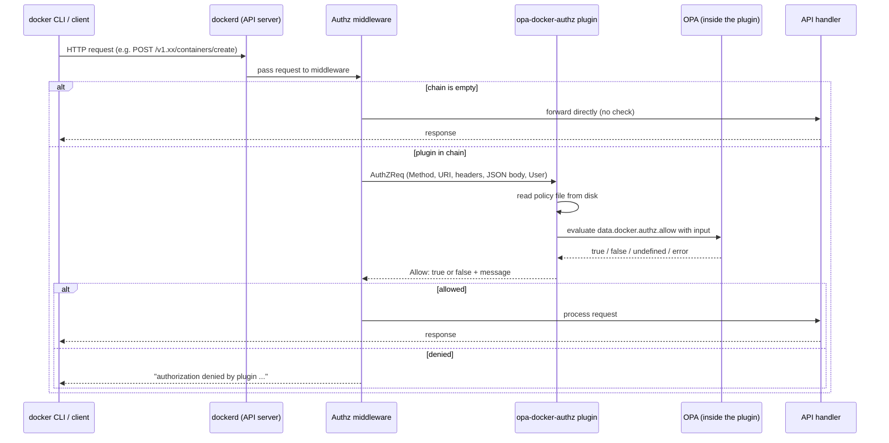

*Bu yazının Türkçesi: [OPA ile Docker Authorization](https://onurbaydas.online/posts/docker-authz-opa/)*

## 1. Introduction

I set up `opa-docker-authz` to restrict Docker on shared, multi-user Linux workstations. After a routine policy update, I noticed that `--privileged` containers were silently running. This article summarizes that incident and what I found in the source code afterward.

Docker authorization plugins let you evaluate every API request sent to the Docker daemon against a policy before the daemon processes it. `opa-docker-authz` is a plugin that implements this mechanism with OPA (Open Policy Agent) and its policy language, Rego.

This article covers:

- How the Docker authorization plugin mechanism works, and how to install `opa-docker-authz`.
- What an example policy guarantees and what it doesn't.
- Four pitfalls: silent fail-open, policy updates, Rego syntax and version compatibility, and fields the policy can't see.
- Protections an authorization plugin can't provide by design.
- A production checklist.

Fail-open means a control mechanism lets a request through on error instead of rejecting it. The main subject of this article is that this can happen without a single error or warning.

## 2. Scenario and Goal

The scenario: multi-user, shared Linux workstations. Users need Docker, but they shouldn't be able to access each other's data or the host.

The core tension is this: the Docker daemon (dockerd) runs as root. The daemon is the background service that handles Docker API requests. Anyone who can reach the daemon's socket can ask it to do work with root privileges. Docker's official documentation also states that the `docker` group grants a user root-level privileges. In this scenario, users have access to the socket.

The goal is a single rule:

> Each user can bind only their own workspace (`/home/<user>/workspace`) to `/workspace` inside a container. No other bind mounts, no privileged containers, no host namespaces. GPU access is allowed.

A bind mount attaches a directory on the host directly into a container. The container sees that directory as part of its own file system. If the container runs as root, it can read and write everything in that directory.

Expected usage looks roughly like this:

```bash
docker run -d \
  --gpus all \
  -v "/home/<user>/workspace":/workspace \
  "<image>"
```

Because users have terminal access, the policy has to account for every request that can reach the Docker API, not just this command.

The approach in this article is to put an authorization layer in front of a standard dockerd running as root. Alternatives such as rootless Docker and userns-remap are covered in [Section 10](#10-what-an-authorization-plugin-cant-provide).

## 3. How Docker Authorization Plugins Work

Docker's default access model is all-or-nothing. Any client that can reach the daemon can make any API call. Authorization plugins add a decision point to this model. Before processing each API request, the daemon asks the configured plugins whether they allow it.

Request flow:



Details that matter for the rest of the article:

**If the chain is empty, there is no check.** `WrapHandler` in Moby's `pkg/authorization/middleware.go` passes the request straight to the handler when the plugin list is empty. The middleware has no mechanism to warn that "a plugin should be here but isn't." This is the foundation of the pitfall in [Section 6](#6-pitfall-1-silent-fail-open).

**The middleware fails closed.** According to Docker's official documentation, if a plugin in the chain can't be reached, the request is denied. Docker also recommends that plugin authors fail closed. So a "the plugin crashed and everything opened up" scenario isn't expected at the middleware level. The risk is the plugin being removed from the chain without any warning.

**User identity is empty in most setups.** The request sent to the plugin has `User` and `AuthenticationMethod` fields. According to the Moby source code, these fields are populated only if the request arrived over TLS and the client presented a client certificate. The username comes from the certificate's CN field. For requests over the Unix socket, which covers nearly all local `docker` commands, both fields are empty strings. The policy can't answer the question "who made this request?" The consequences are covered in [Section 10](#10-what-an-authorization-plugin-cant-provide).

**The plugin doesn't see everything.** According to the official documentation:

- The body is sent to the plugin only when it can be forwarded as JSON.
- For hijacked connections such as `exec` and `attach`, the plugin sees only the initial HTTP request.
- For streamed responses such as `logs` and `events`, it sees only the request.
- The gRPC endpoint that BuildKit uses isn't subject to authorization. A policy that tries to restrict image builds through authorization can't see this channel.

An endpoint is a path in the Docker API that performs a specific operation, for example `/containers/create`.

## 4. Installation

`opa-docker-authz` is an authorization plugin with OPA embedded that you can install as a Docker managed plugin. The examples use the `openpolicyagent/opa-docker-authz-v2:0.9` tag. This version ships with OPA 0.60. Versioning is covered separately in [Section 8](#8-pitfall-3-rego-syntax-and-plugin-version).

Installation:

```bash
docker plugin install --alias opa-docker-authz \
  --grant-all-permissions \
  openpolicyagent/opa-docker-authz-v2:0.9 \
  opa-args="-policy-file /opa/policies/authz.rego"
```

The policy path needs care. The plugin's configuration mounts the host's `/etc/docker` directory read-only at `/opa` inside the plugin. A file at `/etc/docker/policies/authz.rego` on the host appears as `/opa/policies/authz.rego` from inside the plugin. `opa-args` must contain the path inside the plugin, not the host path. If the path is wrong, the plugin allows every request ([Section 6](#6-pitfall-1-silent-fail-open)).

File and directory permissions:

```bash
install -d -m 0755 -o root -g root /etc/docker/policies
install -m 0644 -o root -g root authz.rego /etc/docker/policies/authz.rego
```

To add the plugin to the daemon's authorization plugin chain, use `daemon.json`:

```json
{
  "authorization-plugins": ["opa-docker-authz"]
}
```

If a `daemon.json` already exists, merge this key with the other settings. The order is: install the plugin first, then update `daemon.json`, then make the daemon re-read its configuration. You can restart the service for this. `systemctl reload docker` also rebuilds the chain and doesn't stop running containers ([Section 6](#6-pitfall-1-silent-fail-open)).

## 5. The Policy, Line by Line

The policy below uses OPA 0.60's classic Rego syntax.

```rego
package docker.authz

default allow = false

allow { not is_container_create }
allow { is_container_create; not deny }

is_container_create {
    input.Method == "POST"
    endswith(split(input.Path, "?")[0], "/containers/create")
}
```

`package docker.authz` and the `allow` rule form the decision point the plugin queries by default: `data.docker.authz.allow`.

`default allow = false` is a safe default. If no `allow` rule matches, the decision is deny.

The next two lines define the policy's architecture:

- If the request is **not** a container create request, allow it.
- If it is a container create request and no `deny` rule fired, allow it.

`is_container_create` uses `endswith` to skip the API version prefix (such as `/v1.47/`) and `split` to strip query parameters (`?name=...`).

Hard prohibitions:

```rego
deny { input.Body.HostConfig.Privileged == true }
deny { count(input.Body.HostConfig.CapAdd) > 0 }
deny { input.Body.HostConfig.PidMode == "host" }
deny { input.Body.HostConfig.NetworkMode == "host" }
deny { input.Body.HostConfig.IpcMode == "host" }
deny { input.Body.HostConfig.UTSMode == "host" }
deny { startswith(input.Body.HostConfig.UsernsMode, "host") }
deny { count(input.Body.HostConfig.Devices) > 0 }
deny { s := input.Body.HostConfig.SecurityOpt[_]; contains(s, "unconfined") }
deny { s := input.Body.HostConfig.SecurityOpt[_]; contains(s, "no-new-privileges:false") }
deny { s := input.Body.HostConfig.SecurityOpt[_]; contains(s, "no-new-privileges=false") }
```

These rules block `--privileged`, `--cap-add`, sharing the host's PID/network/IPC/UTS namespaces, disabling the user namespace, passing devices through with `--device`, and setting protections such as seccomp/AppArmor to `unconfined`. Each one on its own can be enough to escape from a container to the host.

The bind mount rule:

```rego
deny { b := input.Body.HostConfig.Binds[_]; not bind_ok(b) }
deny { m := input.Body.HostConfig.Mounts[_]; m.Type == "bind"; not mount_ok(m) }

bind_ok(b) {
    parts := split(b, ":")
    parts[1] == "/workspace"
    seg := split(parts[0], "/")
    count(seg) == 4
    seg[1] == "home"
    seg[3] == "workspace"
}

mount_ok(m) {
    m.Target == "/workspace"
    seg := split(m.Source, "/")
    count(seg) == 4
    seg[1] == "home"
    seg[3] == "workspace"
}
```

In Docker, a bind mount can come from two separate fields. The `-v source:target` syntax writes to the `HostConfig.Binds` array, and the `--mount type=bind,...` syntax writes to the `HostConfig.Mounts` array. The policy checks both.

When the source path is split on `/`, it must have exactly four parts: `""`, `"home"`, the username, and `"workspace"`. The target must be `/workspace`. This also rejects deeper paths such as `/home/<user>/workspace/subdir`. The reason: Docker resolves symbolic links (symlinks) in the bind source. Before this rule was added, the following was seen in production: when a symlink pointing to the host's root was placed inside the workspace and that subpath was bind-mounted, the host's files could be read. The four-part rule closes off symlinks that come in through a subpath. The workspace directory itself being a symlink is a separate risk ([Section 10](#10-what-an-authorization-plugin-cant-provide)).

**What it guarantees** (verified on a live daemon): `--privileged`, `--cap-add`, binding the host root or `/etc`, the subpath symlink, binding the Docker socket into a container, `--device`, `--ipc=host`, and binding outside the workspace with `--mount type=bind` are all denied. Expected usage (the workspace bind and `--gpus all`) works. When the machine reboots, the plugin comes back and the rules keep being enforced.

**What it doesn't guarantee** is covered in [Sections 9](#9-pitfall-4-what-the-policy-cant-see) and [10](#10-what-an-authorization-plugin-cant-provide). Some of it comes from gaps in the policy, and some comes from the mechanism itself. First, though, consider the case where protection can shut off entirely even when the policy is correct.

## 6. Pitfall 1: Silent Fail-Open

### Symptom

The plugin shows as enabled in `docker plugin ls`, `authorization-plugins` is set in `daemon.json`, and the policy file is correct. Yet `docker run --rm --privileged alpine true` succeeds. Host bind mounts aren't denied either. The daemon log has no error or warning.

This happens after running this pair of commands:

```bash
docker plugin disable --force opa-docker-authz
docker plugin enable opa-docker-authz
```

This pair is a common habit, used to "reload the plugin so it picks up the new policy."

### Mechanism: The Plugin Is Dropped from the Chain

Three pieces of the Moby source code explain this behavior:

1. The `Disable()` function in `daemon/pkg/plugin/backend_linux.go` calls `AuthzMiddleware.RemovePlugin(name)` when a plugin of the authorization type is disabled. The plugin is removed from dockerd's authorization plugin chain.
2. The `Enable()` function in the same file has **no** call that adds the plugin back to the middleware. The plugin is enabled and `docker plugin ls` shows it as enabled, but the plugin isn't in the chain.
3. The config reload path in `daemon/command/daemon.go` calls `authzMiddleware.SetPlugins(cfg.AuthorizationPlugins)`. This is where the chain is rebuilt from the list in `daemon.json`. `systemctl reload docker` sends SIGHUP to the daemon and triggers this path.

With the chain empty, the middleware passes every request straight to the handler ([Section 3](#3-how-docker-authorization-plugins-work)). As a result, authorization is silently off after disable/enable. The daemon reports no error, the plugin looks enabled, and the policy file is correct, but no request reaches the plugin. The behavior is the same in the current Moby source.

In short: **`docker plugin disable` turns authorization off, `docker plugin enable` doesn't turn it back on, and `systemctl reload docker` does.**

#### History: Why Does Removal from the Chain Exist?

Removal from the chain isn't a bug; it's a fix. Moby issue #31836, opened in 2017, reported that after an authorization plugin was disabled, the daemon still sent requests to that plugin. Because the plugin no longer responded, all API requests were blocked.

The fixing commit, `38de272bd4`, added code to `Disable()` that removes an authorization-type plugin from the middleware chain. The same commit didn't add code to `Enable()` that puts the plugin back in the chain. This first fix removed the plugin from the chain with different code; later the same year, moby #33655 ("Eliminate authz plugin disable race") moved that code into today's `RemovePlugin` function, and the behavior stayed the same. The silent fail-open described in this section is a side effect of that asymmetry in the fix.

### Observed Behavior

Test results on a live daemon match the mechanism in the source code:

| Step | `--privileged` test |
|---|---|
| Policy written + `systemctl reload docker` | Denied |
| Policy changed + `disable` / `enable` | Succeeded (fail-open) |
| Directory set to 755, file to 644 + `disable` / `enable` | Succeeded (fail-open) |
| Plugin reinstalled (`disable` → `rm` → `install`) + `systemctl reload docker` | Denied |

The behavior is the same in a current version: with Docker Engine 29.9.0 and opa-docker-authz v0.9, `--privileged` succeeds after disable/enable and is denied after `systemctl reload docker`.

In the last step, the chain is rebuilt by the reload, not the reinstall. A reinstall also includes a disable/enable cycle and doesn't add the plugin back to the chain on its own. The plugin is added back by `SetPlugins`, that is, during the reload.

The daemon journal has a notable entry: the plugin allowed the `POST .../plugins/opa-docker-authz/disable?force=1` request that disabled it (`result: true`). Because this policy only checks container creation, the disable request also passes through authorization and gets allowed. After this entry, there are no decision entries for the test requests: requests no longer reach the plugin.

### A Common Misdiagnosis: File Permissions

A frequent explanation for this symptom goes like this: "If the policy file isn't 644, the plugin can't read it, runs with an empty policy, and allows everything." This explanation is wrong for two reasons:

- In the table above, protection was still off after disable/enable even once permissions were set to 644. The step that fixed it was the reload.
- `opa-docker-authz` reads the policy file with `os.ReadFile`. If the read fails (including a permission error), it **denies** the request. A permission problem produces a fail-closed result.

A likely source of the confusion: the official `openpolicyagent/opa` CLI image runs as a non-root user. Running `opa check` with this image on a policy file with 600 permissions returns "permission denied." That says nothing about the plugin's behavior. The 755/644 permissions are a recommended hygiene rule so that separately run tools such as `opa check` can read the file, but they aren't the cause of the fail-open.

### When the Plugin Explicitly Fails Open

The plugin's source code does have a branch that genuinely fails open. Before reading the policy file, the plugin checks it with `os.Stat`. If the file **doesn't exist**, the plugin logs this message and allows the request:

```text
OPA policy file %s does not exist, failing open and allowing request
```

So a typo in the path inside `opa-args`, or getting the `/etc/docker` → `/opa` translation wrong, shuts protection off completely. In this case, the plugin log does leave a trace.

The decision table derived from the source code:

| Condition | Plugin decision |
|---|---|
| Policy file missing | **Allow (fail-open)**, logged |
| File unreadable (e.g., permission error) | Deny |
| Rego compile or evaluation error | Deny |
| `allow` undefined | Deny |
| Plugin not in the chain | Plugin is never asked, **allow** |

### Detection

The plugin appearing "enabled" or the file hash being correct won't catch this problem. A drift check that collects the policy file's hash, the file mode, and the enabled state from `docker plugin ls` returns a "correct" result even during a fail-open. Don't rely on configuration output such as `docker info` for the actual state of the chain either.

The reliable check is a behavioral test. With a regular user account:

```bash
docker run --rm --privileged alpine true
```

This command should be denied with this message:

```text
docker: Error response from daemon: authorization denied by plugin opa-docker-authz:latest: request rejected by administrative policy
```

It isn't enough for the command to merely fail. It can also fail because the image couldn't be pulled or the daemon couldn't be reached. Check that the output contains `authorization denied`. A version of this test that runs on a schedule is in [Section 11](#11-production-checklist).

## 7. Pitfall 2: Updating the Policy

According to its source code, the plugin reads the policy file from disk on **every request**. There is no cache. As soon as the file changes, the next request is evaluated against the new policy. Updating the policy doesn't require reloading the plugin.

The real risk is the disable/enable pair making its way into update automation. Automation that disables and re-enables the plugin when the policy changes, and doesn't reload because `daemon.json` didn't change, turns authorization off on every machine it touches, each time it runs, until the next reload or restart. Even if the correct procedure is written down in the documentation, this risk goes unnoticed when the automation does something different.

A safe policy update:

1. Compile the new policy with the OPA version the plugin uses (`opa check`) and evaluate it against test inputs (`opa eval`).
2. Put the file in place. Because the plugin reads the file on every request, if it sees a half-written file mid-write, that request is denied due to a compile error. To avoid this, write the new file under a temporary name in the same directory and swap it in with `mv`.
3. Don't touch the plugin.
4. Run the `--privileged` test.

If the plugin itself changed (version upgrade, reinstall), run `systemctl reload docker` once you're done and repeat the behavioral test. If the policy forbids writes to the plugin API ([Section 9](#9-pitfall-4-what-the-policy-cant-see)), the plugin must first be removed from the chain via `daemon.json` before these operations.

A pattern for rolling out authorization to multiple machines: back up → reload → roll back automatically if `docker ps` fails → `--privileged` test. It doesn't stop running containers and can run on machines in parallel.

```bash
#!/usr/bin/env bash
set -u
cfg=/etc/docker/daemon.json
bak="$cfg.bak.$(date +%s)"

cp -a "$cfg" "$bak"

# Merge authorization-plugins into the existing settings
jq '. + {"authorization-plugins": ["opa-docker-authz"]}' "$bak" > "$cfg.new" \
  && mv "$cfg.new" "$cfg"

systemctl reload docker

# Roll back automatically if the daemon is unhealthy
if ! docker ps >/dev/null 2>&1; then
  cp -a "$bak" "$cfg"
  systemctl reload docker
  echo "ROLLBACK"
  exit 1
fi
echo -n "ps=OK "

# Behavioral test
if docker run --rm --privileged alpine true 2>&1 | grep -q "authorization denied"; then
  echo "priv=DENIED"
else
  echo "priv=OPEN"
  exit 2
fi
```

Don't consider the rollout done until every machine reports `ps=OK priv=DENIED`.

## 8. Pitfall 3: Rego Syntax and Plugin Version

### Version Status

Rego syntax changed with OPA 1.0. `if` before rule bodies and `contains` for multi-value rules are now mandatory. The policy in [Section 5](#5-the-policy-line-by-line) is written in classic (0.x) syntax.

`opa-docker-authz` versions:

| Plugin | OPA | Managed plugin on Docker Hub |
|---|---|---|
| v0.9 | 0.60.0 | Yes (latest tag) |
| v0.10 | 1.3.0 | No |
| v0.11 | 1.21.1 | No |

The project is maintained, and new releases are published on GitHub. However, the newest tag you can pull from Docker Hub with `docker plugin install` is 0.9. Because 0.10 and later aren't published on Docker Hub as managed plugins, using these versions requires building the plugin from source.

The result: a classic policy written for 0.9 won't compile when the plugin is upgraded to 0.10+. `opa check` with OPA 1.21.1:

```text
rego_parse_error: `if` keyword is required before rule body
```

The plugin denies the request on a compile error. The result is fail-closed, but every request, including `docker ps`, is denied and Docker becomes unusable.

### Bridge: `import rego.v1`

For a policy that works on both versions, use `import rego.v1`. This import was added in OPA 0.59.0. Once the policy is converted to OPA 1.x syntax and this line is added at the top, both 0.60 and 1.x compile it.

```rego
package docker.authz

import rego.v1

default allow := false

allow if {
	is_container_create
	not deny
}

deny if input.Body.HostConfig.Privileged == true
```

`authz-hardened-v1.rego` is in this form and was evaluated with all test inputs on OPA 0.60.0 and 1.21.1. Both versions return the same decisions. Converting the policy to this form before upgrading the plugin is recommended.

### A Rego Pitfall: An Error Can Turn into "Allow"

By default, OPA treats a runtime error in a built-in function (for example, an invalid regex) not as an error but as **undefined**. The plugin also calls OPA without the `StrictBuiltinErrors` option.

If a built-in errors inside a `deny` rule, the rule becomes undefined, meaning it doesn't fire. `not deny` is then true. In the deny-list + `not deny` pattern, an error means **allow**.

Test: with a `deny` rule containing a broken regex, a privileged input returns `allow = true`. Running the same evaluation with `--strict-builtin-errors` returns `eval_builtin_error`.

Mitigations:

- Run policy tests in CI (continuous integration) with `opa eval --strict-builtin-errors`.
- In `deny` rules, avoid built-ins that can error (regex, parsing functions) as much as possible.
- Where possible, use an allow-list instead of a deny-list. Describe what's allowed, not what's forbidden. That way, an undefined result means deny.

## 9. Pitfall 4: What the Policy Can't See

The policy in [Section 5](#5-the-policy-line-by-line) and its hardened version were tested against 19 test scenarios, both with `opa eval` and on a live Docker daemon.

| Test input | Original | Hardened |
|---|---|---|
| Own workspace | allowed | allowed |
| Another user's workspace | **allowed** | **allowed** |
| `--privileged` | denied | denied |
| `/etc` bind | denied | denied |
| Workspace subpath | denied | denied |
| Root directory via `--mount type=bind` | denied | denied |
| Volume mount with driver options | **allowed** | denied |
| `--volumes-from` | **allowed** | denied |
| `--gpus` | allowed | allowed |
| Bodyless create request | **allowed** | denied |
| Plugin disable request | **allowed** | denied |
| Plugin list (GET) | allowed | allowed |
| `volume create` with driver options | **allowed** | denied |
| Plain `volume create` | allowed | allowed |
| Bodyless `volume create` | **allowed** | denied |
| `exec` | **allowed** | **allowed** |
| `exec --privileged` | **allowed** | denied |
| Path containing `..` | **allowed** | denied |
| `--cap-add` | denied | denied |

Live daemon tests were run with plugin v0.9 (OPA 0.60). In the `opa eval` evaluation, the hardened column is the same for the classic-syntax `authz-hardened.rego` on OPA 0.60, and for `authz-hardened-v1.rego` on both OPA 0.60 and 1.21.1. The rows for another user's workspace and `exec` are the subject of [Section 10](#10-what-an-authorization-plugin-cant-provide).

There's an inconsistency in the plain `volume create` row. When a named volume is attached with `-v name:/path`, it lands in `HostConfig.Binds`, doesn't match the `/home/...` format, hits the bind rule, and is denied. When the same volume is attached with `--mount type=volume`, it has no driver configuration, so it's allowed. Plain volumes don't point to a host directory, so this is harmless. A policy that also wants to allow `-v` should add a separate branch to `bind_ok` for named volumes.

### Volume-Type Mounts

The original policy checks `HostConfig.Mounts` entries only if `Type == "bind"`. Docker's `local` volume driver, however, supports creating a volume that points to a directory on the host through driver options. Such a mount arrives as `Type == "volume"` and isn't covered by the bind rule. The container can access an arbitrary directory on the host.

The fix: deny volume mounts that contain a driver configuration.

```rego
deny { m := input.Body.HostConfig.Mounts[_]; m.Type == "volume"; m.VolumeOptions.DriverConfig }
```

### `volume create` Options

You can reach the same result by first creating a volume with driver options through a separate `POST /volumes/create` request and then mounting it. Because the original policy allows every endpoint other than container create, this request isn't checked.

The fix: make volume creation a separate decision point and accept only requests without driver options. Volumes without options remain allowed.

```rego
allow { is_volume_create; volume_ok }

is_volume_create {
    input.Method == "POST"
    endswith(split(input.Path, "?")[0], "/volumes/create")
}
volume_ok { is_object(input.Body); count(object.get(input.Body, "DriverOpts", {})) == 0 }
```

The rule is intentionally written as an allow-list. A deny-list rule such as `volume_deny { count(input.Body.DriverOpts) > 0 }` doesn't fire when the body doesn't arrive, and the request goes through (see [Bodyless Requests](#bodyless-requests) below). The `is_object` check also denies the cases where the body doesn't arrive at all or arrives as `null`. The Docker CLI always sends a body with `volume create` requests, and `DriverOpts` is an empty object when there are no options, so normal usage isn't affected.

### `--volumes-from`

`HostConfig.VolumesFrom` lets a container inherit all the mounts of another container. On a shared machine, this means inheriting another user's workspace from a container that has it mounted. The original policy doesn't look at this field.

```rego
deny { count(input.Body.HostConfig.VolumesFrom) > 0 }
```

### Path Normalization

The policy only splits the path on `/`; it doesn't resolve it. `/home/../workspace` splits into four parts and satisfies the rule. This example doesn't directly give access to sensitive data, but it shows that the policy evaluates the path as text. The hardened version rejects an empty value, `.`, and `..` in the username segment:

```rego
bind_ok(b) {
    parts := split(b, ":")
    parts[1] == "/workspace"
    seg := split(parts[0], "/")
    count(seg) == 4
    seg[1] == "home"
    not {"", ".", ".."}[seg[2]]
    seg[3] == "workspace"
}
```

The plugin's input has a `Resolved` field that is expected to carry the path with symlinks resolved. In the managed plugin, however, this field arrives empty. The plugin does the resolution on its own file system, and the host's `/home` directory doesn't exist inside the plugin. For this reason, `Resolved` can't be used as a symlink defense.

### Bodyless Requests

This is the most insidious blind spot of the deny-list pattern. All the `deny` rules look at fields under `input.Body.HostConfig`. If the body doesn't reach the plugin, or the plugin can't parse it, no `deny` rule fires, `not deny` is true, and the request goes through.

Don't assume the plugin will always parse the body. Docker's documentation also states that the body isn't forwarded to the plugin in every case. The fix is one line:

```rego
deny { not input.Body.HostConfig }
```

This rule denies a container create request that has no `HostConfig`. A normal `docker run` always sends `HostConfig`, so the rule doesn't affect legitimate use.

This blind spot isn't theoretical. In CVE-2024-41110 (CVE: Common Vulnerabilities and Exposures), a specially crafted API request could make the daemon forward the request to the authorization plugin without its body. Plugins that make decisions based on the body could allow a request they would normally deny. The vulnerability was first fixed in January 2019, in Docker Engine v18.09.1. Because the fix wasn't carried forward to later major versions, it came back as a regression. According to the advisory, the affected versions are v19.03.15, v20.10.27, v23.0.14, v24.0.9, v25.0.5, v26.0.2, v26.1.4, v27.0.3, v27.1.0, and earlier versions on each of those branches. The advisory gives patched versions for only three branches: versions after v23.0.14, v26.1.4, and v27.1.0. For docker-ce, the fix is in v27.1.1. The advisory gives no patched version for the 19.03, 20.10, 24.0, 25.0, 26.0, and 27.0 branches. If you're on one of these branches, upgrade to a patched version.

The `deny { not input.Body.HostConfig }` rule catches exactly this case: in a bodyless create request, `HostConfig` is undefined and the request is denied. Even if the engine is patched, the rule should stay as defense in depth, because the policy's security shouldn't depend on a single fix in the engine.

The same blind spot exists in every deny-list rule that looks at the body. When you add a decision point other than container create to the policy (`volume create`, `exec`), test separately that it also denies bodyless requests.

### The Plugin API

In the journal entry from [Section 6](#6-pitfall-1-silent-fail-open), the request to disable the plugin passes through authorization and is allowed. This means any user who can reach the socket can turn off authorization entirely. It's a direct consequence of the mechanism in Section 6.

The fix: deny every operation on the plugin API other than reads.

```rego
allow { not is_container_create; not is_volume_create; not is_plugin_write }

is_plugin_write { input.Method != "GET"; input.PathArr[1] == "plugins" }
is_plugin_write { input.Method != "GET"; startswith(input.PathArr[1], "v"); input.PathArr[2] == "plugins" }
```

The second rule catches version-prefixed paths (`/v1.47/plugins/...`).

The operational consequence: this rule also prevents administrators from disabling the plugin over the socket. To upgrade or reinstall the plugin, first remove the `authorization-plugins` key from `daemon.json` and reload. When you're done, put the key back and reload again. This trade-off also makes the dangerous disable/enable habit from [Section 7](#7-pitfall-2-updating-the-policy) impossible.

### `exec --privileged`

`docker exec --privileged` starts a privileged process in a running container. This request goes to the `POST /containers/{id}/exec` endpoint, and its body contains a `Privileged: true` field. Because the policy in [Section 5](#5-the-policy-line-by-line) only checks container creation, this request is unrestricted. So privileged access that was denied at the `create` stage can be obtained at the `exec` stage.

This part doesn't require identity, so policy can close it:

```rego
allow { not is_container_create; not is_volume_create; not is_plugin_write; not is_exec_create }
allow { is_exec_create; exec_ok }

is_exec_create {
    input.Method == "POST"
    input.PathArr[count(input.PathArr) - 1] == "exec"
}
exec_ok { input.Body.Privileged == false }
```

The first line replaces the general `allow` rule from [The Plugin API](#the-plugin-api).

The rule is intentionally written as an allow-list. The Docker CLI always sends the `Privileged` field in exec requests, so a normal `docker exec` keeps working. Because it's an allow-list, a bodyless request or one missing the field is denied.

A deny-list rule such as `exec_deny { not input.Body }` doesn't do the job. When the plugin can't parse the body, the `input.Body` field can arrive as `null`. `null` is a defined value in Rego, not `false`, so `not input.Body` is false. A bodyless privileged exec request passes such a rule. The create-side `deny { not input.Body.HostConfig }` rule isn't affected by this problem: the `HostConfig` field of a `null` body is undefined, so the rule fires.

### `--gpus` and `DeviceRequests`

`--gpus` writes to `HostConfig.DeviceRequests`, not `HostConfig.Devices`. The `Devices` rule doesn't block GPU access. In this scenario, GPU access is part of the goal, so the field was intentionally left open. A policy that wants to restrict GPUs has to handle `DeviceRequests` separately.

### Other Unchecked Fields

`CgroupnsMode`, `CgroupParent`, `Sysctls`, `Runtime`, and `PortBindings` aren't checked by either policy. They were considered lower risk. By the nature of the deny-list approach, the list has to be reviewed whenever a new field is added to the Docker API.

## 10. What an Authorization Plugin Can't Provide

Two rows in the hardened table are still open: another user's workspace and `exec`. `exec --privileged` can be closed with policy ([Section 9](#9-pitfall-4-what-the-policy-cant-see)). But restrictions that depend on the question "whose container is this?" can't be closed by improving the policy.

### No Identity

For requests over the Unix socket, the `User` field is empty ([Section 3](#3-how-docker-authorization-plugins-work)). The policy can check the **format** of the `/home/<user>/workspace` path, but it can't know whether the requester is that `<user>`. A user can bind another user's workspace into their own container.

Home directories with 0700 permissions don't stop this. The files are accessed by the daemon, which runs as root. For directories on local disk, this means direct read and write access. If workspaces are mounted over NFS (Network File System) with `sec=krb5`, whether the root daemon can access another user's data depends on Kerberos identity mapping.

The same cause creates one more risk. Because users own their home directories, a user can delete the workspace directory and replace it with a symlink that points somewhere else on the host. The path format passes the policy, and because Docker resolves symlinks in the bind source ([Section 5](#5-the-policy-line-by-line)), whatever the symlink points to gets mounted. If the workspace is an NFS mount point, it can't be deleted. When the mount is absent, or the workspace is a local directory, this is possible. A policy that looks at path format can't close this risk.

Carrying identity with TLS client certificates is theoretically possible. However, it requires users to connect over TLS with their own certificates instead of the local socket. For a shared workstation, that's a separate infrastructure project.

### `exec`, `commit`, and `rm` Are Unrestricted

The policy only checks container creation. And since there's no identity, you can't write a rule based on "whose container is this?" either. A user can:

- `exec` into another user's container as root,
- turn that container into an image with `commit` and take it out,
- stop or delete it.

You can ban `exec` entirely, but then users can't get into their own containers either. Without ownership information, you can't write a selective rule.

### The `docker` Group Is Root-Equivalent

According to Docker's official documentation, the `docker` group grants a user root-level privileges, and only trusted users should be able to control the Docker daemon. An authorization plugin doesn't change this; it only closes some paths. The list of those paths can easily end up incomplete. The plugin can silently drop out of service through an administrator mistake or, if the policy isn't strict enough, through a regular user's request.

### Authorization Alone Is Not a Security Boundary

It helps to split the risks into two categories:

- **Gaps by design:** Access to the host through legitimate Docker features (such as `--privileged`, host bind mounts, and volume driver options). An authorization policy exists to close these.
- **Runtime escape vulnerabilities:** Escaping a container through security bugs in runc or the kernel. No policy closes these. The remedy is keeping runc, Docker, and the kernel up to date.

An authorization plugin is a useful layer for the first category. But because it has no identity, can be dropped from the chain, and relies on a deny-list that can be incomplete, it isn't enough on its own against untrusted users.

### Alternatives

- **Rootless Docker:** The daemon runs with the user's own privileges. The root-equivalence problem largely goes away.
- **Podman:** A daemonless alternative that can run rootless.
- **userns-remap:** Maps root in the container to an unprivileged UID range on the host.
- **A separate daemon per user:** Each user gets their own socket and isolation.
- **Kubernetes + admission control:** Identity and authorization are built into the API server. The policy (for example, with OPA Gatekeeper) is written in a context that knows identity.
- **A root-owned launcher:** Instead of the Docker socket, users get a small root-owned tool that launches containers only with allowed parameters. Identity comes from the operating system.

Every option has a cost. Rootless Docker can cause compatibility problems when added to an existing setup after the fact. Because userns-remap maps root in the container to a different UID on the host, it can break users' access to their NFS data under their own identities. GPU access can also be affected. For requirements that need identity, a root-owned launcher or a separate daemon per user is a sturdier foundation than an authorization plugin.

## 11. Production Checklist

**Version**
- Run Docker Engine 29.3.1 or later. This version patches CVE-2026-34040, which allows AuthZ plugins to be bypassed, and CVE-2026-33997, which allows privilege validation to be skipped during `docker plugin install`.
- If you have to stay on an older version, at least use one that is patched for CVE-2024-41110. The advisory gives patched versions only for the 23.0, 26.1, and 27.1 branches: versions after v23.0.14, v26.1.4, and v27.1.0 (docker-ce v27.1.1). No patched version is given for the 19.03, 20.10, 24.0, 25.0, 26.0, and 27.0 branches; if you're on one of them, upgrade to a patched version ([Section 9](#9-pitfall-4-what-the-policy-cant-see)).

**Permissions**
- Set the policy directory to `0755 root:root` and the file to `0644 root:root`. This isn't the cause of the fail-open. It's a recommended hygiene rule so that separately run tools such as `opa check` can read the file.
- Write the policy path as the path inside the plugin (`/etc/docker/...` → `/opa/...`). If the path is wrong, the plugin explicitly fails open.

**Behavioral Test**
- After every installation, every policy change, and every plugin operation, run `docker run --rm --privileged alpine true` as a regular user.
- Check for the `authorization denied` message, not just the exit code.
- `docker plugin ls`, file hashes, and file modes don't show the state of the chain. A drift check limited to these won't catch a fail-open.

**Periodic Test and Alerting**
- Run the behavioral test at regular intervals and raise an alert if it isn't denied. This is the check that catches the situation in [Section 6](#6-pitfall-1-silent-fail-open) the earliest:

```bash
#!/usr/bin/env bash
# Run as a non-root service account in the docker group.
out=$(docker run --rm --privileged alpine true 2>&1)
if ! grep -q "authorization denied" <<<"$out"; then
  logger -p auth.crit "docker-authz: privileged test NOT denied: ${out:-<succeeded>}"
  exit 1
fi
```

**Update Procedure**
- For policy changes, don't touch the plugin. Change the file and test.
- Don't use `docker plugin disable/enable` to update the policy.
- Before plugin operations (upgrade, reinstall), remove the plugin from `daemon.json` and reload. When you're done, add it back, reload again, and repeat the behavioral test.
- Compare your automation scripts against the documented procedure.
- Deny write operations on the plugin API in the policy.
- Before upgrading the plugin version, convert the policy to the `import rego.v1` form and run `opa check` with the target OPA version.

**Policy**
- Deny bodyless requests: `deny { not input.Body.HostConfig }`. For decision points other than container create (`volume create`, `exec`), use an allow-list and test with a bodyless request.
- Check the volume type in `Mounts`, `volume create` options, and `VolumesFrom`.
- Reject `.`, `..`, and empty values in path segments.
- Test in CI with `--strict-builtin-errors`.

**Backup**
- Don't exclude the `/var/lib/docker` directory from backups, or explicitly add the plugin to your restore procedure. The plugin binary lives there. If `daemon.json` requires the plugin and the plugin is missing, `validateAuthzPlugins` fails and dockerd doesn't start. The result is fail-closed: authorization doesn't open up, but Docker stops entirely on that machine.

**Logging**
- Ship the plugin's decision logs to a central location. An allow decision on the plugin API, followed by decision logs that stop, is the first sign of the plugin being dropped from the chain.
- Define a separate alert rule for the `failing open and allowing request` message.

## 12. Conclusion

You know a security control works by testing whether it actually blocks, not because it looks "enabled." The plugin can look enabled, and the policy file and permissions can be correct. Despite all that, the authorization plugin chain can be empty. A one-line `docker run --privileged` test reveals this in a second. `docker plugin disable` turns authorization off, `enable` doesn't turn it back on, and `systemctl reload docker` does.

A Docker authorization plugin doesn't change the fact that the `docker` group is root-equivalent. It's a layer that doesn't know identity, checks only some endpoints, and can silently drop out of service. It's useful for preventing accidents among trusted users. Separating untrusted users requires a sturdier foundation, such as rootless operation, per-user isolation, or a control plane that knows identity.

Since that incident, I run the behavioral test periodically. You can't know the difference between "looks enabled" and "works" without testing it.

## 13. References

- Docker, Access authorization plugin: https://docs.docker.com/engine/extend/plugins_authorization/
- Docker, Linux post-installation steps (docker group): https://docs.docker.com/engine/install/linux-postinstall/
- Docker, Docker daemon attack surface: https://docs.docker.com/engine/security/#docker-daemon-attack-surface
- Docker, dockerd configuration reload behavior: https://docs.docker.com/reference/cli/dockerd/#configuration-reload-behavior
- moby, `pkg/authorization/middleware.go`: https://github.com/moby/moby/blob/b1bf272a8c767e2a21737fa0625844e9970c3dc2/pkg/authorization/middleware.go
- moby, `daemon/pkg/plugin/backend_linux.go`: https://github.com/moby/moby/blob/b1bf272a8c767e2a21737fa0625844e9970c3dc2/daemon/pkg/plugin/backend_linux.go
- moby, `daemon/command/daemon.go`: https://github.com/moby/moby/blob/b1bf272a8c767e2a21737fa0625844e9970c3dc2/daemon/command/daemon.go
- moby, issue #31836 (a disabled authz plugin blocking requests): https://github.com/moby/moby/issues/31836
- moby, commit `38de272bd4` (removing a disabled authz plugin from the chain): https://github.com/moby/moby/commit/38de272bd4
- moby, PR #33655 (Eliminate authz plugin disable race): https://github.com/moby/moby/pull/33655
- NVD, CVE-2024-41110: https://nvd.nist.gov/vuln/detail/CVE-2024-41110
- moby, GHSA-v23v-6jw2-98fq (CVE-2024-41110 advisory): https://github.com/moby/moby/security/advisories/GHSA-v23v-6jw2-98fq
- NVD, CVE-2026-34040: https://nvd.nist.gov/vuln/detail/CVE-2026-34040
- NVD, CVE-2026-33997: https://nvd.nist.gov/vuln/detail/CVE-2026-33997
- opa-docker-authz, `main.go`: https://github.com/open-policy-agent/opa-docker-authz/blob/v0.9/main.go
- opa-docker-authz, releases: https://github.com/open-policy-agent/opa-docker-authz/releases
- opa-docker-authz v0.9, `go.mod`: https://github.com/open-policy-agent/opa-docker-authz/blob/v0.9/go.mod
- Docker Hub, `openpolicyagent/opa-docker-authz-v2` tags: https://hub.docker.com/r/openpolicyagent/opa-docker-authz-v2/tags
- OPA, v0 → v1 upgrade guide: https://www.openpolicyagent.org/docs/v0-upgrade
- OPA, v0.59.0 release notes (`rego.v1` import): https://github.com/open-policy-agent/opa/releases/tag/v0.59.0
- OPA, errors and strict built-in errors: https://www.openpolicyagent.org/docs/errors
