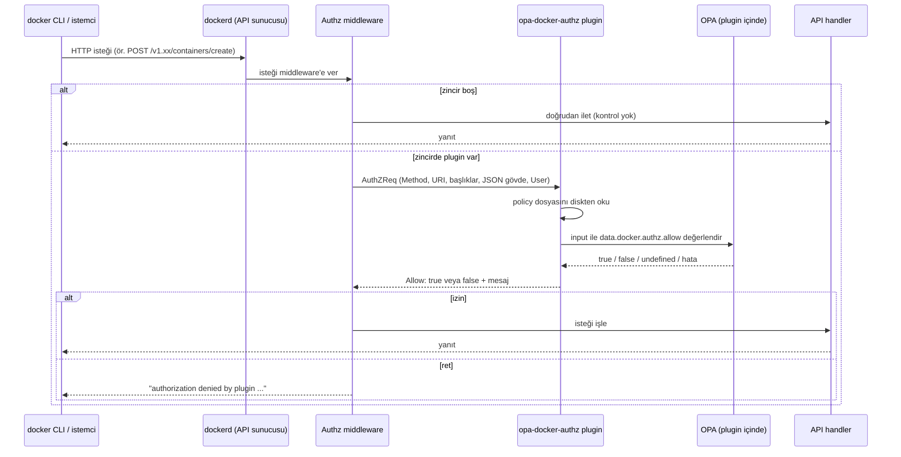

## 1. Giriş

Docker authorization plugin'leri, Docker daemon'una gelen her API isteğini işlenmeden önce bir policy'ye göre değerlendirmeyi sağlar. `opa-docker-authz`, bu mekanizmayı OPA (Open Policy Agent) ve Rego policy diliyle uygulayan bir plugin'dir.

Bu yazı şu konuları ele alıyor:

- Docker authorization plugin mekanizmasının çalışma şekli ve `opa-docker-authz` kurulumu.
- Örnek bir policy'nin neyi garanti ettiği, neyi etmediği.
- Dört tuzak: sessiz fail-open, policy güncelleme, Rego sözdizimi ve sürüm uyumu, policy'nin göremediği alanlar.
- Authorization plugin'inin tasarım gereği sağlayamadığı korumalar.
- Production için bir kontrol listesi.

Fail-open, bir kontrol mekanizmasının hata durumunda isteği reddetmek yerine geçirmesi demektir. Yazının ana konusu, bu durumun hiçbir hata ya da uyarı üretmeden oluşabilmesi.

## 2. Senaryo ve hedef

Senaryo: çok kullanıcılı, paylaşımlı Linux iş istasyonları. Kullanıcıların Docker kullanması gerekiyor ama birbirlerinin verisine ve host'a erişmemeleri isteniyor.

Temel gerilim şu: Docker daemon'u (dockerd) root olarak çalışır. Daemon, arka planda çalışan ve Docker API isteklerini işleyen servistir. Daemon'un socket'ine erişebilen biri, daemon'dan root yetkisiyle iş yapmasını isteyebilir. Docker'ın resmi dokümanı da `docker` grubunun kullanıcıya root düzeyinde yetki verdiğini belirtir. Bu senaryoda kullanıcıların socket'e erişimi var.

Hedef tek bir kural:

> Her kullanıcı yalnızca kendi workspace'ini (`/home/<kullanıcı>/workspace`) konteyner içinde `/workspace` yoluna bağlayabilsin. Başka bind mount yok, privileged konteyner yok, host namespace'leri yok. GPU erişimi serbest.

Bind mount, host'taki bir dizini konteynerin içine doğrudan bağlamaktır. Konteyner o dizini kendi dosya sistemi gibi görür. Konteyner root olarak çalışıyorsa dizindeki her şeyi okuyup yazabilir.

Beklenen kullanım kabaca şöyle bir çağrıdır:

```bash
docker run -d \
  --gpus all \
  -v "/home/<kullanıcı>/workspace":/workspace \
  "<imaj>"
```

Kullanıcıların terminal erişimi olduğu için policy'nin yalnızca bu komutu değil, Docker API'sine gelebilecek her isteği hesaba katması gerekir.

Yazıdaki yaklaşım, root olarak çalışan standart dockerd'nin önüne bir authorization katmanı koymaktır. Rootless Docker ve userns-remap gibi alternatifler Bölüm 10'da ele alınıyor.

## 3. Docker authorization plugin nasıl çalışır?

Docker'ın varsayılan erişim modeli "ya hep ya hiç"tir. Daemon'a erişebilen her istemci her API çağrısını yapabilir. Authorization plugin'leri bu modele bir karar noktası ekler. Daemon, her API isteğini işlemeden önce yapılandırılmış plugin'lere izin verip vermediklerini sorar.

İstek akışı:



Yazının geri kalanı için önemli ayrıntılar:

**Zincir boşsa kontrol yoktur.** Moby'nin `pkg/authorization/middleware.go` dosyasındaki `WrapHandler`, plugin listesi boşsa isteği doğrudan handler'a verir. Middleware'de "plugin olmalıydı ama yok" diye bir uyarı mekanizması yoktur. Bölüm 6'daki tuzağın temeli budur.

**Middleware fail-closed çalışır.** Docker'ın resmi dokümanına göre zincirdeki bir plugin'e ulaşılamazsa istek reddedilir. Docker, plugin yazarlarına da fail-closed davranmalarını önerir. Dolayısıyla "plugin çöktü, her şey açıldı" senaryosu middleware düzeyinde beklenmez. Risk, plugin'in zincirden hiçbir uyarı olmadan çıkarılmasıdır.

**Kullanıcı kimliği çoğu kurulumda boştur.** Plugin'e giden istekte `User` ve `AuthenticationMethod` alanları vardır. Moby kaynak koduna göre bu alanlar yalnızca istek TLS üzerinden geldiyse ve istemci bir client sertifikası sunduysa dolar. Kullanıcı adı sertifikanın CN alanından alınır. Unix socket üzerinden gelen isteklerde, yani yerel `docker` komutlarının neredeyse tamamında, iki alan da boş string'dir. Policy "bu isteği kim yaptı?" sorusunu cevaplayamaz. Bunun sonuçları Bölüm 10'da ele alınıyor.

**Plugin her şeyi görmez.** Resmi dokümana göre:

- Gövde plugin'e yalnızca JSON olarak iletilebildiğinde gönderilir.
- `exec` ve `attach` gibi hijack edilen bağlantılarda plugin yalnızca ilk HTTP isteğini görür.
- `logs` ve `events` gibi akan yanıtlarda yalnızca isteği görür.
- BuildKit'in kullandığı gRPC endpoint'i authorization'a tabi değildir. Image build'i authorization ile kısıtlamaya çalışan bir policy bu kanalı göremez.

Endpoint, Docker API'sinde belirli bir işlemi yapan yoldur, örneğin `/containers/create`.

## 4. Kurulum

`opa-docker-authz`, Docker managed plugin olarak kurulabilen, içinde OPA gömülü bir authorization plugin'idir. Örneklerde `openpolicyagent/opa-docker-authz-v2:0.9` etiketi kullanılıyor. Bu sürüm OPA 0.60 ile gelir. Sürüm konusu Bölüm 8'de ayrıca ele alınıyor.

Kurulum:

```bash
docker plugin install --alias opa-docker-authz \
  --grant-all-permissions \
  openpolicyagent/opa-docker-authz-v2:0.9 \
  opa-args="-policy-file /opa/policies/authz.rego"
```

Policy yolu dikkat gerektirir. Plugin'in yapılandırması host'taki `/etc/docker` dizinini plugin'in içinde `/opa` yoluna salt okunur olarak bağlar. Host'ta `/etc/docker/policies/authz.rego` konumundaki dosya, plugin'in içinden `/opa/policies/authz.rego` olarak görünür. `opa-args` içine host yolu değil, plugin içindeki yol yazılmalıdır. Yol yanlışsa plugin her isteğe izin verir (Bölüm 6).

Dosya ve dizin izinleri:

```bash
install -d -m 0755 -o root -g root /etc/docker/policies
install -m 0644 -o root -g root authz.rego /etc/docker/policies/authz.rego
```

Plugin'i daemon'un yetkilendirme zincirine eklemek için `daemon.json`:

```json
{
  "authorization-plugins": ["opa-docker-authz"]
}
```

Mevcut bir `daemon.json` varsa bu anahtar diğer ayarlarla birleştirilmelidir. Sıra: önce plugin kurulur, sonra `daemon.json` güncellenir, sonra daemon'un yapılandırmayı yeniden okuması sağlanır. Bunun için servis yeniden başlatılabilir. `systemctl reload docker` de zinciri yeniden kurar ve çalışan konteynerleri durdurmaz (Bölüm 6).

## 5. Policy: Satır satır

Aşağıdaki policy OPA 0.60'ın klasik Rego sözdizimiyle yazılmıştır.

```rego
package docker.authz

default allow = false

allow { not is_container_create }
allow { is_container_create; not deny }

is_container_create {
    input.Method == "POST"
    endswith(split(input.Path, "?")[0], "/containers/create")
}
```

`package docker.authz` ve `allow` kuralı, plugin'in varsayılan olarak sorguladığı karar noktasıdır: `data.docker.authz.allow`.

`default allow = false` güvenli bir varsayılandır. Hiçbir `allow` kuralı eşleşmezse karar ret olur.

Sonraki iki satır policy'nin mimarisini belirler:

- Konteyner oluşturma isteği **değilse** izin ver.
- Konteyner oluşturma isteğiyse ve hiçbir `deny` kuralı tetiklenmediyse izin ver.

`is_container_create`, API sürüm önekini (`/v1.47/` gibi) atlamak için `endswith` kullanır ve sorgu parametrelerini (`?name=...`) `split` ile ayırır.

Kesin yasaklar:

```rego
deny { input.Body.HostConfig.Privileged == true }
deny { count(input.Body.HostConfig.CapAdd) > 0 }
deny { input.Body.HostConfig.PidMode == "host" }
deny { input.Body.HostConfig.NetworkMode == "host" }
deny { input.Body.HostConfig.IpcMode == "host" }
deny { input.Body.HostConfig.UTSMode == "host" }
deny { startswith(input.Body.HostConfig.UsernsMode, "host") }
deny { count(input.Body.HostConfig.Devices) > 0 }
deny { s := input.Body.HostConfig.SecurityOpt[_]; contains(s, "unconfined") }
deny { s := input.Body.HostConfig.SecurityOpt[_]; contains(s, "no-new-privileges:false") }
deny { s := input.Body.HostConfig.SecurityOpt[_]; contains(s, "no-new-privileges=false") }
```

Bu kurallar şunları yasaklar: `--privileged`, `--cap-add`, host'un PID/ağ/IPC/UTS namespace'lerini paylaşmak, user namespace'i kapatmak, `--device` ile cihaz geçirmek ve seccomp/AppArmor gibi korumaları `unconfined` yapmak. Her biri tek başına konteynerden host'a geçiş için yeterli olabilir.

Bind mount kuralı:

```rego
deny { b := input.Body.HostConfig.Binds[_]; not bind_ok(b) }
deny { m := input.Body.HostConfig.Mounts[_]; m.Type == "bind"; not mount_ok(m) }

bind_ok(b) {
    parts := split(b, ":")
    parts[1] == "/workspace"
    seg := split(parts[0], "/")
    count(seg) == 4
    seg[1] == "home"
    seg[3] == "workspace"
}

mount_ok(m) {
    m.Target == "/workspace"
    seg := split(m.Source, "/")
    count(seg) == 4
    seg[1] == "home"
    seg[3] == "workspace"
}
```

Docker'da bind mount iki ayrı alandan gelebilir. `-v kaynak:hedef` sözdizimi `HostConfig.Binds` dizisine, `--mount type=bind,...` sözdizimi `HostConfig.Mounts` dizisine yazılır. Policy ikisini de kontrol eder.

Kaynak yol `/` ile bölündüğünde tam dört parça olmalıdır: `""`, `"home"`, kullanıcı adı, `"workspace"`. Hedef `/workspace` olmalıdır. Böylece `/home/<kullanıcı>/workspace/alt-dizin` gibi daha derin yollar da reddedilir. Gerekçe: Docker bind kaynağındaki sembolik bağları (symlink) çözer. Bu kural eklenmeden önce canlı ortamda şu görüldü: workspace içine host'un köküne işaret eden bir symlink konup bu alt yol bağlandığında host'un dosyaları okunabiliyordu. Dört parça kuralı alt yol üzerinden gelen symlink'i kapatır. Workspace dizininin kendisinin symlink olması ayrı bir risktir (Bölüm 10).

**Garanti ettikleri** (canlı daemon üzerinde doğrulandı): `--privileged`, `--cap-add`, host kökünü ya da `/etc`'yi bağlamak, alt yol symlink'i, Docker socket'ini konteynere bağlamak, `--device`, `--ipc=host` ve `--mount type=bind` ile workspace dışı bağlama reddedilir. Beklenen kullanım (workspace bind ve `--gpus all`) çalışır. Makine yeniden başlatıldığında plugin geri gelir ve kurallar uygulanmaya devam eder.

**Garanti etmedikleri** Bölüm 9 ve 10'da. Bir kısmı policy'nin eksik yazılmasından, bir kısmı mekanizmanın kendisinden kaynaklanır. Ancak önce, policy doğru olsa bile korumanın tamamen kapanabildiği durum ele alınmalı.

## 6. Tuzak 1: Sessiz fail-open

### Belirti

Plugin `docker plugin ls` çıktısında etkin görünür, `daemon.json` içinde `authorization-plugins` tanımlıdır, policy dosyası doğrudur. Buna rağmen `docker run --rm --privileged alpine true` başarıyla çalışır. Host bind mount'ları da reddedilmez. Daemon log'unda hata ya da uyarı yoktur.

Bu durum şu komut çifti çalıştırıldıktan sonra oluşur:

```bash
docker plugin disable --force opa-docker-authz
docker plugin enable opa-docker-authz
```

Bu komut çifti, "plugin'i yeniden yükleyip yeni policy'yi okutmak" amacıyla sık kullanılan bir alışkanlıktır.

### Mekanizma: plugin zincirden düşer

Moby kaynak kodunda üç parça bu davranışı açıklar:

1. `daemon/pkg/plugin/backend_linux.go` içindeki `Disable()` fonksiyonu, authorization tipindeki bir plugin devre dışı bırakıldığında `AuthzMiddleware.RemovePlugin(name)` çağırır. Plugin dockerd'nin yetkilendirme zincirinden çıkarılır.
2. Aynı dosyadaki `Enable()` fonksiyonunda plugin'i middleware'e geri ekleyen bir çağrı **yoktur**. Plugin etkinleşir, `docker plugin ls` onu etkin gösterir, ama plugin zincirde değildir.
3. `daemon/command/daemon.go` içindeki config reload yolu `authzMiddleware.SetPlugins(cfg.AuthorizationPlugins)` çağırır. Zinciri `daemon.json` içindeki listeden yeniden kuran yer budur. `systemctl reload docker` daemon'a SIGHUP gönderir ve bu yolu tetikler.

Zincir boşken middleware her isteği doğrudan handler'a verir (Bölüm 3). Sonuç olarak disable/enable sonrasında authorization sessizce kapalıdır. Daemon hata vermez, plugin etkin görünür, policy dosyası doğrudur, ama hiçbir istek plugin'e gitmez. Davranış güncel moby kaynağında da aynıdır.

Kısaca: **`docker plugin disable` authorization'ı kapatır, `docker plugin enable` geri açmaz, `systemctl reload docker` açar.**

#### Tarihçe: zincirden çıkarma neden var?

Zincirden çıkarma bir hata değil, bir düzeltmedir. 2017'de açılan moby issue #31836, authorization plugin'i devre dışı bırakıldıktan sonra daemon'un istekleri hâlâ o plugin'e gönderdiğini bildirdi. Plugin artık yanıt vermediği için tüm API istekleri bloklanıyordu.

Düzeltme olan commit `38de272bd4`, `Disable()` fonksiyonuna authorization tipindeki plugin'i middleware zincirinden çıkaran kodu ekledi. Aynı commit `Enable()` tarafına plugin'i zincire geri ekleyen bir kod eklemedi. Bu bölümdeki sessiz fail-open, o düzeltmenin bu asimetrisinden doğan bir yan etkidir.

### Gözlenen davranış

Canlı bir daemon üzerindeki test sonuçları kaynak koddaki mekanizmayla uyumludur:

| Adım | `--privileged` testi |
|---|---|
| Policy yazıldı + `systemctl reload docker` | Reddedildi |
| Policy değişti + `disable` / `enable` | Çalıştı (fail-open) |
| Dizin 755, dosya 644 yapıldı + `disable` / `enable` | Çalıştı (fail-open) |
| Plugin yeniden kuruldu (`disable` → `rm` → `install`) + `systemctl reload docker` | Reddedildi |

Davranış güncel sürümde de aynıdır: Docker Engine 29.9.0 ve opa-docker-authz v0.9 ile disable/enable sonrası `--privileged` çalışır, `systemctl reload docker` sonrası reddedilir.

Son adımda zinciri yeniden kuran, yeniden kurulum değil reload'dur. Yeniden kurulum da bir disable/enable döngüsü içerir ve kendi başına plugin'i zincire geri eklemez. Zincire geri ekleme `SetPlugins` ile, yani reload sırasında olur.

Daemon journal'ında dikkat çekici bir kayıt var: plugin, kendisini devre dışı bırakan `POST .../plugins/opa-docker-authz/disable?force=1` isteğine izin vermiş (`result: true`). Bu policy yalnızca konteyner oluşturmayı denetlediği için disable isteği de authorization'dan geçer ve izin alır. Bu kayıttan sonra test isteklerine ait karar kaydı yoktur: istekler artık plugin'e ulaşmaz.

### Yaygın yanlış teşhis: dosya izinleri

Bu belirti için sık başvurulan açıklama şudur: "Policy dosyası 644 değilse plugin dosyayı okuyamaz, boş policy ile çalışır ve her şeye izin verir." Bu açıklama iki nedenle yanlıştır:

- Yukarıdaki tabloda izinler 644 yapıldıktan sonra disable/enable ile koruma hâlâ kapalıdır. Düzelten adım reload'dur.
- `opa-docker-authz` policy dosyasını `os.ReadFile` ile okur. Okuma hatası (izin hatası dahil) olursa isteği **reddeder**. İzin sorunu fail-closed bir sonuç üretir.

Karışıklığın olası kaynağı: resmi `openpolicyagent/opa` CLI imajı root olmayan bir kullanıcıyla çalışır. 600 izinli bir policy dosyası bu imajla `opa check` edilirse "permission denied" alınır. Bu, plugin'in davranışı hakkında bilgi vermez. 755/644 izinleri zararsız bir hijyen kuralı olarak kalabilir, ama fail-open'ın nedeni değildir.

### Plugin'in açıkça fail-open olduğu durum

Plugin'in kaynak kodunda gerçekten fail-open olan bir dal vardır. Policy dosyası okunmadan önce `os.Stat` ile kontrol edilir. Dosya **yoksa** plugin şu mesajı log'a yazıp isteğe izin verir:

```text
OPA policy file %s does not exist, failing open and allowing request
```

Dolayısıyla `opa-args` içindeki yolda bir yazım hatası ya da `/etc/docker` → `/opa` dönüşümünün yanlış uygulanması korumayı tamamen kapatır. Bu durumda plugin log'unda bir iz kalır.

Kaynak koddan çıkan karar tablosu:

| Durum | Plugin kararı |
|---|---|
| Policy dosyası yok | **İzin (fail-open)**, log'a yazılır |
| Dosya okunamıyor (ör. izin hatası) | Ret |
| Rego derleme ya da değerlendirme hatası | Ret |
| `allow` undefined | Ret |
| Plugin zincirde değil | Plugin'e hiç sorulmaz, **izin** |

### Tespit

Plugin'in "etkin" görünmesi ya da dosya hash'inin doğru olması bu sorunu yakalamaz. Policy dosyasının hash'ini, dosya modunu ve `docker plugin ls` çıktısındaki etkin durumu toplayan bir drift kontrolü, fail-open sırasında da "doğru" sonuç verir. Zincirin gerçek durumu için `docker info` gibi yapılandırma çıktılarına da dayanılmamalıdır.

Güvenilir kontrol davranış testidir. Normal bir kullanıcı hesabıyla:

```bash
docker run --rm --privileged alpine true
```

Bu komut şu mesajla reddedilmelidir:

```text
docker: Error response from daemon: authorization denied by plugin opa-docker-authz:latest: request rejected by administrative policy
```

Komutun yalnızca başarısız olması yeterli değildir. İmaj çekilemediği ya da daemon'a ulaşılamadığı için de başarısız olabilir. Çıktıda `authorization denied` geçtiği kontrol edilmelidir. Bu testin düzenli çalışan sürümü Bölüm 11'de.

## 7. Tuzak 2: Policy güncelleme

Plugin, kaynak koduna göre policy dosyasını **her istekte** diskten okur. Önbellek yoktur. Dosya değiştiği anda bir sonraki istek yeni policy ile değerlendirilir. Policy güncellemesi için plugin'i yeniden yüklemeye gerek yoktur.

Asıl risk, disable/enable komut çiftinin güncelleme otomasyonuna girmesidir. Policy değiştiğinde plugin'i disable/enable yapan, `daemon.json` değişmediği için reload yapmayan bir otomasyon, her çalıştığında dokunduğu makinelerde authorization'ı bir sonraki reload ya da yeniden başlatmaya kadar kapatır. Dokümanda doğru prosedür yazılı olsa bile otomasyon farklı bir şey yapıyorsa bu risk gözden kaçar.

Güvenli policy güncellemesi:

1. Yeni policy'yi plugin'in kullandığı OPA sürümüyle derleyin (`opa check`) ve test girdileriyle değerlendirin (`opa eval`).
2. Dosyayı yerine koyun. Plugin dosyayı her istekte okuduğu için yazma sırasında yarım bir dosya görülürse o istek derleme hatası yüzünden reddedilir. Bunu önlemek için yeni dosyayı aynı dizine geçici bir adla yazıp `mv` ile değiştirin.
3. Plugin'e dokunmayın.
4. `--privileged` testini çalıştırın.

Plugin'in kendisi değiştiyse (sürüm yükseltme, yeniden kurulum) işlem bittikten sonra `systemctl reload docker` çalıştırın ve davranış testini tekrarlayın. Policy plugin API'sine yazmayı yasaklıyorsa (Bölüm 9), bu işlemlerden önce plugin'in zincirden `daemon.json` üzerinden çıkarılması gerekir.

Authorization'ı birden fazla makineye yaymak için bir desen: yedek al → reload → `docker ps` başarısızsa otomatik geri al → `--privileged` testi. Çalışan konteynerleri durdurmaz ve makinelerde paralel çalıştırılabilir.

```bash
#!/usr/bin/env bash
set -u
cfg=/etc/docker/daemon.json
bak="$cfg.bak.$(date +%s)"

cp -a "$cfg" "$bak"

# authorization-plugins anahtarını mevcut ayarlarla birleştir
jq '. + {"authorization-plugins": ["opa-docker-authz"]}' "$bak" > "$cfg.new" \
  && mv "$cfg.new" "$cfg"

systemctl reload docker

# Daemon sağlıklı değilse otomatik geri al
if ! docker ps >/dev/null 2>&1; then
  cp -a "$bak" "$cfg"
  systemctl reload docker
  echo "ROLLBACK"
  exit 1
fi
echo -n "ps=OK "

# Davranış testi
if docker run --rm --privileged alpine true 2>&1 | grep -q "authorization denied"; then
  echo "priv=DENIED"
else
  echo "priv=OPEN"
  exit 2
fi
```

Her makine `ps=OK priv=DENIED` raporlamadan dağıtım bitmiş sayılmamalı.

## 8. Tuzak 3: Rego sözdizimi ve plugin sürümü

### Sürüm durumu

OPA 1.0 ile Rego sözdizimi değişti. Kural gövdelerinden önce `if`, çok değerli kurallarda `contains` artık zorunludur. Bölüm 5'teki policy klasik (0.x) sözdizimiyle yazılmıştır.

`opa-docker-authz` sürümleri:

| Plugin | OPA | Docker Hub'da managed plugin |
|---|---|---|
| v0.9 | 0.60.0 | Var (en yeni etiket) |
| v0.10 | 1.3.0 | Yok |
| v0.11 | 1.21.1 | Yok |

Proje bakımdadır ve yeni sürümler GitHub'da yayınlanır. Ancak `docker plugin install` ile Docker Hub'dan çekilebilen en yeni etiket 0.9'dur. 0.10 ve sonrası Docker Hub'da managed plugin olarak yayınlanmadığı için, bu sürümleri kullanmak plugin'i kaynak koddan derlemeyi gerektirir.

Sonuç: 0.9 için yazılmış klasik bir policy, plugin 0.10+ sürümüne yükseltildiğinde derlenmez. OPA 1.21.1 ile `opa check`:

```text
rego_parse_error: `if` keyword is required before rule body
```

Plugin derleme hatasında isteği reddeder. Sonuç fail-closed'dır, ama `docker ps` dahil her istek reddedilir ve Docker kullanılamaz hâle gelir.

### Köprü: `import rego.v1`

İki sürümde de çalışan bir policy için `import rego.v1` kullanılır. Bu import OPA 0.59.0'da eklendi. Policy OPA 1.x sözdizimine çevrilip başına bu satır konduğunda hem 0.60 hem 1.x onu derler.

```rego
package docker.authz

import rego.v1

default allow := false

allow if {
	is_container_create
	not deny
}

deny if input.Body.HostConfig.Privileged == true
```

`authz-hardened-v1.rego` bu biçimdedir ve OPA 0.60.0 ile 1.21.1 üzerinde tüm test girdileriyle değerlendirildi. İki sürüm aynı kararları verir. Plugin yükseltmesinden önce policy'nin bu biçime çevrilmesi önerilir.

### Rego tuzağı: hata "izin"e dönüşebilir

OPA varsayılan olarak bir built-in fonksiyonun çalışma zamanı hatasını (örneğin geçersiz bir regex) hata olarak değil, **undefined** olarak ele alır. Plugin de OPA'yı `StrictBuiltinErrors` seçeneği olmadan çağırır.

Bir `deny` kuralı içinde built-in hata verirse kural undefined olur, yani tetiklenmez. `not deny` bu durumda true olur. Deny-list + `not deny` deseninde hata **izin** anlamına gelir.

Test: bozuk bir regex içeren bir `deny` kuralıyla privileged girdi `allow = true` döndürür. Aynı değerlendirme `--strict-builtin-errors` ile çalıştırıldığında `eval_builtin_error` verir.

Önlemler:

- CI'da policy testlerini `opa eval --strict-builtin-errors` ile çalıştırın.
- `deny` kurallarında hata verebilecek built-in'lerden (regex, ayrıştırma fonksiyonları) mümkün olduğunca kaçının.
- Mümkünse deny-list yerine allow-list kullanın. Neyin yasak olduğunu değil, neyin izinli olduğunu tarif edin. Böylece undefined bir sonuç ret anlamına gelir.

## 9. Tuzak 4: Policy'nin göremedikleri

Bölüm 5'teki policy ve sertleştirilmiş sürümü 19 test senaryosu üzerinde, hem `opa eval` ile hem canlı Docker daemon'u üzerinde test edildi.

| Test girdisi | Orijinal | Sertleştirilmiş |
|---|---|---|
| Kendi workspace'i | izin | izin |
| Başka kullanıcının workspace'i | **izin** | **izin** |
| `--privileged` | ret | ret |
| `/etc` bind | ret | ret |
| Workspace alt yolu | ret | ret |
| `--mount type=bind` ile kök dizin | ret | ret |
| Driver seçenekli volume mount | **izin** | ret |
| `--volumes-from` | **izin** | ret |
| `--gpus` | izin | izin |
| Gövdesiz create isteği | **izin** | ret |
| Plugin devre dışı bırakma isteği | **izin** | ret |
| Plugin listeleme (GET) | izin | izin |
| Driver seçenekli `volume create` | **izin** | ret |
| Sade `volume create` | izin | izin |
| Gövdesiz `volume create` | **izin** | ret |
| `exec` | **izin** | **izin** |
| `exec --privileged` | **izin** | ret |
| `..` içeren yol | **izin** | ret |
| `--cap-add` | ret | ret |

Canlı daemon testleri plugin v0.9 (OPA 0.60) ile yapıldı. `opa eval` ile yapılan değerlendirmede sertleştirilmiş sütun, klasik sözdizimli `authz-hardened.rego` için OPA 0.60'ta, `authz-hardened-v1.rego` için hem OPA 0.60 hem 1.21.1'de aynıdır. Başka kullanıcının workspace'i ve `exec` satırları Bölüm 10'un konusudur.

Sade `volume create` satırıyla ilgili bir tutarsızlık var. Adlandırılmış bir volume `-v isim:/yol` ile bağlandığında `HostConfig.Binds`'e düşer, `/home/...` biçimine uymadığı için bind kuralına takılır ve reddedilir. Aynı volume `--mount type=volume` ile bağlandığında driver yapılandırması olmadığı için izin alır. Sade volume'lar host dizini göstermediği için bu zararsızdır. `-v` ile de izin vermek isteyen bir policy, `bind_ok`'a adlandırılmış volume için ayrı bir dal eklemelidir.

### Volume tipindeki mount'lar

Orijinal policy `HostConfig.Mounts` girdilerini yalnızca `Type == "bind"` ise kontrol eder. Docker'ın `local` volume driver'ı ise driver seçenekleriyle host'taki bir dizini gösteren bir volume oluşturmayı destekler. Böyle bir mount `Type == "volume"` olarak gelir ve bind kuralına girmez. Konteyner host'un keyfi bir dizinine erişebilir.

Düzeltme: driver yapılandırması içeren volume mount'larını reddetmek.

```rego
deny { m := input.Body.HostConfig.Mounts[_]; m.Type == "volume"; m.VolumeOptions.DriverConfig }
```

### `volume create` seçenekleri

Aynı sonuca, önce ayrı bir `POST /volumes/create` isteğiyle driver seçenekli bir volume oluşturup sonra onu bağlayarak da ulaşılabilir. Orijinal policy konteyner oluşturma dışındaki her endpoint'e izin verdiği için bu istek denetlenmez.

Düzeltme: volume oluşturmayı ayrı bir karar noktası yapmak ve yalnızca driver seçeneği içermeyen istekleri kabul etmek. Seçeneksiz volume'lar serbest kalır.

```rego
allow { is_volume_create; volume_ok }

is_volume_create {
    input.Method == "POST"
    endswith(split(input.Path, "?")[0], "/volumes/create")
}
volume_ok { is_object(input.Body); count(object.get(input.Body, "DriverOpts", {})) == 0 }
```

Kural bilinçli olarak allow-list biçiminde. `volume_deny { count(input.Body.DriverOpts) > 0 }` gibi bir deny-list kuralı gövde gelmediğinde tetiklenmez ve istek geçer (aşağıda "Gövdesiz istek"). `is_object` kontrolü, gövdenin hiç gelmediği ya da `null` geldiği durumu da reddeder. Docker CLI `volume create` isteğinde gövdeyi her zaman gönderir ve seçenek yoksa `DriverOpts` boş bir nesnedir, bu yüzden normal kullanım etkilenmez.

### `--volumes-from`

`HostConfig.VolumesFrom`, başka bir konteynerin tüm mount'larını devralmayı sağlar. Paylaşımlı bir makinede bu, başka bir kullanıcının workspace'i takılı konteynerinden o workspace'i devralmak demektir. Orijinal policy bu alana bakmaz.

```rego
deny { count(input.Body.HostConfig.VolumesFrom) > 0 }
```

### Yol normalizasyonu

Policy yolu yalnızca `/` ile böler, çözümlemez. `/home/../workspace` dört parçaya bölünür ve kurala uyar. Bu örnek doğrudan hassas veriye erişim sağlamaz, ama policy'nin yolu metin olarak değerlendirdiğini gösterir. Sertleştirilmiş sürüm kullanıcı adı segmentinde boş değeri, `.` ve `..`'yı reddeder:

```rego
bind_ok(b) {
    parts := split(b, ":")
    parts[1] == "/workspace"
    seg := split(parts[0], "/")
    count(seg) == 4
    seg[1] == "home"
    not {"", ".", ".."}[seg[2]]
    seg[3] == "workspace"
}
```

Plugin'in girdisinde symlink'leri çözülmüş yolu taşıması beklenen bir `Resolved` alanı vardır. Ancak managed plugin'de bu alan boş gelir. Plugin çözümlemeyi kendi dosya sisteminde yapar ve plugin'in içinde host'un `/home` dizini yoktur. Bu nedenle `Resolved` symlink savunması olarak kullanılamaz.

### Gövdesiz istek

Deny-list deseninin en sinsi kör noktası budur. Bütün `deny` kuralları `input.Body.HostConfig` altındaki alanlara bakar. Gövde plugin'e ulaşmazsa ya da plugin onu ayrıştıramazsa hiçbir `deny` kuralı tetiklenmez, `not deny` true olur ve istek geçer.

Plugin'in gövdeyi her zaman ayrıştıracağı varsayılmamalıdır. Docker'ın dokümanı da gövdenin plugin'e her durumda iletilmediğini belirtir. Düzeltme tek satırdır:

```rego
deny { not input.Body.HostConfig }
```

Bu kural, konteyner oluşturma isteğinde `HostConfig` yoksa isteği reddeder. Normal `docker run` her zaman `HostConfig` gönderdiği için meşru kullanımı etkilemez.

Bu kör nokta teorik değil. CVE-2024-41110'da, özel hazırlanmış bir API isteğiyle daemon isteği authorization plugin'ine gövdesiz iletebiliyordu. Gövdeye bakarak karar veren plugin'ler, normalde reddedecekleri bir isteğe izin verebiliyordu. Açık ilk olarak Ocak 2019'da Docker Engine v18.09.1'de düzeltilmişti. Düzeltme sonraki ana sürümlere taşınmadığı için regresyon olarak geri geldi. Advisory'ye göre v23.0.14, v26.1.4 ve v27.1.0'dan sonraki sürümler yamalıdır. docker-ce için düzeltme v27.1.1'dedir.

`deny { not input.Body.HostConfig }` kuralı tam bu durumu yakalar: gövdesiz bir create isteğinde `HostConfig` undefined olur ve istek reddedilir. Engine yamalı olsa bile kural savunma derinliği olarak kalmalıdır, çünkü policy'nin güvenliği engine'deki tek bir düzeltmeye bağlı olmamalı.

Aynı kör nokta, gövdeye bakan her deny-list kuralında vardır. Policy'ye konteyner oluşturma dışında bir karar noktası eklendiğinde (`volume create`, `exec`) o noktanın da gövdesiz isteği reddettiği ayrıca test edilmelidir.

### Plugin API'si

Bölüm 6'daki journal kaydında plugin'i devre dışı bırakma isteği authorization'dan geçer ve izin alır. Bu, socket'e erişebilen her kullanıcının authorization'ın tamamını kapatabileceği anlamına gelir. Bölüm 6'daki mekanizmanın doğrudan sonucudur.

Düzeltme: plugin API'sinde okuma dışındaki her işlemi reddetmek.

```rego
allow { not is_container_create; not is_volume_create; not is_plugin_write }

is_plugin_write { input.Method != "GET"; input.PathArr[1] == "plugins" }
is_plugin_write { input.Method != "GET"; startswith(input.PathArr[1], "v"); input.PathArr[2] == "plugins" }
```

İkinci kural sürüm önekli yolları (`/v1.47/plugins/...`) yakalar.

Operasyonel sonuç: bu kural yöneticinin de socket üzerinden plugin'i devre dışı bırakmasını engeller. Plugin'i yükseltmek ya da yeniden kurmak için önce `authorization-plugins` anahtarı `daemon.json`'dan çıkarılıp reload yapılır, işlem bitince anahtar geri konur ve tekrar reload yapılır. Bu takas, Bölüm 7'deki tehlikeli disable/enable alışkanlığını da imkânsız hâle getirir.

### `exec --privileged`

`docker exec --privileged`, çalışan bir konteynerde privileged bir süreç başlatır. Bu istek `POST /containers/{id}/exec` endpoint'ine gider ve gövdesinde `Privileged: true` alanı bulunur. Bölüm 5'teki policy yalnızca konteyner oluşturmayı denetlediği için bu istek serbesttir. Dolayısıyla `create` aşamasında reddedilen privileged yetki, `exec` aşamasında alınabilir.

Kimlik gerektirmeyen bu kısım policy ile kapatılabilir:

```rego
allow { not is_container_create; not is_volume_create; not is_plugin_write; not is_exec_create }
allow { is_exec_create; exec_ok }

is_exec_create {
    input.Method == "POST"
    input.PathArr[count(input.PathArr) - 1] == "exec"
}
exec_ok { input.Body.Privileged == false }
```

İlk satır, "Plugin API'si" başlığındaki genel `allow` kuralının yerini alır.

Kural bilinçli olarak allow-list biçiminde. Docker CLI exec isteğinde `Privileged` alanını her zaman gönderir, bu yüzden normal `docker exec` çalışmaya devam eder. Allow-list olduğu için gövdesiz ya da alanı eksik bir istek reddedilir.

Deny-list ile yazılmış `exec_deny { not input.Body }` gibi bir kural bu işi yapmaz. Plugin gövdeyi ayrıştıramadığında `input.Body` alanı `null` gelebilir. `null` Rego'da tanımlı bir değerdir, `false` değildir, dolayısıyla `not input.Body` false olur. Gövdesiz bir privileged exec isteği böyle bir kuraldan geçer. Create tarafındaki `deny { not input.Body.HostConfig }` kuralı bu sorundan etkilenmez: `null` bir gövdenin `HostConfig` alanı undefined olur ve kural tetiklenir.

### `--gpus` ve `DeviceRequests`

`--gpus`, `HostConfig.Devices` alanına değil `HostConfig.DeviceRequests` alanına yazılır. `Devices` kuralı GPU erişimini engellemez. Bu senaryoda GPU erişimi hedefin parçası olduğu için alan bilinçli olarak açık bırakıldı. GPU'yu kısıtlamak isteyen bir policy'nin `DeviceRequests`'i ayrıca ele alması gerekir.

### Kontrol edilmeyen diğer alanlar

`CgroupnsMode`, `CgroupParent`, `Sysctls`, `Runtime` ve `PortBindings` iki policy'de de kontrol edilmez. Bunlar daha düşük riskli kabul edildi. Deny-list yaklaşımının doğası gereği, Docker API'sine her yeni alan eklendiğinde liste gözden geçirilmelidir.

## 10. Authorization plugin'inin veremedikleri

Sertleştirilmiş tabloda iki satır hâlâ açıktır: başka kullanıcının workspace'i ve `exec`. `exec --privileged` policy ile kapatılabilir (Bölüm 9). Ama "kimin konteyneri?" sorusuna dayanan kısıtlar policy'yi iyileştirerek kapatılamaz.

### Kimlik yok

Unix socket üzerinden gelen isteklerde `User` alanı boştur (Bölüm 3). Policy `/home/<kullanıcı>/workspace` yolunun **biçimini** kontrol edebilir, ama isteği yapanın o `<kullanıcı>` olup olmadığını bilemez. Bir kullanıcı başka bir kullanıcının workspace'ini kendi konteynerine bağlayabilir.

Ev dizinlerinin 0700 izinli olması bunu durdurmaz. Dosyalara erişen, root olarak çalışan daemon'dur. Yerel diskteki dizinler için bu doğrudan okuma ve yazma erişimi demektir. Workspace'ler NFS üzerinden `sec=krb5` ile bağlıysa, root daemon'un başka bir kullanıcının verisine erişip erişemeyeceği Kerberos kimlik eşlemesine bağlıdır.

Aynı nedenle bir risk daha vardır. Kullanıcı kendi ev dizininin sahibi olduğu için workspace dizinini silip yerine host'ta başka bir yeri gösteren bir symlink koyabilir. Yol biçimi policy'den geçer ve Docker bind kaynağındaki symlink'i çözdüğü için (Bölüm 5) symlink'in gösterdiği yer bağlanır. Workspace bir NFS mount noktasıysa silinemez. Mount yokken ya da workspace yerel bir dizinse bu mümkündür. Yol biçimine bakan bir policy bu riski kapatamaz.

TLS client sertifikalarıyla kimlik taşımak teorik olarak mümkündür. Ancak bu, kullanıcıların yerel socket yerine TLS üzerinden ve kendi sertifikalarıyla bağlanmasını gerektirir. Paylaşımlı bir iş istasyonu için bu ayrı bir altyapı işidir.

### `exec`, `commit`, `rm` serbest

Policy yalnızca konteyner oluşturmayı denetler. Kimlik olmadığı için "bu konteyner kimin?" sorusuna dayanan bir kural da yazılamaz. Bir kullanıcı:

- başka bir kullanıcının konteynerine root olarak `exec` ile girebilir,
- o konteyneri `commit` ile imaja çevirip dışarı alabilir,
- onu durdurabilir ya da silebilir.

`exec` tamamen yasaklanabilir, ama bu durumda kullanıcılar kendi konteynerlerine de giremez. Sahiplik bilgisi olmadan seçici bir kural yazılamaz.

### `docker` grubu root eşdeğeridir

Docker'ın resmi dokümanına göre `docker` grubu kullanıcıya root düzeyinde yetki verir ve Docker daemon'unu yalnızca güvenilir kullanıcılar kontrol edebilmelidir. Authorization plugin'i bu gerçeği değiştirmez, yalnızca bazı yolları kapatır. Bu yolların listesi kolayca eksik kalabilir. Plugin, bir yönetici hatasıyla ya da policy yeterince sıkı değilse sıradan bir kullanıcının isteğiyle sessizce devreden çıkabilir.

### Authorization tek başına bir güvenlik sınırı değil

Riskleri iki kategoriye ayırmak işe yarar:

- **Tasarım gereği açıklar:** Docker'ın meşru özellikleriyle host'a erişim (`--privileged`, host bind mount, volume driver seçenekleri gibi). Authorization policy'si bunları kapatmak için vardır.
- **Runtime kaçış açıkları:** runc ya da kernel'deki güvenlik hataları üzerinden konteynerden kaçış. Bunları hiçbir policy kapatmaz. Çare runc, Docker ve kernel'i güncel tutmaktır.

Authorization plugin'i birinci kategoride işe yarayan bir katmandır. Ancak kimlik olmadığı, plugin zincirden düşebildiği ve deny-list eksik kalabildiği için, güvenilmeyen kullanıcılara karşı tek başına yeterli değildir.

### Alternatifler

- **Rootless Docker:** Daemon kullanıcının kendi yetkileriyle çalışır. Root eşdeğeri sorun büyük ölçüde ortadan kalkar.
- **Podman:** Daemon'suz, rootless çalışabilen bir alternatif.
- **userns-remap:** Konteynerdeki root'u host'ta yetkisiz bir UID aralığına eşler.
- **Kullanıcı başına ayrı daemon:** Her kullanıcının kendi socket'i ve izolasyonu olur.
- **Kubernetes + admission control:** Kimlik ve yetkilendirme API sunucusunda yerleşiktir. Policy (örneğin OPA Gatekeeper ile) kimliği bilen bir bağlamda yazılır.
- **Root sahipli bir başlatıcı:** Kullanıcılara Docker socket'i yerine, yalnızca izin verilen parametrelerle konteyner başlatan, root'a ait küçük bir araç verilir. Kimlik işletim sisteminden gelir.

Her seçeneğin bir bedeli vardır. Rootless Docker mevcut bir kuruluma sonradan eklendiğinde uyum sorunları çıkarabilir. userns-remap, konteynerdeki root'u host'ta başka bir UID'ye eşlediği için kullanıcıların NFS'teki verilerine kendi kimlikleriyle erişmesini bozabilir. GPU erişimi de etkilenebilir. Kimlik gerektiren gereksinimler için root sahipli bir başlatıcı ya da kullanıcı başına ayrı daemon, authorization plugin'inden daha sağlam bir temel sunar.

## 11. Production kontrol listesi

**Sürüm**
- Docker Engine en az 29.3.1 olsun. Bu sürüm, AuthZ plugin'lerinin atlatılabildiği CVE-2026-34040'ı ve `docker plugin install` sırasında privilege doğrulamasının atlanabildiği CVE-2026-33997'yi yamalar.
- Daha eski bir sürümde kalmak zorundaysanız en azından CVE-2024-41110 için yamalı bir sürüm kullanın (docker-ce v27.1.1, Bölüm 9).

**İzinler**
- Policy dizini `0755 root:root`, dosyası `0644 root:root` olsun. Fail-open'ın nedeni bu değildir, ama ayrı çalıştırılan `opa check` gibi kontrol araçlarının dosyayı okuyabilmesi için gereklidir.
- Policy yolunu plugin içindeki yola göre yazın (`/etc/docker/...` → `/opa/...`). Yol yanlışsa plugin açıkça fail-open olur.

**Davranış testi**
- Her kurulumdan, her policy değişikliğinden ve her plugin işleminden sonra normal bir kullanıcıyla `docker run --rm --privileged alpine true` çalıştırın.
- Yalnızca çıkış kodunu değil, `authorization denied` mesajını kontrol edin.
- `docker plugin ls`, dosya hash'leri ve dosya modları zincirin durumunu göstermez. Bunlarla sınırlı bir drift kontrolü fail-open'ı yakalamaz.

**Periyodik test ve alarm**
- Davranış testini düzenli aralıklarla çalıştırın ve reddedilmezse alarm üretin. Bölüm 6'daki durumu en erken yakalayacak kontrol budur:

```bash
#!/usr/bin/env bash
# Root olmayan, docker grubundaki bir servis hesabıyla çalıştırın.
out=$(docker run --rm --privileged alpine true 2>&1)
if ! grep -q "authorization denied" <<<"$out"; then
  logger -p auth.crit "docker-authz: privileged test NOT denied: ${out:-<başarılı>}"
  exit 1
fi
```

**Güncelleme prosedürü**
- Policy değişikliği için plugin'e dokunmayın. Dosyayı değiştirin, test edin.
- `docker plugin disable/enable` komutlarını policy güncellemesi için kullanmayın.
- Plugin işlemlerinden (yükseltme, yeniden kurulum) önce plugin'i `daemon.json`'dan çıkarıp reload yapın. İşlem bitince geri ekleyip tekrar reload yapın ve davranış testini tekrarlayın.
- Otomasyon betiklerini dokümandaki prosedürle karşılaştırın.
- Plugin API'sine yazma işlemlerini policy'de reddedin.
- Plugin sürümünü yükseltmeden önce policy'yi `import rego.v1` biçimine çevirin ve hedef OPA sürümüyle `opa check` çalıştırın.

**Policy**
- Gövdesiz istekleri reddedin: `deny { not input.Body.HostConfig }`. Konteyner oluşturma dışındaki karar noktalarında (`volume create`, `exec`) allow-list kullanın ve gövdesiz istekle test edin.
- `Mounts` içindeki volume tipini, `volume create` seçeneklerini ve `VolumesFrom`'u kontrol edin.
- Yol segmentlerinde `.`, `..` ve boş değeri reddedin.
- CI'da `--strict-builtin-errors` ile test edin.

**Yedekleme**
- `/var/lib/docker` dizinini yedekten hariç tutmayın ya da plugin'i geri yükleme prosedürüne açıkça ekleyin. Plugin ikilisi orada durur. `daemon.json` plugin'i isterken plugin yoksa `validateAuthzPlugins` başarısız olur ve dockerd başlamaz. Sonuç fail-closed'dır: authorization açılmaz ama makinede Docker tamamen durur.

**Loglama**
- Plugin'in karar log'larını merkezi bir yere gönderin. Plugin API'sine verilen izinler ve ardından kesilen karar log'ları, zincirden düşmenin ilk izleridir.
- `failing open and allowing request` mesajı için ayrı bir alarm kuralı tanımlayın.

## 12. Sonuç

Bir güvenlik kontrolünün çalıştığını "etkin" görünmesinden değil, gerçekten engelleyip engellemediğini test ederek anlarsınız. Plugin etkin görünebilir, policy dosyası doğru ve izinler düzgün olabilir. Bunlara rağmen authorization zinciri boş olabilir. Tek satırlık bir `docker run --privileged` testi bu durumu bir saniyede gösterir. `docker plugin disable` authorization'ı kapatır, `enable` geri açmaz, `systemctl reload docker` açar.

Docker authorization plugin'i, `docker` grubunun root eşdeğeri olduğu gerçeğini değiştirmez. Kimlik bilmeyen, yalnızca bazı endpoint'leri denetleyen ve sessizce devreden çıkabilen bir katmandır. Güvenilir kullanıcılar arasında kazaları önlemek için faydalıdır. Güvenilmeyen kullanıcıları ayırmak için rootless çalışma, kullanıcı başına izolasyon ya da kimliği bilen bir kontrol düzlemi gibi daha sağlam bir temel gerekir.

## Güncelleme (12 Ekim 2026)

Bölüm 6'ya zincirden çıkarmanın tarihçesi, Bölüm 9'a CVE-2024-41110 ve Bölüm 11'e minimum Docker Engine sürümü eklendi.

## 13. Kaynaklar

- Docker, Access authorization plugin: https://docs.docker.com/engine/extend/plugins_authorization/
- Docker, Linux post-installation steps (docker grubu): https://docs.docker.com/engine/install/linux-postinstall/
- Docker, Docker daemon attack surface: https://docs.docker.com/engine/security/#docker-daemon-attack-surface
- Docker, dockerd configuration reload behavior: https://docs.docker.com/reference/cli/dockerd/#configuration-reload-behavior
- moby, `pkg/authorization/middleware.go`: https://github.com/moby/moby/blob/b1bf272a8c767e2a21737fa0625844e9970c3dc2/pkg/authorization/middleware.go
- moby, `daemon/pkg/plugin/backend_linux.go`: https://github.com/moby/moby/blob/b1bf272a8c767e2a21737fa0625844e9970c3dc2/daemon/pkg/plugin/backend_linux.go
- moby, `daemon/command/daemon.go`: https://github.com/moby/moby/blob/b1bf272a8c767e2a21737fa0625844e9970c3dc2/daemon/command/daemon.go
- moby, issue #31836 (disable edilen authz plugin'in istekleri bloklaması): https://github.com/moby/moby/issues/31836
- moby, commit `38de272bd4` (disable edilen authz plugin'i zincirden çıkarma): https://github.com/moby/moby/commit/38de272bd4
- NVD, CVE-2024-41110: https://nvd.nist.gov/vuln/detail/CVE-2024-41110
- moby, GHSA-v23v-6jw2-98fq (CVE-2024-41110 advisory): https://github.com/moby/moby/security/advisories/GHSA-v23v-6jw2-98fq
- NVD, CVE-2026-34040: https://nvd.nist.gov/vuln/detail/CVE-2026-34040
- NVD, CVE-2026-33997: https://nvd.nist.gov/vuln/detail/CVE-2026-33997
- opa-docker-authz, `main.go`: https://github.com/open-policy-agent/opa-docker-authz/blob/v0.9/main.go
- opa-docker-authz, sürümler: https://github.com/open-policy-agent/opa-docker-authz/releases
- opa-docker-authz v0.9, `go.mod`: https://github.com/open-policy-agent/opa-docker-authz/blob/v0.9/go.mod
- Docker Hub, `openpolicyagent/opa-docker-authz-v2` etiketleri: https://hub.docker.com/r/openpolicyagent/opa-docker-authz-v2/tags
- OPA, v0 → v1 yükseltme rehberi: https://www.openpolicyagent.org/docs/v0-upgrade
- OPA, v0.59.0 sürüm notları (`rego.v1` import'u): https://github.com/open-policy-agent/opa/releases/tag/v0.59.0
- OPA, hatalar ve strict built-in errors: https://www.openpolicyagent.org/docs/errors
