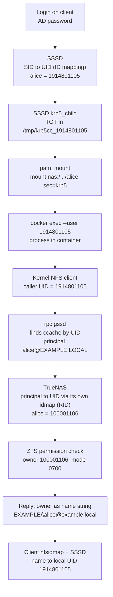

## Introduction

In our shared GPU lab, three things broke in the same few weeks. Files on a user's NFS home showed up as `nobody:nogroup`. A freshly provisioned home dataset came out owned by `root:root` with mode `755` instead of belonging to the user with mode `700`. A student's Jupyter container opened with the prompt `I have no name!` and `sudo` refused to work.

All three came from the same root cause. The same Active Directory user had one UID on the Linux clients and a different UID on the storage server. Neither side was misconfigured on its own terms. In the end, we fixed it by measuring the difference between the two numbers and shifting the storage server's ID range by exactly that amount.

This post follows one identity from login to an NFS file, shows where the mismatch hurts, and covers the fix, a checklist, and alternatives.

## The Setup

The environment has four parts:

- **Domain controller:** a Samba-based AD appliance for the `EXAMPLE.LOCAL` realm.
- **Storage:** TrueNAS SCALE at `nas.example.local` (192.0.2.10), joined to the same domain. Every user gets a separate ZFS dataset, exported over NFSv4 with `sec=krb5` only. Each dataset is owned by its user with mode `0700`. The owner has full access and everyone else has none.
- **Clients:** Ubuntu workstations joined to the domain with SSSD. `pam_mount` mounts the user's dataset at login, and `rpc.gssd` handles the Kerberos side of NFS.
- **Docker:** users run their work (Jupyter, training jobs) in containers. The user's NFS directory is bind-mounted into the container as `/workspace`.

The isolation goal is simple: user A must not be able to read user B's dataset, even with Docker in the picture.

The diagram shows which identity is in effect at each hop, before the fix. The UIDs are examples.



The client's number never reaches the server; it only selects the Kerberos ticket. The server uses the principal and its own number, and the owner comes back as a name. The two numbers never meet, which is why the mismatch could hide.

## Why Containers Must Not Run as Root Here

With `sec=sys`, the server trusts the UID the client sends. With `sec=krb5`, it trusts a Kerberos principal, and the client picks that principal from the UID of the calling process.

### How the client picks a Kerberos identity

Per the `rpc.gssd` man page, user credentials live in a file with "a well-known name constructed using the user's UID", typically in `/tmp`. SSSD writes the ticket cache under exactly that kind of name:

```ini
# /etc/sssd/sssd.conf (domain section, excerpt)
ldap_id_mapping = True
krb5_ccachedir = /tmp
krb5_ccname_template = FILE:%d/krb5cc_%U
krb5_renewable_lifetime = 7d
krb5_renew_interval = 60m
```

`%U` is the login UID and `%d` is `krb5_ccachedir` (`sssd-krb5(5)`). Renewal keeps a long Jupyter session from losing its ticket.

A container shares the host kernel, so when a container process touches `/workspace`, `rpc.gssd` looks for a ticket cache under that process's UID. The container's UID decides which identity the NAS sees.

### What root gets

The `rpc.gssd` man page is explicit about root: "By default rpc.gssd uses the system's machine credentials for UID 0 accesses that require GSS authentication."

So root in the container reaches the NAS as the machine account, which owns none of the `0700` datasets. Root gets *less* access to the user's files than the user. That is good for security, but any setup step that writes to `/workspace` as root fails.

Our launcher used to create Jupyter directories as root and then `chown -R` them to the user. On a Kerberos mount that step cannot work. We replaced it with a `mkdir` run as the user:

```bash
# Create directories AS THE USER (NFS, owner is the user)
docker exec --user "$UID:$GID" "$name" bash -c '
  mkdir -p /workspace/.jupyter/runtime /workspace/.local/bin /workspace/.cache
'
```

On the host, a playbook running `chmod 0755` on a mounted NFS path failed with `PermissionError: [Errno 1] Operation not permitted`. Permissions belong to the server.

### Running as the user, with root kept inside the container

The launcher now starts every interactive shell and Jupyter process with the host UID and GID:

```bash
docker exec -it --user "$(id -u):$(id -g)" "$name" bash -lc 'cd /workspace && exec bash'
```

Docker accepts a numeric UID for `--user`; only a user *name* must exist in the container. A UID with no entry in the image's `/etc/passwd` still runs, and that is where `I have no name!` comes from. Tools that look up the user, `sudo` among them, break too.

So a separate root step runs first to make the image aware of the user:

```bash
docker exec --user 0 "$name" bash -c "
  grep -q ':x:$GID:' /etc/group  || echo '$USER:x:$GID:' >> /etc/group
  id $UID >/dev/null 2>&1        || echo '$USER:x:$UID:$GID::/workspace:/bin/bash' >> /etc/passwd
  grep -q '^$USER:' /etc/shadow  || echo '$USER:*:19999:0:99999:7:::' >> /etc/shadow
  command -v sudo >/dev/null     || (apt-get update && apt-get install -y sudo)
  echo '$USER ALL=(ALL) NOPASSWD:ALL' > /etc/sudoers.d/lab && chmod 0440 /etc/sudoers.d/lab
"
```

Each line in that block fixed a failure we hit:

- We first used `useradd`. Some images do not have it, so the script now writes to `/etc/passwd` and `/etc/group` directly.
- Images built on the Jupyter Docker Stacks start as `jovyan` (UID 1000). Without `--user 0`, the setup ran as `jovyan` and could not write `/etc/passwd`. The result was `I have no name!` and a broken `sudo`.
- A user that exists in `passwd` but not in `shadow` makes `sudo` fail with `account validation failure`. A non-expiring shadow line with a locked password fixes it.

This `sudo` is container root only: users can `apt install`, but on `/workspace` it is the machine account and cannot read anyone's dataset. Access to the Docker daemon itself is a separate problem, covered in a [separate post on Docker authorization](/posts/docker-authz-opa/).

The `jovyan` case fails in a different way. The host has no ticket cache for UID 1000, so `rpc.gssd` has nothing to present. The user's own UID is the only one that works correctly.
<!-- ONUR: The records do not show which exact error a root or jovyan process got on /workspace (Permission denied? Stale file handle? Key has expired?). Fill in if you remember. -->

## The UID Mismatch

### Two ID mapping engines, two numbers

AD identifies users by SID. Every Linux system has to turn a SID into a number, and ours used two different engines.

**On the clients, SSSD.** With the AD provider, `ldap_id_mapping` is true by default. The `sssd-ad(5)` man page says the provider maps "UID and GID values from the objectSID parameter in Active Directory", and that "When ID-mapping is enabled, the uidNumber and gidNumber attributes are ignored." The default range runs from 200,000 to 2,000,200,000 in slices of 200,000. Each domain lands in a slice chosen by a hash of its SID, so the resulting UIDs are large and look arbitrary.

**On TrueNAS, winbind with the RID backend.** TrueNAS joins AD through Samba. Its documentation says that by default it "uses an algorithmic method based on the RID component of the user or group SID", and lists the default domain range as 100000001 to 200000000. Our TrueNAS used this default. The Samba man page gives the formula: `ID = RID - BASE_RID + LOW_RANGE_ID`.

Both engines are deterministic, but they start from different bases. For a user with RID 1105, the client computed `1914801105` and TrueNAS computed `100001106`. Neither was wrong, but they were not the same number.

### Where the mismatch hits, layer by layer

The example UIDs are the values before the fix.

| Layer | Where the identity comes from | Example UID | What the mismatch does here |
|---|---|---|---|
| Client host | SSSD ID mapping from SID | 1914801105 | Consistent on the client. `id -u` returns it, and the launcher passes it to the container. If it is ever sent to TrueNAS as a number, it points to the wrong account or to none. |
| Container | `docker exec --user <host UID>` | 1914801105 | Without a `passwd` entry you get `I have no name!` and `sudo` breaks. As root or `jovyan`, NFS requests do not carry the user's identity. |
| NFS request | `rpc.gssd` finds `/tmp/krb5cc_<UID>`, and the principal goes on the wire | `alice@EXAMPLE.LOCAL` | The number is only a lookup key on the client. The mismatch does not matter here, provided the ticket cache is named after the UID the process actually runs as. |
| TrueNAS file system | Principal to UID through winbind idmap, checked against ZFS ownership | 100001106 | The dataset must be owned by *this* number. If ownership is wrong, the user is locked out of their own `0700` dataset. |
| TrueNAS API `filesystem.setperm` | Whatever the provisioning code sends | 100001106 (correct) or 1914801105 (wrong) | Our name-based call did not apply. The dataset stayed `root:root 755`, so the owner could not write and other users could read. Sending the client's UID would have been just as wrong. |
| NFSv4 name mapping (idmapd) | Server sends `EXAMPLE\alice@example.local`, and the client maps it through NSS (SSSD) | client: 1914801105 | If the client's NFSv4 domain does not match, the name does not map and the file shows as `nobody`. If it matches, the name maps to the client's own UID and the mismatch disappears from view. |

### Symptom 1: `nobody:nogroup`

The client logs were full of this:

```text
nfsidmap: libnfsidmap: Unable to determine the NFSv4 domain; Using 'localdomain' as the NFSv4 domain ...
nfsidmap: nss_getpwnam: name 'EXAMPLE\alice@example.local' does not map into domain 'localdomain'
nfsidmap: nss_name_to_gid: name 'EXAMPLE\domain users@example.local' does not map into domain 'localdomain'
```

NFSv4 sends owners as `user@domain` strings, not numbers (`nfsidmap(5)`), and the client accepts only names from its own NFSv4 domain. If `idmapd.conf` does not set one, the client tries a DNS `_nfsv4idmapdomain` record, then the DNS domain. Ours found neither, fell back to `localdomain`, and every owner became `nobody`.

The fix was one line on every client, plus clearing the cache:

```ini
# /etc/idmapd.conf
[General]
Domain = example.local
```

```bash
sudo nfsidmap -c
```

`nfsidmap -c` clears the keyring of cached mappings. The man page warns that a stale key alone can make ownership show as `nobody`.

After that fix, ownership *looked* correct, and the mismatch became invisible: `ls -l` showed `alice`, `ls -ln` showed `1914801105`, and TrueNAS stored `100001106`.

### Symptom 2: a new dataset owned by `root:root 755`

At first, the share squashed all access to the user (`mapall`), which hid ownership problems. Once we made it Kerberos-only without `mapall`, isolation depended on one thing: each dataset's owner had to be exactly the UID that TrueNAS maps the user's principal to.

The provisioning code set permissions by name:

```python
payload = {
    "path": mount_path,
    "uid": None,
    "user": "EXAMPLE\\alice",
    "group": "EXAMPLE\\domain users",
    "mode": "700",
    "options": {"recursive": True, "traverse": False},
}
```

On our TrueNAS version this did not apply ownership, and new datasets stayed `root:root 755`. Under a Kerberos-only share, the owner cannot write to their own home, and any other authenticated user can read it.
<!-- ONUR: The commit says the name-based call never applied ownership on "SCALE API v2.0". The current API reference (v25.10) does list user/group name fields for filesystem.setperm. Add your TrueNAS version here, and say whether the API returned an error or reported success. -->

### Why this stays quiet

No error ever mentioned a UID. Every tool showed the right *name*, the symptoms had different names in different layers, and Kerberos kept the number off the wire. You only see the mismatch when you put the two numbers side by side.

## The Fix

The fix had two parts. First, make every layer carry the right identity. Second, make the two numbers equal.

### Part 1: the right identity at every hop

1. **Names on the wire.** Every client gets `Domain = example.local` in `idmapd.conf` and runs `nfsidmap -c`, so the owner strings from TrueNAS resolve through SSSD to local users.
2. **Principals for access.** The share accepts only `KRB5`, with no `mapall`/`maproot`. The clients mount with `sec=krb5`, run `rpc.gssd`, keep the ticket cache at a predictable `/tmp/krb5cc_%U`, and renew it.
3. **The user's UID inside the container.** Every process that touches `/workspace` runs with `--user <host UID>:<host GID>`. Root work happens in a separate `--user 0` exec that touches only the container's own files.
4. **Ownership from the server's own lookup.** Provisioning asks TrueNAS which UID it uses for the user, then sets ownership numerically:

```python
uid_resp = self._post("/user/get_user_obj", {"username": username})
user_obj = uid_resp.json() or {}
uid, gid = user_obj.get("pw_uid"), user_obj.get("pw_gid")
if not isinstance(uid, int) or not isinstance(gid, int):
    return {"success": False, "message": "could not resolve uid/gid"}

payload = {
    "path": mount_path,
    "mode": "700",
    "uid": uid,
    "gid": gid,
    "options": {"recursive": True, "traverse": False},
}
resp = self._post("/filesystem/setperm", payload)
```

`user.get_user_obj` returns the `struct passwd` fields for a user, including `pw_uid` and `pw_gid`, and it works for Active Directory accounts too. The TrueNAS API documents `uid` and `gid` in `filesystem.setperm` as numeric owner IDs. If TrueNAS cannot resolve the user, provisioning stops instead of leaving a dataset owned by root.

### Part 2: align the UIDs by shifting the TrueNAS range

Both engines add the user's RID to a fixed base. TrueNAS uses `range_low - BASE_RID`. SSSD uses the start of the slice the domain landed in. The `sssd-ad(5)` page requires `ldap_idmap_range_size` to be at least the highest RID in the domain, so every user fits in that one slice. Because both sides add the same RID, the difference between the two UIDs is the same for every user in the domain. If you move the TrueNAS base by that difference, the numbers become equal.

That is what we did:

1. Pick one user and read their UID on both sides: `id -u` on an Ubuntu client and the UID on TrueNAS.
2. Compute the delta: client UID minus TrueNAS UID.
3. In the TrueNAS Active Directory idmap settings, add the delta to both **Range Low** and **Range High** of the domain entry.
4. Check other users. The delta should now be zero for all of them.
5. Re-own the existing datasets, because every AD UID on TrueNAS has changed.

With the example numbers:

```text
client (SSSD):    alice  RID 1105  ->  1914801105
TrueNAS (RID):    alice  RID 1105  ->  100001106    (range 100000001-200000000)
delta = 1914801105 - 100001106 = 1814799999

new TrueNAS range: 100000001 + delta = 1914800000
                   200000000 + delta = 2014799999
TrueNAS (RID):    alice  RID 1105  ->  1914801105   == client
```

After the change, the UID was the same for every user we checked on the clients, in the containers, and on TrueNAS. `ls -ln` now shows the same number on both sides. Even when a number does cross the boundary, it identifies the right person.

The re-own step is not optional. ZFS stores numeric owners, so every existing dataset still pointed to the old TrueNAS UIDs, and each one had to be re-owned to its user's new UID.

A few limits apply to this trick:

- It depends on SSSD's slice choice. All clients must use the same SSSD ID mapping settings so they all land in the same slice. The man page warns that hash collisions can make slices differ between machines, so check more than one client.
- Users whose RID is above the SSSD range size do not fit the scheme. The man page says lookups fail for them.
- The TrueNAS docs warn that the domain range "must not overlap with local accounts or trusted domain ranges", and that idmap mistakes can assign permissions to the wrong users. Make the change in a maintenance window and verify before users log in.

## How to Check Your Own Setup

**On the client, find out who you are:**

```bash
id                    # UID and GID as SSSD computed them
getent passwd alice   # the same, from NSS
klist                 # the principal and the ticket cache path; it should end in krb5cc_<your UID>
```

If the cache name does not contain your `id -u`, `rpc.gssd` cannot find it; check `krb5_ccname_template`.

**On TrueNAS, find out who the server thinks you are** (from the TrueNAS shell):

```bash
id 'EXAMPLE\alice'
midclt call user.get_user_obj '{"username": "alice"}'
```

Compare `pw_uid` with the client's `id -u`. If they differ, compute the delta for two or three users. If the delta is the same for all of them, the range shift above will work.

**Check the NFS mount and the name mapping:**

```bash
findmnt -t nfs4 -o TARGET,SOURCE,OPTIONS   # look for sec=krb5 and vers=4.x
nfsidmap -d                                # effective NFSv4 domain; must not be "localdomain"
grep -E '^\s*Domain' /etc/idmapd.conf
systemctl is-active rpc-gssd
journalctl -t nfsidmap --since today       # "does not map into domain" means wrong domain
```

**Check ownership both ways:**

```bash
ls -l  ~/nfs-home     # names: should show alice, never nobody
ls -ln ~/nfs-home     # numbers: after alignment, the same UID as on TrueNAS
```

On TrueNAS, `ls -ln /mnt/pool/users/alice` should show the same UID with mode `drwx------`.

**Inside the container:**

```bash
docker exec --user "$(id -u):$(id -g)" mybox sh -c 'id; whoami; ls -ln /workspace | head'
```

`whoami` should print a name, and `/workspace` should show the same UID. Repeat with `--user 0`: listing `/workspace` should fail. If it succeeds, check the share's `maproot` and the dataset's mode.

## Alternatives

**SSSD on POSIX attributes.** Store `uidNumber`/`gidNumber` in AD for every user, set `ldap_id_mapping = False` in SSSD, and select the AD (RFC2307) idmap backend on TrueNAS. Both sides read the same stored number, independent of any slice or range. The costs:

- Every account needs those attributes, assigned uniquely and forever by your provisioning.
- The SSSD man page recommends replicating them to the Global Catalog for performance.
- The man page warns that changing ID mapping options "will cause user and group IDs to change", so every home directory on the clients has to be re-owned.

**Two UID spaces.** Leave the numbers different and rely on Kerberos plus idmapd names, always setting ownership from the server's own lookup. Nothing is migrated, but everyone must know never to send a client UID to the server, which rules out `sec=sys`, NFSv3, and careless numeric backups. We ran like this for a while; it is how the mismatch stayed hidden. (Replacing SSSD with winbind on the clients would also give one algorithm on both sides, at the cost of a new identity stack.)

**The approach we used: shift the TrueNAS RID range.** It changes one setting on one server, and it touches neither AD nor the clients. The cost is a one-time re-own of the existing datasets and a dependency on SSSD's slice. If the SSSD ID mapping settings change, or a client lands in a different slice, the delta comes back. For a lab with one NAS and identical clients, that was the cheapest way to get one UID per user everywhere.

## Conclusion

With NFSv4 and Kerberos, identity on the wire is a principal plus a name string, and a numeric UID exists only inside each system. That let our clients and our NAS disagree about every UID with nothing visibly wrong. The problems appeared where a number or a name crossed a boundary: an idmapd domain that defaulted to `localdomain`, a permission call that did not apply ownership, and containers that ran as root or as the image's built-in user instead of the person at the keyboard.

Three rules came out of this:

- Run container processes that touch Kerberos NFS as the user's host UID, and keep root work inside the container.
- Set ownership on the server with the UID the server itself resolves.
- Compare `id -u` on the client with the server's UID for the same user. If they differ by a constant, shift the server's RID range by that amount and re-own the data.

## References

- `rpc.gssd(8)`, credential cache lookup and machine credentials for UID 0: https://man7.org/linux/man-pages/man8/rpc.gssd.8.html
- `nfsidmap(5)`, NFSv4 `user@domain` names, `-c`, `-d`, stale keys showing as nobody: https://man7.org/linux/man-pages/man5/nfsidmap.5.html
- `idmapd.conf(5)`, `Domain` and its default: https://linux.die.net/man/5/idmapd.conf
- `sssd-ad(5)`, `ldap_id_mapping`, ID ranges and slices, `ldap_idmap_range_size`: https://man.archlinux.org/man/sssd-ad.5.en
- `sssd-krb5(5)`, `krb5_ccname_template`, renewal options: https://man.archlinux.org/man/sssd-krb5.5.en
- Samba `idmap_rid(8)`: https://www.samba.org/samba/docs/current/man-html/idmap_rid.8.html
- TrueNAS, Configuring Active Directory (idmap backends and warnings): https://www.truenas.com/docs/scale/credentials/directoryservices/configad/
- TrueNAS, Directory Services Screens (Range Low/High, default ranges): https://www.truenas.com/docs/scale/credentials/directoryservices/directoryservicesscreens/
- TrueNAS API, `filesystem.setperm`: https://api.truenas.com/v25.10/api_methods_filesystem.setperm.html
- TrueNAS API, `user.get_user_obj`: https://api.truenas.com/v25.10/api_methods_user.get_user_obj.html
- Docker, running containers (default user, `--user`, numeric UIDs): https://docs.docker.com/engine/containers/run/
- Docker CLI, `docker container exec`: https://docs.docker.com/reference/cli/docker/container/exec/
