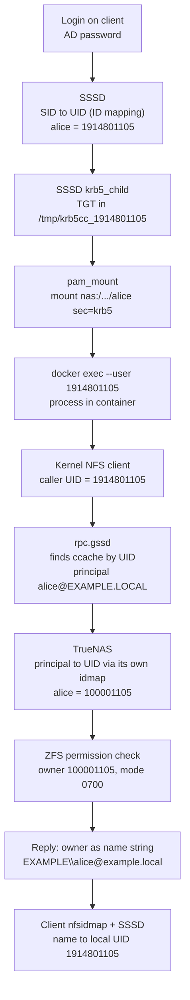

## Introduction

In our shared GPU lab, three things broke in the same few weeks. Files on a user's NFS home showed up as `nobody:nogroup`. A freshly provisioned home dataset came out owned by `root:root` with mode `755` instead of belonging to the user with mode `700`. A student's Jupyter container opened with the prompt `I have no name!` and `sudo` refused to work.
<!-- ONUR: Confirm this framing. The three symptoms are from the incident notes; there is no record of the exact moment you remember as "the system went crazy". -->

All three came from the same root cause. The same Active Directory user had one UID on the Linux clients and a different UID on the storage server. Neither side was misconfigured on its own terms.

This post follows one user's identity from login to a file on NFS, shows where the mismatch hurts and why it stays hidden, and ends with the fix, a checklist, and the alternatives.

## The Setup

The environment has four parts:

- **Domain controller:** a Samba-based AD appliance for the `EXAMPLE.LOCAL` realm.
- **Storage:** TrueNAS SCALE at `nas.example.local` (192.0.2.10), joined to the same domain. Every user gets a separate ZFS dataset, exported over NFSv4 with `sec=krb5` only. Each dataset is owned by its user with mode `0700`. The owner has full access and everyone else has none.
- **Clients:** Ubuntu workstations joined to the domain with SSSD. `pam_mount` mounts the user's dataset at login, and `rpc.gssd` handles the Kerberos side of NFS.
- **Docker:** users run their work (Jupyter, training jobs) in containers. The user's NFS directory is bind-mounted into the container as `/workspace`.

The isolation goal is simple: user A must not be able to read user B's dataset, even with Docker in the picture.

The diagram shows which identity is in effect at each hop. The UIDs are examples.



The client's number never reaches the server; it is only used to find the right Kerberos ticket. The server works with the principal and its own number, and the owner comes back as a name. As long as each translation works, the two numbers never meet.

## Why Containers Must Not Run as Root Here

With `sec=sys`, the server trusts whatever UID the client sends. With `sec=krb5`, it trusts a Kerberos principal instead. The client still has to decide which principal to use for a request, and it does that by looking at the UID of the process that made the request.

### How the client picks a Kerberos identity

The `rpc.gssd` man page explains the lookup. User credentials are stored in a file with "a well-known name constructed using the user's UID", typically in `/tmp`. In our clients, SSSD writes the ticket cache to exactly that kind of name:

```ini
# /etc/sssd/sssd.conf (domain section, excerpt)
ldap_id_mapping = True
krb5_ccachedir = /tmp
krb5_ccname_template = FILE:%d/krb5cc_%U
krb5_renewable_lifetime = 7d
krb5_renew_interval = 60m
```

In `krb5_ccname_template`, `%U` is the login UID and `%d` is `krb5_ccachedir` (see `sssd-krb5(5)`). The renewal settings keep a long Jupyter session from losing its ticket halfway through.

A container shares the host kernel. When a process inside the container touches `/workspace`, the host's NFS client sees that process's UID, and `rpc.gssd` looks for a ticket cache under that UID. So the container's UID decides which Kerberos identity the NFS server sees.

### What root gets

The `rpc.gssd` man page is explicit about root: "By default rpc.gssd uses the system's machine credentials for UID 0 accesses that require GSS authentication."

A root process in the container therefore reaches the NAS as the machine account, not as the user. The machine account owns none of the user datasets, and they are all `0700`. So root inside the container gets less access to the user's files than the user does. This is a security property, but it also breaks things in practice. Any setup step that runs as root and writes to `/workspace` will fail.

Our launcher used to create Jupyter directories as root and then `chown -R` them to the user. On a Kerberos mount that step cannot work. We replaced it with a `mkdir` run as the user:

```bash
# Create directories AS THE USER (NFS, owner is the user)
docker exec --user "$UID:$GID" "$name" bash -c '
  mkdir -p /workspace/.jupyter/runtime /workspace/.local/bin /workspace/.cache
'
```

The same thing happens on the host. A playbook that ran `chmod 0755` on an already mounted NFS path failed with `PermissionError: [Errno 1] Operation not permitted`. The permissions belong to the server, and the client cannot change them.

### Running as the user, with root kept inside the container

The launcher now starts every interactive shell and Jupyter process with the host UID and GID:

```bash
docker exec -it --user "$(id -u):$(id -g)" "$name" bash -lc 'cd /workspace && exec bash'
```

The Docker documentation lets you pass a numeric UID to `--user`. Only a user *name* has to exist in the container. A numeric UID with no entry in the image's `/etc/passwd` still runs, and that is where `I have no name!` comes from. Bash prints that prompt when it cannot resolve the current UID to a name. Tools that look up the user also break, and `sudo` is one of them.

So a separate root step runs first to make the image aware of the user:

```bash
docker exec --user 0 "$name" bash -c "
  grep -q ':x:$GID:' /etc/group  || echo '$USER:x:$GID:' >> /etc/group
  id $UID >/dev/null 2>&1        || echo '$USER:x:$UID:$GID::/workspace:/bin/bash' >> /etc/passwd
  grep -q '^$USER:' /etc/shadow  || echo '$USER:*:19999:0:99999:7:::' >> /etc/shadow
  command -v sudo >/dev/null     || (apt-get update && apt-get install -y sudo)
  echo '$USER ALL=(ALL) NOPASSWD:ALL' > /etc/sudoers.d/lab && chmod 0440 /etc/sudoers.d/lab
"
```

Each line in that block fixed a failure we hit:

- We first used `useradd`. Some images do not have it, so the script now writes to `/etc/passwd` and `/etc/group` directly.
- Images built on the Jupyter Docker Stacks start as `jovyan` (UID 1000). Without `--user 0`, the setup ran as `jovyan` and could not write `/etc/passwd`. The result was `I have no name!` and a broken `sudo`.
- A user that exists in `passwd` but not in `shadow` makes `sudo` fail with `account validation failure`. A non-expiring shadow line with a locked password fixes it.

`sudo` only works inside the container, so users can `apt install` into their own environment. That root reaches the NAS as the machine account, so it cannot read another user's dataset. Access to the Docker daemon itself is a separate problem, covered in a [separate post on Docker authorization](/posts/docker-authz-opa/).

The `jovyan` case fails in a different way. The host has no ticket cache for UID 1000, so `rpc.gssd` has nothing to present. The user's own UID is the only one that works correctly.
<!-- ONUR: The records do not show which exact error a root or jovyan process got on /workspace (Permission denied? Stale file handle? Key has expired?). Fill in if you remember. -->

## The UID Mismatch

### Two ID mapping engines, two numbers

Active Directory identifies users by SID, not by UID. Every Linux system that sees AD users has to turn a SID into a number, and our two systems use different engines for it.

**On the clients, SSSD.** With the AD provider, `ldap_id_mapping` is true by default. The `sssd-ad(5)` man page says the provider maps "UID and GID values from the objectSID parameter in Active Directory", and that "When ID-mapping is enabled, the uidNumber and gidNumber attributes are ignored." The default range runs from 200,000 to 2,000,200,000 in slices of 200,000. Each domain lands in a slice chosen by a hash of its SID, so the resulting UIDs are large and look arbitrary.

**On TrueNAS, winbind.** TrueNAS joins AD through Samba. Its documentation says that by default it "uses an algorithmic method based on the RID component of the user or group SID", which is the RID backend. The Samba man page gives the formula: `ID = RID - BASE_RID + LOW_RANGE_ID`.
<!-- ONUR: Confirm the lab's TrueNAS uses the default RID backend and note its range_low. The records only show that TrueNAS resolves its own UID. -->

Both engines are deterministic, but they use different formulas. For the same user, the client might compute `1914801105` and TrueNAS `100001105`. Neither is wrong, but they are not the same number.

### Where the mismatch hits, layer by layer

| Layer | Where the identity comes from | Example UID | What the mismatch does here |
|---|---|---|---|
| Client host | SSSD ID mapping from SID | 1914801105 | Consistent on the client. `id -u` returns it, and the launcher passes it to the container. If it is ever sent to TrueNAS as a number, it points to the wrong account or to none. |
| Container | `docker exec --user <host UID>` | 1914801105 | Without a `passwd` entry you get `I have no name!` and `sudo` breaks. As root or `jovyan`, NFS requests do not carry the user's identity. |
| NFS request | `rpc.gssd` finds `/tmp/krb5cc_<UID>`, and the principal goes on the wire | `alice@EXAMPLE.LOCAL` | The number is only a lookup key on the client. The mismatch does not matter here, provided the ticket cache is named after the UID the process actually runs as. |
| TrueNAS file system | Principal to UID through winbind idmap, checked against ZFS ownership | 100001105 | The dataset must be owned by *this* number. If ownership is wrong, the user is locked out of their own `0700` dataset. |
| TrueNAS API `filesystem.setperm` | Whatever the provisioning code sends | 100001105 (correct) or 1914801105 (wrong) | Our name-based call did not apply. The dataset stayed `root:root 755`, so the owner could not write and other users could read. Sending the client's UID would be just as wrong. |
| NFSv4 name mapping (idmapd) | Server sends `EXAMPLE\alice@example.local`, and the client maps it through NSS (SSSD) | client: 1914801105 | If the client's NFSv4 domain does not match, the name does not map and the file shows as `nobody`. If it matches, the name maps to the client's own UID and the mismatch disappears from view. |

### Symptom 1: `nobody:nogroup`

The client logs were full of this:

```text
nfsidmap: libnfsidmap: Unable to determine the NFSv4 domain; Using 'localdomain' as the NFSv4 domain ...
nfsidmap: nss_getpwnam: name 'EXAMPLE\alice@example.local' does not map into domain 'localdomain'
nfsidmap: nss_name_to_gid: name 'EXAMPLE\domain users@example.local' does not map into domain 'localdomain'
```

NFSv4 sends owners as `user@domain` strings, not as numbers (`nfsidmap(5)`). The client accepts only names from its own NFSv4 domain. `idmapd.conf(5)` describes that domain as "a namespace with a unique username<->UID and groupname<->GID mapping". If it is not set, the client tries a DNS `_nfsv4idmapdomain` record and then the DNS domain. Our workstations could not determine a domain either way, so they fell back to `localdomain`, and every owner turned into `nobody`.

The fix was one line on every client, plus clearing the cache:

```ini
# /etc/idmapd.conf
[General]
Domain = example.local
```

```bash
sudo nfsidmap -c
```

`nfsidmap -c` clears the keyring of cached mappings. The man page warns that a stale key alone can make ownership show as `nobody`.

After the fix, ownership looked correct and the mismatch became *invisible*: `ls -l` showed `alice`, `ls -ln` showed `1914801105`, and TrueNAS stored `100001105`.

### Symptom 2: a new dataset owned by `root:root 755`

At first, the share squashed all access to the user (`mapall`), which hid ownership problems. Once we made it Kerberos-only without `mapall`, isolation depended on one thing: each dataset's owner had to be exactly the UID that TrueNAS maps the user's principal to.

The provisioning code set permissions by name:

```python
payload = {
    "path": mount_path,
    "uid": None,
    "user": "EXAMPLE\\alice",
    "group": "EXAMPLE\\domain users",
    "mode": "700",
    "options": {"recursive": True, "traverse": False},
}
```

On our TrueNAS version this did not apply ownership, and new datasets stayed `root:root 755`. Under a Kerberos-only share, the owner cannot write to their own home, and any other authenticated user can read it.
<!-- ONUR: The commit says the name-based call never applied ownership on "SCALE API v2.0". The current API reference (v25.10) does list user/group name fields for filesystem.setperm. Add your TrueNAS version here, and say whether the API returned an error or reported success. -->

### Why this stays quiet

The mismatch never produced an error that mentioned UIDs:

- Every system is correct by its own rules, and every tool shows the right *name*.
- The symptoms have different names in different layers: `nobody`, `root:root 755`, `I have no name!`.
- Kerberos hides the number on the wire. It only matters where a number crosses the boundary: a permission API call, a `sec=sys` mount, a restore with numeric owners, a `chown` from the client.

You only see it when you put the two numbers side by side.

## The Fix

We did not try to make the numbers equal. Instead, we made sure no number ever crosses from one side to the other:

1. **Names on the wire.** Every client gets `Domain = example.local` in `idmapd.conf` and runs `nfsidmap -c`, so the owner strings from TrueNAS resolve through SSSD to local users.
2. **Principals for access.** The share accepts only `KRB5`, with no `mapall`/`maproot`. The clients mount with `sec=krb5`, run `rpc.gssd`, keep the ticket cache at a predictable `/tmp/krb5cc_%U`, and renew it. The NAS decides access based on the principal.
3. **The user's UID inside the container.** Every process that touches `/workspace` runs with `--user <host UID>:<host GID>`, so `rpc.gssd` finds the user's ticket. Root work happens in a separate `--user 0` exec that touches only the container's own files.
4. **The server's UID for ownership.** Provisioning asks TrueNAS which UID *it* uses for the user, then sets ownership numerically:

```python
uid_resp = self._post("/user/get_user_obj", {"username": username})
user_obj = uid_resp.json() or {}
uid, gid = user_obj.get("pw_uid"), user_obj.get("pw_gid")
if not isinstance(uid, int) or not isinstance(gid, int):
    return {"success": False, "message": "could not resolve uid/gid"}

payload = {
    "path": mount_path,
    "mode": "700",
    "uid": uid,
    "gid": gid,
    "options": {"recursive": True, "traverse": False},
}
resp = self._post("/filesystem/setperm", payload)
```

`user.get_user_obj` returns the `struct passwd` fields for a user, including `pw_uid` and `pw_gid`, and it works for Active Directory accounts too. The TrueNAS API documents `uid` and `gid` in `filesystem.setperm` as numeric owner IDs.

This works because one component now answers both questions: TrueNAS maps the principal to a UID when it checks access, and TrueNAS chose the UID that owns the dataset. The client's UID is used only to find the ticket cache, which SSSD names after that same UID. Each side stays consistent within itself.

The check fails loudly on purpose. If TrueNAS cannot resolve the user, provisioning stops and does not create a dataset owned by root.

## How to Check Your Own Setup

Run these as the affected user, then compare the results across systems.

**On the client, find out who you are:**

```bash
id                    # UID and GID as SSSD computed them
getent passwd alice   # the same, from NSS
klist                 # the principal and the ticket cache path; it should end in krb5cc_<your UID>
```

If `klist` shows no ticket, or the cache name does not contain the UID that `id -u` printed, `rpc.gssd` cannot find it. Check `krb5_ccname_template` in `sssd.conf`.

**On TrueNAS, find out who the server thinks you are** (from the TrueNAS shell):

```bash
id 'EXAMPLE\alice'
midclt call user.get_user_obj '{"username": "alice"}'
```

Compare `pw_uid` with the `id -u` output from the client. If they differ, you have two UID spaces. That is fine as long as nothing sends numbers across.

**Check the NFS mount and the name mapping:**

```bash
findmnt -t nfs4 -o TARGET,SOURCE,OPTIONS   # look for sec=krb5 and vers=4.x
nfsidmap -d                                # effective NFSv4 domain; must not be "localdomain"
grep -E '^\s*Domain' /etc/idmapd.conf
systemctl is-active rpc-gssd
journalctl -t nfsidmap --since today       # "does not map into domain" means wrong domain
```

**Check ownership both ways:**

```bash
ls -l  ~/nfs-home     # names: should show alice, never nobody
ls -ln ~/nfs-home     # numbers: should show the client's UID, not the server's
```

On TrueNAS, `ls -ln /mnt/pool/users/alice` should show the server's UID, mode `drwx------`.

**Inside the container:**

```bash
docker exec --user "$(id -u):$(id -g)" mybox sh -c 'id; whoami; ls -ln /workspace | head'
```

`id` should print the host UID, and `whoami` should print a name, not an error. Files in `/workspace` should show the same UID. Then repeat with `--user 0` and try to list `/workspace`. On a Kerberos mount without machine-account access to the dataset, that should fail. If it succeeds, check the share's `maproot` setting and the dataset's mode.

## Alternatives: Align the UIDs or Live With Two

The other option is to make both sides compute the same number. There are two common ways to do it.

**SSSD on POSIX attributes.** Store `uidNumber`/`gidNumber` in AD for every user, set `ldap_id_mapping = False` in SSSD, and select the AD (RFC2307) idmap backend on TrueNAS. Both sides then read the same stored number. The costs:

- Every account needs those attributes. Provisioning has to assign them uniquely and forever.
- The SSSD man page recommends replicating them to the Global Catalog for performance.
- Changing this on a running system changes every user's UID. The man page warns that changing the ID mapping options "will cause user and group IDs to change", which means re-owning every home directory and every file on the NAS.
- TrueNAS warns that only experienced administrators should customize idmap, because "Misconfiguration can lead to permissions incorrectly assigned to users or groups", especially for data accessed over NFS.

**Same algorithm on both sides.** Use winbind with the same `idmap_rid` range on the clients, or tune SSSD toward winbind. SSSD has `ldap_idmap_autorid_compat`, but that targets winbind's *autorid*, and the man page calls it non-deterministic. It does not reproduce `idmap_rid`. In practice this means changing the client identity stack.

**The approach we used: two UID spaces, nothing numeric crosses.** Nothing in AD or on existing datasets changes, and SSSD keeps its zero-configuration ID mapping. The cost is a rule everyone has to know: *never send a client UID to the server*. That rules out `sec=sys` and NFSv3 for these shares, and any backup or migration tool that preserves numeric owners needs care.

For a lab with one NAS and Kerberos everywhere, the second approach was cheaper. With several NFS servers, `sec=sys` clients, or tools that pass numeric IDs around, aligning the UIDs once is worth the migration.

## Conclusion

With NFSv4 and Kerberos, identity on the wire is a principal plus a name string; a numeric UID exists only inside each system. That let our clients and NAS disagree about every UID with nothing visibly wrong. The problems appeared where a number or name crossed a boundary: an idmapd domain that defaulted to `localdomain`, a permission call that did not apply ownership, and containers that ran as root or as the image's user instead of the person at the keyboard.

Three rules came out of this:

- Run container processes that touch Kerberos NFS as the user's host UID, and keep root work inside the container.
- Set ownership on the server with the server's own UID.
- Compare `id -u` on the client with the server's UID for the same user before you trust any numeric owner.

## References

- `rpc.gssd(8)`, credential cache lookup and machine credentials for UID 0: https://man7.org/linux/man-pages/man8/rpc.gssd.8.html
- `nfsidmap(5)`, NFSv4 `user@domain` names, `-c`, `-d`, stale keys showing as nobody: https://man7.org/linux/man-pages/man5/nfsidmap.5.html
- `idmapd.conf(5)`, `Domain` and its default: https://linux.die.net/man/5/idmapd.conf
- `sssd-ad(5)`, `ldap_id_mapping`, ID ranges, `ldap_idmap_autorid_compat`: https://man.archlinux.org/man/sssd-ad.5.en
- `sssd-krb5(5)`, `krb5_ccname_template`, renewal options: https://man.archlinux.org/man/sssd-krb5.5.en
- Samba `idmap_rid(8)`: https://www.samba.org/samba/docs/current/man-html/idmap_rid.8.html
- TrueNAS, Configuring Active Directory (idmap backends and warnings): https://www.truenas.com/docs/scale/credentials/directoryservices/configad/
- TrueNAS, Directory Services Screens: https://www.truenas.com/docs/scale/credentials/directoryservices/directoryservicesscreens/
- TrueNAS API, `filesystem.setperm`: https://api.truenas.com/v25.10/api_methods_filesystem.setperm.html
- TrueNAS API, `user.get_user_obj`: https://api.truenas.com/v25.10/api_methods_user.get_user_obj.html
- Docker, running containers (default user, `--user`, numeric UIDs): https://docs.docker.com/engine/containers/run/
- Docker CLI, `docker container exec`: https://docs.docker.com/reference/cli/docker/container/exec/
