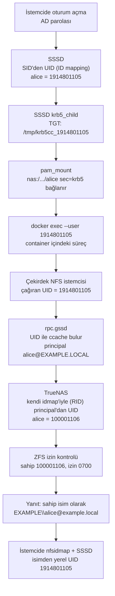

## Giriş

Paylaşımlı, çok kullanıcılı Linux iş istasyonlarında birkaç hafta içinde birkaç ayrı şey bozuldu. Kullanıcının NFS üzerindeki ev dizininde dosyalar `nobody:nogroup` olarak görünmeye başladı. Share'i sıkılaştırdıktan sonra kullanıcı, `ls` onu sahip olarak gösterdiği halde kendi ev dizinine yazamaz oldu. Yeni açılan bir kullanıcı dataset'i, kullanıcıya ait ve `700` izinli olması gerekirken `root:root` sahipliğinde ve `755` izinli çıktı. Bir kullanıcının Jupyter container'ı `I have no name!` istemiyle açıldı ve `sudo` çalışmadı.

Bunların çoğunun kök nedeni aynıydı. Aynı Active Directory kullanıcısının Linux istemcilerde bir UID'si, depolama sunucusunda başka bir UID'si vardı. İki taraf da kendi kurallarına göre doğru yapılandırılmıştı. Sonunda istemcilerin kullandığı tabanı hesaplayıp depolama sunucusunun ID aralığını aynı sayıdan başlattık. Erişimin çalışması için aynı yol üzerindeki iki eşlemenin daha, biri istemcide biri sunucuda, düzeltilmesi gerekti.

Bu yazı bir kullanıcının kimliğini oturum açmadan NFS üzerindeki bir dosyaya kadar takip ediyor. Uyuşmazlığın nerede sorun çıkardığını ve neden çoğu zaman gizli kaldığını gösteriyor. Sonunda çözümü, kendi kurulumunuz için bir kontrol listesini ve alternatifleri anlatıyor.

## Kurulum

Ortam dört parçadan oluşuyor:

- **Domain controller:** `EXAMPLE.LOCAL` realm'i için Samba tabanlı bir AD cihazı.
- **Depolama:** `nas.example.local` (192.0.2.10) adresinde, aynı domain'e bağlı TrueNAS SCALE. Her kullanıcının ayrı bir ZFS dataset'i var ve bunlar NFSv4 üzerinden yalnızca `sec=krb5` ile paylaşılıyor. Her dataset'in sahibi kendi kullanıcısı, izni `0700`. Sahibi tam yetkili, diğer herkesin yetkisi yok.
- **İstemciler:** SSSD ile domain'e bağlı Ubuntu iş istasyonları. `pam_mount` oturum açılırken kullanıcının dataset'ini bağlıyor, NFS'in Kerberos tarafını `rpc.gssd` yürütüyor.
- **Docker:** Kullanıcılar işlerini (Jupyter, eğitim işleri) container'larda çalıştırıyor. Kullanıcının NFS dizini container'a `/workspace` olarak bind mount ediliyor.

İzolasyon hedefi basit: Docker devreye girse bile A kullanıcısı B kullanıcısının dataset'ini okuyamamalı.

Diyagram, düzeltmeden önce her adımda hangi kimliğin geçerli olduğunu gösteriyor. UID'ler örnektir.



İstemcinin hesapladığı sayı sunucuya hiç ulaşmaz. Yalnızca doğru Kerberos biletini bulmak için kullanılır. Sunucu principal ile ve kendi sayısıyla çalışır, sahip bilgisi istemciye isim olarak geri döner. Her çeviri adımı çalıştığı sürece iki sayı hiç karşılaşmaz. Uyuşmazlığın bu kadar uzun süre gizli kalabilmesinin nedeni de budur.

## Container'lar Neden Burada Root Olarak Çalışmamalı

`sec=sys` kullanıldığında sunucu, istemcinin gönderdiği UID'ye güvenir. `sec=krb5` kullanıldığında ise bir Kerberos principal'ına güvenir. İstemcinin yine de her istek için hangi principal'ı kullanacağına karar vermesi gerekir ve bunu isteği yapan sürecin UID'sine bakarak yapar.

### İstemci Kerberos kimliğini nasıl seçer

`rpc.gssd` man sayfası bu aramayı anlatır. Kullanıcının kimlik bilgileri, adı kullanıcının UID'sinden üretilen bir dosyada durur. Bu dosya genellikle `/tmp` altındadır. Bizim istemcilerde SSSD bilet önbelleğini tam olarak bu biçimde bir isimle yazar:

```ini
# /etc/sssd/sssd.conf (domain bölümü, kısaltılmış)
ldap_id_mapping = True
krb5_ccachedir = /tmp
krb5_ccname_template = FILE:%d/krb5cc_%U
krb5_renewable_lifetime = 7d
krb5_renew_interval = 60m
```

`krb5_ccname_template` içinde `%U` oturum açan kullanıcının UID'sidir, `%d` ise `krb5_ccachedir` değeridir (bkz. `sssd-krb5(5)`). Yenileme ayarları, uzun süren bir Jupyter oturumunun biletini yarı yolda kaybetmesini önler.

Container host'un çekirdeğini paylaşır. Container içindeki bir süreç `/workspace`'e eriştiğinde host'un NFS istemcisi o sürecin UID'sini görür ve `rpc.gssd` bilet önbelleğini o UID'ye göre arar. Yani NFS sunucusunun hangi Kerberos kimliğini göreceğini container'daki UID belirler.

### Root ne elde eder

`rpc.gssd` man sayfası root konusunda açıktır: varsayılan olarak, GSS kimlik doğrulaması gerektiren UID 0 erişimlerinde makinenin kendi kimlik bilgileri (machine credentials) kullanılır.

Bu nedenle container içindeki root süreci NAS'a kullanıcı olarak değil, makine hesabı olarak ulaşır. Makine hesabı hiçbir kullanıcı dataset'inin sahibi değildir ve hepsi `0700` izinlidir. Sonuçta container içindeki root, kullanıcının dosyalarına kullanıcının kendisinden daha az erişebilir. Bu güvenlik açısından iyidir, ama pratikte bazı şeyleri bozar. Root olarak çalışıp `/workspace`'e yazan her kurulum adımı başarısız olur.

Bizde sorun daha da erken başladı. Başlatıcı container'ları root olarak ve `-w /workspace` ile başlatıyordu. Share yalnızca Kerberos kabul eder hale gelince container hiç açılmaz oldu: çalışma ortamının `/workspace`'e yaptığı `chdir` root olarak çalıştı ve reddedildi. Çözüm, container'ı `-w /` ile başlatmak oldu. Böylece root NFS yoluna hiç dokunmuyor, `/workspace`'e yalnızca kullanıcı olarak çalışan exec'lerde geçiliyor.

Başlatıcı betiğimiz eskiden Jupyter dizinlerini root olarak oluşturup ardından `chown -R` ile kullanıcıya veriyordu. Kerberos ile bağlı bir dizinde bu adım çalışamaz. Bu adımı kullanıcı olarak çalışan bir `mkdir` ile değiştirdik:

```bash
# Dizinleri KULLANICI olarak oluştur (NFS, sahibi kullanıcı)
docker exec --user "$UID:$GID" "$name" bash -c '
  mkdir -p /workspace/.jupyter/runtime /workspace/.local/bin /workspace/.cache
'
```

Aynı durum host'ta da yaşandı. Zaten bağlı olan bir NFS yoluna `chmod 0755` uygulayan bir playbook `PermissionError: [Errno 1] Operation not permitted` hatasıyla durdu. İzinler sunucuya aittir ve istemci onları değiştiremez.

### Kullanıcı olarak çalışmak, root'u container içinde tutmak

Başlatıcı artık her etkileşimli kabuğu ve Jupyter sürecini host'taki UID ve GID ile başlatıyor:

```bash
docker exec -it --user "$(id -u):$(id -g)" "$name" bash -lc 'cd /workspace && exec bash'
```

Docker dokümanına göre `--user` seçeneğine sayısal bir UID verilebilir. Container içinde var olması gereken yalnızca kullanıcı *adıdır*. İmajın `/etc/passwd` dosyasında karşılığı olmayan sayısal bir UID de çalışır. `I have no name!` istemi de buradan gelir. Bash, geçerli UID'yi bir isme çeviremediğinde bu istemi gösterir. Kullanıcıyı sorgulayan araçlar da bozulur, `sudo` da bunlardan biridir.

Bu yüzden önce, imajın kullanıcıyı tanıması için ayrı bir root adımı çalışır:

```bash
docker exec --user 0 "$name" bash -c "
  grep -q ':x:$GID:' /etc/group  || echo '$USER:x:$GID:' >> /etc/group
  id $UID >/dev/null 2>&1        || echo '$USER:x:$UID:$GID::/workspace:/bin/bash' >> /etc/passwd
  grep -q '^$USER:' /etc/shadow  || echo '$USER:*:19999:0:99999:7:::' >> /etc/shadow
  command -v sudo >/dev/null     || (apt-get update && apt-get install -y sudo)
  echo '$USER ALL=(ALL) NOPASSWD:ALL' > /etc/sudoers.d/lab && chmod 0440 /etc/sudoers.d/lab
"
```

Bu bloktaki her satır karşılaştığımız bir hatayı düzeltti:

- İlk sürüm `useradd` kullanıyordu. Bazı imajlarda bu komut yok, bu yüzden betik artık `/etc/passwd` ve `/etc/group` dosyalarına doğrudan yazıyor.
- Jupyter Docker Stacks tabanlı imajlar `jovyan` (UID 1000) kullanıcısıyla başlar. `--user 0` olmadan kurulum adımı `jovyan` olarak çalıştı ve `/etc/passwd` dosyasına yazamadı. Sonuç `I have no name!` ve çalışmayan bir `sudo` oldu.
- `passwd` içinde olup `shadow` içinde olmayan bir kullanıcı, `sudo`'nun `account validation failure` hatası vermesine yol açar. Süresi dolmayan, parolası kilitli bir shadow satırı bunu çözer.

`sudo` yalnızca container içinde çalışır, böylece kullanıcılar kendi ortamlarına `apt install` yapabilir. Bu root NAS'a makine hesabı olarak ulaştığı için başka bir kullanıcının dataset'ini okuyamaz. Docker daemon'una erişimin kendisi ayrı bir sorundur. Onu [Docker authorization üzerine ayrı bir yazıda](/posts/docker-authz-opa/) anlattım.

`jovyan` durumu farklı bir şekilde bozulur. Host'ta UID 1000 için bir bilet önbelleği yoktur, dolayısıyla `rpc.gssd`'nin sunabileceği bir kimlik yoktur. Doğru çalışan tek UID kullanıcının kendi UID'sidir.

## UID Uyuşmazlığı

### İki ID eşleme motoru, iki sayı

Active Directory kullanıcıları UID ile değil SID ile tanır. AD kullanıcılarını gören her Linux sistemi bir SID'i sayıya çevirmek zorundadır ve bizim iki sistemimiz bunun için farklı motorlar kullanıyor.

**İstemcilerde SSSD.** AD sağlayıcısında `ldap_id_mapping` varsayılan olarak açıktır. `sssd-ad(5)` man sayfasına göre sağlayıcı, UID ve GID değerlerini AD'deki `objectSID` alanından üretir. ID eşleme açıkken `uidNumber` ve `gidNumber` alanları yok sayılır. Varsayılan aralık 200.000'den 2.000.200.000'e kadar uzanır ve 200.000'lik dilimlere bölünür. Her domain, SID'inin hash'iyle seçilen bir dilime düşer. Bu yüzden ortaya çıkan UID'ler büyük ve rastgele görünen sayılardır.

**TrueNAS'ta winbind ve RID backend'i.** TrueNAS AD'ye Samba üzerinden bağlanır. Dokümanına göre varsayılan olarak, kullanıcı ya da grup SID'inin RID bileşenine dayalı algoritmik bir yöntem kullanır. Varsayılan domain aralığı 100000001 ile 200000000 arasıdır. Bizim TrueNAS da bu varsayılanı kullanıyordu. Samba man sayfası formülü şöyle verir: `ID = RID - BASE_RID + LOW_RANGE_ID`.

İki motor da deterministiktir, ama farklı tabanlardan başlarlar. RID'i 1105 olan bir kullanıcı için istemci `1914801105`, TrueNAS ise `100001106` hesapladı. İkisi de yanlış değildi, ama aynı sayı değildiler. İki sayıyı ilk kez, istemcideki `id` çıktısını TrueNAS'ta kullanıcının dosyalarının sahibiyle karşılaştırdığımızda yan yana gördük.

### Uyuşmazlık katman katman nerede vurur

Örnek UID'ler düzeltmeden önceki değerlerdir.

| Katman | Kimlik nereden gelir | Örnek UID | Uyuşmazlık burada ne yapar |
|---|---|---|---|
| İstemci host | SSSD, SID'den ID eşleme | 1914801105 | İstemci içinde tutarlıdır. `id -u` bu sayıyı verir, başlatıcı da onu container'a geçirir. Bu sayı TrueNAS'a bir gün sayı olarak gönderilirse yanlış hesabı ya da hiçbir hesabı göstermez. |
| Container | `docker exec --user <host UID>` | 1914801105 | `passwd` kaydı yoksa `I have no name!` çıkar ve `sudo` bozulur. Süreç root ya da `jovyan` olarak çalışırsa NFS istekleri kullanıcının kimliğini taşımaz. |
| NFS isteği | `rpc.gssd` `/tmp/krb5cc_<UID>` dosyasını bulur, principal ağa gider | `alice@EXAMPLE.LOCAL` | Sayı istemcide yalnızca bir arama anahtarıdır. Bilet önbelleği sürecin gerçekten çalıştığı UID ile adlandırıldığı sürece uyuşmazlık burada önemli değildir. |
| TrueNAS dosya sistemi | winbind idmap ile principal'dan UID, ZFS sahipliğiyle karşılaştırılır | 100001106 | Dataset'in sahibi *bu* sayı olmalıdır. Sahiplik yanlışsa kullanıcı kendi `0700` dataset'ine giremez. |
| TrueNAS API `filesystem.setperm` | Provisioning kodu ne gönderirse | 100001106 (doğru) ya da 1914801105 (yanlış) | İsimle yaptığımız çağrı uygulanmadı. Dataset `root:root 755` kaldı: sahibi yazamadı, diğer kullanıcılar okuyabildi. İstemcinin UID'sini göndermek de aynı derecede yanlış olurdu. |
| NFSv4 isim eşleme (idmapd) | Sunucu `EXAMPLE\alice@example.local` gönderir, istemci bunu NSS (SSSD) üzerinden çevirir | istemci: 1914801105 | İstemcinin NFSv4 domain'i uymazsa isim çevrilmez ve dosya `nobody` görünür. Uyarsa isim istemcinin kendi UID'sine çevrilir ve uyuşmazlık görünmez olur. |

### Belirti 1: `nobody:nogroup`

İstemci logları şu satırlarla doluydu:

```text
nfsidmap: libnfsidmap: Unable to determine the NFSv4 domain; Using 'localdomain' as the NFSv4 domain ...
nfsidmap: nss_getpwnam: name 'EXAMPLE\alice@example.local' does not map into domain 'localdomain'
nfsidmap: nss_name_to_gid: name 'EXAMPLE\domain users@example.local' does not map into domain 'localdomain'
```

NFSv4 dosya sahibini sayı olarak değil, `kullanıcı@domain` biçiminde bir dize olarak gönderir (`nfsidmap(5)`). İstemci yalnızca kendi NFSv4 domain'inden gelen isimleri kabul eder. `idmapd.conf(5)` bu domain'i, kullanıcı adı ile UID ve grup adı ile GID arasında tekil bir eşlemenin geçerli olduğu bir ad alanı olarak tanımlar. Domain ayarlı değilse istemci önce DNS'te `_nfsv4idmapdomain` kaydına, ardından DNS domain'ine bakar. Bizim iş istasyonlarımız iki yoldan da bir domain belirleyemedi, `localdomain` değerine düştü ve her dosyanın sahibi `nobody` oldu.

Çözüm her istemcide tek bir satır ve önbelleğin temizlenmesiydi:

```ini
# /etc/idmapd.conf
[General]
Domain = example.local
```

```bash
sudo nfsidmap -c
```

`nfsidmap -c` önbelleğe alınmış eşlemelerin tutulduğu keyring'i temizler. Man sayfası, eskimiş tek bir anahtarın bile sahipliğin `nobody` görünmesine yol açabileceği konusunda uyarır.

Bu düzeltmeden sonra sahiplik doğru *göründü* ve uyuşmazlık görünmez oldu: `ls -l` `alice` gösteriyordu, `ls -ln` `1914801105` gösteriyordu, TrueNAS ise `100001106` saklıyordu.

### Belirti 2: sahip doğru, yine de `Permission denied`

Başlangıçta share tüm erişimi tek bir kullanıcıya eziyordu (`mapall`) ve bu, sahiplik sorunlarını gizliyordu. `mapall`'ı kaldırıp share'i yalnızca Kerberos kabul edecek şekilde değiştirdikten sonra izolasyon tek bir şeye bağlı kaldı: her dataset'in sahibi, TrueNAS'ın kullanıcının principal'ını eşlediği UID'nin tam olarak kendisi olmalıydı.

Bu değişiklikten sonraki ilk test şöyleydi:

```text
$ stat -c '%U %u' ~/nfs-home
alice 1914801105
$ touch ~/nfs-home/_t
touch: cannot touch '/home/alice/nfs-home/_t': Permission denied
```

İstemci sahibi doğru kullanıcıya çözdü, çünkü idmapd ismi çeviriyordu. Sunucu ise yazmayı yine reddetti. Aynı anda üç şey yanlıştı ve her biri tek başına erişimi engellemeye yetiyordu:

- **Sayılar farklıydı.** TrueNAS dosyaları kendi UID'siyle saklıyordu ve istemciler bu UID'yi hiç kullanmıyordu.
- **İstemci kullanıcının biletini sunmuyordu.** Bilet önbelleğinin adında rastgele bir son ek vardı (`/tmp/krb5cc_1914801105_XXXXXX`) ve `rpc.gssd` onu bulamadı.
- **Sunucu principal'ı `nobody`'ye eşliyordu.** İlk ikisi düzeltildikten sonra bile kullanıcı `ls: cannot open directory ...: Permission denied` aldı. Teşhis için dizini kısa bir süre `777` yaptık ve dizin açıldı. Kullanıcı içeri sahip olarak değil, "diğerleri" izniyle giriyordu. TrueNAS'ta `getent passwd 'EXAMPLE\alice'` çözülüyordu, ama domain'siz `getent passwd alice` boş dönüyordu.

Çözüm bölümü üçünü de ele alıyor.

### Belirti 3: `root:root 755` sahipliğinde yeni dataset

Provisioning kodu izinleri isimle ayarlıyordu:

```python
payload = {
    "path": mount_path,
    "uid": None,
    "user": "EXAMPLE\\alice",
    "group": "EXAMPLE\\domain users",
    "mode": "700",
    "options": {"recursive": True, "traverse": False},
}
```

Bizim TrueNAS sürümümüzde bu çağrı reddedildi ve yeni dataset'ler `root:root 755` olarak kaldı. Kimse fark etmedi, çünkü provisioning kodu hatayı yakalayıp "kritik değil" diye log'a yazdı ve devam etti. Eski dataset'ler yalnızca elle düzeltildikleri için doğru görünüyordu. Yalnızca Kerberos kabul eden bir share'de `root:root 755` bir dataset, sahibinin kendi ev dizinine yazamaması ve kimliği doğrulanmış diğer her kullanıcının o dizini okuyabilmesi demektir. Daha yeni TrueNAS API dokümanları `filesystem.setperm` için `user` ve `group` isim alanlarını listeliyor, yani isimle yapılan çağrı sizin sürümünüzde farklı davranabilir. Sayısal ID kullanmak bu soruyu tamamen ortadan kaldırır.

### Neden sessiz kalıyor

Uyuşmazlık hiçbir zaman UID'lerden bahseden bir hata üretmedi:

- Her sistem kendi kurallarına göre doğru çalışıyor ve her araç doğru *ismi* gösteriyor.
- Belirtiler farklı katmanlarda farklı isimler taşıyor: `nobody`, sahibi olduğunuz dosyada `Permission denied`, `root:root 755`, `I have no name!`.
- Kerberos sayıyı ağda gizliyor. Sayı ancak sınırı geçtiği yerde önem kazanıyor: bir izin API çağrısı, bir `sec=sys` mount'u, sayısal sahipliği koruyarak yapılan bir geri yükleme, istemciden yapılan bir `chown`.

Uyuşmazlığı ancak iki sayıyı yan yana koyduğunuzda görürsünüz.

## Çözüm

Çözüm üç parçadan oluştu. Önce her katmanın doğru kimliği taşımasını sağladık, sonra iki sayıyı eşitledik, en son da kullanıcıyı hâlâ `nobody`'ye çeviren iki eşlemeyi düzelttik.

### 1. kısım: her adımda doğru kimlik

1. **Ağda isimler.** Her istemcinin `idmapd.conf` dosyasına `Domain = example.local` yazılır ve `nfsidmap -c` çalıştırılır. Böylece TrueNAS'tan gelen sahip dizeleri SSSD üzerinden yerel kullanıcılara çevrilir.
2. **Erişim için principal'lar.** Share yalnızca `KRB5` kabul eder, `mapall`/`maproot` yoktur. İstemciler `sec=krb5` ile bağlanır, `rpc.gssd` çalıştırır, bilet önbelleğini öngörülebilir bir yolda (`/tmp/krb5cc_%U`) tutar ve yeniler. Share yalnızca Kerberos kabul eder hale geldikten sonra bunların her biri en az bir kez bozuldu:
   - `pam_mount` seçeneklerinde `sec=krb5` yoktu, mount reddedildi.
   - `rpc-gssd` her istemcide çalışmıyordu. Etkinleştirilmesi gerekir.
   - `rpc.gssd` şu hatayı yazdı: `ERROR: unable to resolve 192.0.2.10 to hostname: Name or service not known`. Ters çözümleme olmadan sunucunun NFS servis principal'ını kuramaz ve mount başarısız olur. DNS'te bir PTR kaydı ya da `/etc/hosts`'a sunucunun FQDN'iyle bir satır bunu çözer.
   - Bazı kullanıcılar `ls: cannot access '/home/alice/nfs-home/': Key has expired` aldı. SSSD KDC'ye ulaşamazken oturum açmışlardı. Geçerli bir biletleri yoktu ve onu yenileyen de olmadı. Yukarıda gösterilen yenileme ayarları bunu çözer, kullanıcının bir kez çıkış yapıp tekrar girmesi gerekir.
3. **Container içinde kullanıcının UID'si.** `/workspace`'e dokunan her süreç `--user <host UID>:<host GID>` ile çalışır. Root işleri yalnızca container'ın kendi dosyalarına dokunan ayrı bir `--user 0` exec'iyle yapılır.
4. **Sahiplik için sunucunun kendi çözümlemesi.** Provisioning, TrueNAS'a kullanıcı için hangi UID'yi kullandığını sorar ve sahipliği sayısal olarak ayarlar:

```python
uid_resp = self._post("/user/get_user_obj", {"username": username})
user_obj = uid_resp.json() or {}
uid, gid = user_obj.get("pw_uid"), user_obj.get("pw_gid")
if not isinstance(uid, int) or not isinstance(gid, int):
    return {"success": False, "message": "could not resolve uid/gid"}

payload = {
    "path": mount_path,
    "mode": "700",
    "uid": uid,
    "gid": gid,
    "options": {"recursive": True, "traverse": False},
}
resp = self._post("/filesystem/setperm", payload)
```

`user.get_user_obj`, bir kullanıcı için `struct passwd` alanlarını (`pw_uid` ve `pw_gid` dahil) döndürür ve Active Directory hesapları için de çalışır. TrueNAS API dokümanı `filesystem.setperm` içindeki `uid` ve `gid` alanlarını sayısal sahip kimlikleri olarak tanımlar. TrueNAS kullanıcıyı çözemezse provisioning durur ve root sahipliğinde bir dataset bırakmaz.

### 2. kısım: TrueNAS aralığını taşıyarak UID'leri hizalamak

İki motor da kullanıcının RID'ine sabit bir taban ekler. TrueNAS'ta bu taban `range_low - BASE_RID`, SSSD'de ise domain'in düştüğü dilimin başlangıcıdır. `sssd-ad(5)` sayfası `ldap_idmap_range_size` değerinin domain'deki en büyük RID'den küçük olmamasını şart koşar, yani her kullanıcı o tek dilime sığar. TrueNAS aralığını aynı tabandan başlatırsa sayılar eşitlenir.

SSSD'nin tabanını, istemcideki UID'den RID'i çıkararak bulduk. Bunu bir kullanıcı ve iki grup için yaptık. Üçü de aynı sayıyı verdi, bu da istemcinin formülünün `taban + RID` olduğunu doğruladı:

```text
alice          1914801105 - 1105 = 1914800000
domain users   1914800513 -  513 = 1914800000
başka bir grup 1914801158 - 1158 = 1914800000
```

Sonra TrueNAS tarafını değiştirdik:

1. Domain'in Active Directory idmap ayarlarında **RID** backend'i kalır. **Range Low** tabana, **Range High** taban artı SSSD dilim boyutuna (200.000) ayarlanır. RID backend'inin SSSD uyumluluk seçeneği kapalı kalır, çünkü aralık zaten hizalıdır.
2. TrueNAS, directory service etkinken idmap değişikliğini kaydetmedi. Directory service'i devre dışı bırakın, kaydedin, sonra tekrar etkinleştirin.
3. Etkinleştirmek TrueNAS'ın domain'e yeniden katılmasına yol açar. Katılım için kullanılan hesabın TrueNAS'ın bilgisayar nesnesine yazma yetkisi olmalıdır. Yoksa katılım `LDB_MODIFY` sırasında `Insufficient access` hatasıyla başarısız olur. Bu adımda `KRB5KDC_ERR_PREAUTH_FAILED` görürseniz neden yanlış parola, yanlış UPN biçimi ya da Kerberos'un izin verdiğinden büyük bir saat farkıdır.
4. Doğrulama: TrueNAS'ta `wbinfo -i 'EXAMPLE\alice'`, istemcideki `id -u alice` ile aynı UID'yi göstermelidir.
5. Mevcut verinin sahipliğini yeniden ayarlayın, çünkü TrueNAS'taki bütün AD UID'leri değişti.

Örnek sayılarla:

```text
istemci (SSSD):   alice  RID 1105  ->  1914801105
TrueNAS önce:     alice  RID 1105  ->  100001106    (aralık 100000001-200000000)
TrueNAS sonra:    alice  RID 1105  ->  1914801105   (aralık 1914800000-1915000000)
```

Sahipliği yeniden ayarlamak isteğe bağlı bir adım değil. ZFS sahibi sayı olarak saklar, bu yüzden mevcut her dataset hâlâ eski TrueNAS UID'lerini gösteriyordu. TrueNAS'ın eski ve yeni formülü ikisi de `taban + RID` olduğu için kayma her hesapta aynıdır: `1914800000 - 100000001 = 1814799999`. Önce özyinelemeli bir ZFS snapshot aldık, sonra eski aralıktaki her UID ve GID'ye bu kaymayı ekledik:

```bash
zfs snapshot -r pool/users@before-idmap-fix
OLD_LOW=100000001; OLD_HIGH=200000000; DELTA=1814799999
for U in $(find /mnt/pool/users -printf '%U\n' | sort -un); do
  [ "$U" -ge "$OLD_LOW" ] && [ "$U" -le "$OLD_HIGH" ] &&
    find /mnt/pool/users -uid "$U" -exec chown -h "$((U + DELTA))" {} +
done
# gruplar için aynı döngü: %G, -gid ve chgrp
```

Burada iki ayrıntı önemli. Her kullanıcının ev dizini ayrı bir child dataset'ti, bu yüzden `find` `-xdev` kullanmamalı, yoksa ilk dataset sınırında durur. Küçük UID'li yerel hesaplar eski aralığın dışında kaldığı için döngü onlara dokunmaz.

Değişiklikten sonra kontrol ettiğimiz her kullanıcıda UID istemcide, container'da ve TrueNAS'ta aynıydı. `ls -ln` artık iki tarafta da aynı sayıyı gösteriyor. Bir sayı sınırı geçse bile doğru kişiyi gösteriyor.

### 3. kısım: hâlâ `nobody` döndüren iki eşleme

Sayıların hizalanması yetmedi. Belirti 2'deki kullanıcı iki nedenle hâlâ `Permission denied` alıyordu.

**İstemcide, `rpc.gssd`'nin bulabildiği bir bilet önbelleği.** SSSD bileti rastgele son ekli bir isimle yazmıştı: `/tmp/krb5cc_1914801105_XXXXXX`. `rpc.gssd` bu dosyayı kullanmadı. `krb5_ccname_template = FILE:%d/krb5cc_%U` ayarı (yukarıda gösterildi) önbelleğe sabit bir isim verdi. Ayarı her istemciye dağıtıp SSSD'yi yeniden başlattık. Ardından `klist` `/tmp/krb5cc_1914801105` gösterdi.

**TrueNAS'ta "Use Default Domain".** Bu ayar kapalıyken TrueNAS yalnızca domain önekli ismi (`EXAMPLE\alice`) çözüyor, domain'siz `alice` boş dönüyordu. Gelen principal'lar `nobody`'ye düşüyordu. `777` testinde dizinin açılmasının nedeni buydu. Ayar açılınca domain'siz isim hizalanmış UID'ye çözüldü ve `0700` ev dizini sahibine açıldı.

Bu ayarı değiştirmenin de bir püf noktası vardı. TrueNAS, Kerberos kullanıcı kimlik bilgisi tutarken directory service'i devre dışı bırakmayı reddetti: `Kerberos user credentials may not be stored for disabled directory services`. Önce kimlik bilgisini TrueNAS makine hesabının Kerberos principal'ına (keytab'ına) çevirdik, sonra devre dışı bırakıp ayarı değiştirdik ve tekrar etkinleştirdik. Bu, sonraki yeniden katılımlardaki parola ve `PREAUTH_FAILED` sorunlarını da ortadan kaldırdı.

Eski eşlemeler iki tarafta da önbellekte durur, bu yüzden değişiklikten sonra onları temizledik:

```bash
# TrueNAS
net cache flush
nfsidmap -c
midclt call service.restart nfs
# istemciler: yeniden mount edin ya da çıkış yapıp tekrar girin
```

Bu yöntemin bazı sınırları var:

- SSSD'nin seçtiği dilime bağlıdır. Hepsi aynı dilime düşsün diye tüm istemciler aynı SSSD ID eşleme ayarlarını kullanmalıdır. Man sayfası, hash çakışmalarının dilimleri makineden makineye farklılaştırabileceği konusunda uyarır. Bu yüzden birden fazla istemcide kontrol edin.
- RID'i SSSD aralık boyutundan büyük olan kullanıcılar bu şemaya uymaz. Man sayfasına göre bu kullanıcılar için sorgular başarısız olur.
- TrueNAS dokümanı, domain aralığının yerel hesaplarla ya da güvenilen domain aralıklarıyla çakışmaması gerektiği ve idmap hatalarının izinleri yanlış kullanıcılara atayabileceği konusunda uyarır. Değişikliği bir bakım penceresinde yapın ve kullanıcılar oturum açmadan önce doğrulayın.

## Kendi Kurulumunuzu Nasıl Kontrol Edersiniz

Bu komutları sorun yaşayan kullanıcı olarak çalıştırın ve sonuçları sistemler arasında karşılaştırın.

**İstemcide, kim olduğunuzu öğrenin:**

```bash
id                    # SSSD'nin hesapladığı UID ve GID
getent passwd alice   # aynısı, NSS üzerinden
klist                 # principal ve bilet önbelleği yolu; krb5cc_<UID'niz> ile bitmeli
```

`klist` bilet göstermiyorsa ya da önbellek adı `id -u` çıktısındaki UID'yi içermiyorsa, `rpc.gssd` bileti bulamaz. `sssd.conf` içindeki `krb5_ccname_template` ayarını kontrol edin.

**TrueNAS'ta, sunucunun sizi kim sandığını öğrenin** (TrueNAS kabuğundan):

```bash
id 'EXAMPLE\alice'
midclt call user.get_user_obj '{"username": "alice"}'
```

`pw_uid` değerini istemcideki `id -u` çıktısıyla karşılaştırın. Farklıysa iki üç hesap için istemcideki UID'den RID'i çıkarın. Sonuç hepsinde aynıysa o sayı istemcinin tabanıdır ve yukarıdaki aralık değişikliği işe yarar.

**NFS mount'unu ve isim eşlemeyi kontrol edin:**

```bash
findmnt -t nfs4 -o TARGET,SOURCE,OPTIONS   # sec=krb5 ve vers=4.x olmalı
nfsidmap -d                                # etkin NFSv4 domain'i; "localdomain" olmamalı
grep -E '^\s*Domain' /etc/idmapd.conf
systemctl is-active rpc-gssd
journalctl -t nfsidmap --since today       # "does not map into domain" = yanlış domain
```

Share yalnızca Kerberos kabul ediyorsa ve sahibi olduğunuz bir dizinde yine `Permission denied` alıyorsanız, sunucunun domain'siz kullanıcı adını nasıl gördüğüne bakın (TrueNAS'ta domain olmadan `getent passwd alice`). `klist`'in rastgele son eki olmayan bir önbellek gösterdiğini de kontrol edin. Daha fazla ayrıntı için `rpc-gssd`'yi durdurup erişimi tekrarlarken `rpc.gssd -f -vvv` komutunu ön planda çalıştırın.

**Sahipliği iki yönden kontrol edin:**

```bash
ls -l  ~/nfs-home     # isimler: alice görünmeli, asla nobody değil
ls -ln ~/nfs-home     # sayılar: hizalamadan sonra TrueNAS'takiyle aynı UID
```

TrueNAS'ta `ls -ln /mnt/pool/users/alice` aynı UID'yi ve `drwx------` iznini göstermelidir.

**Container içinde:**

```bash
docker exec --user "$(id -u):$(id -g)" mybox sh -c 'id; whoami; ls -ln /workspace | head'
```

`id` host'taki UID'yi, `whoami` bir hata değil bir isim göstermelidir. `/workspace` içindeki dosyalar da aynı UID'yi göstermelidir. Ardından aynı komutu `--user 0` ile çalıştırıp `/workspace`'i listelemeyi deneyin. Makine hesabının dataset'e erişimi olmayan bir Kerberos mount'unda bu başarısız olmalıdır. Başarılı olursa share'in `maproot` ayarını ve dataset'in iznini kontrol edin.

## Alternatifler

**SSSD'yi POSIX attribute'larına geçirmek.** Her kullanıcı için AD'de `uidNumber`/`gidNumber` saklanır, SSSD'de `ldap_id_mapping = False` yapılır ve TrueNAS'ta AD (RFC2307) idmap backend'i seçilir. İki taraf da herhangi bir dilim ya da aralıktan bağımsız olarak aynı saklanan sayıyı okur. Bedelleri:

- Her hesabın bu attribute'lara ihtiyacı vardır ve provisioning onları benzersiz ve kalıcı olarak atamak zorundadır.
- SSSD man sayfası, performans için bu attribute'ların Global Catalog'a da kopyalanmasını önerir.
- Man sayfası, ID eşleme ayarlarını değiştirmenin kullanıcı ve grup kimliklerini değiştireceği konusunda uyarır. Bu durumda istemcilerdeki her ev dizininin sahipliği yeniden ayarlanmalıdır.

**İki UID alanıyla yaşamak.** Sayılar farklı bırakılır, Kerberos ve idmapd isimlerine güvenilir, sahiplik her zaman sunucunun kendi çözümlemesinden ayarlanır. Hiçbir şey taşınmaz, ama herkes istemcinin UID'sini asla sunucuya göndermemesi gerektiğini bilmelidir. Bu da `sec=sys`, NFSv3 ve sayısal sahipliği koruyan dikkatsiz yedeklemeleri dışarıda bırakır. Bir süre böyle çalıştık ve uyuşmazlık tam da bu yüzden gizli kaldı. (İstemcilerde SSSD yerine winbind kullanmak da iki tarafa aynı algoritmayı verir, ama kimlik altyapısını değiştirmeyi gerektirir.)

**Uyguladığımız yaklaşım: TrueNAS RID aralığını taşımak.** Tek bir sunucuda tek bir ayar değişir, AD'ye ve istemcilere dokunulmaz. Bedeli, mevcut dataset'lerin sahipliğinin bir kez yeniden ayarlanması, NAS'ın domain'e yeniden katılması ve SSSD'nin dilimine bağımlı kalmaktır. SSSD'nin ID eşleme ayarları değişirse ya da bir istemci farklı bir dilime düşerse uyuşmazlık geri gelir. Tek NAS'lı ve istemcileri aynı yapılandırılmış bir ortam için, her yerde kullanıcı başına tek UID elde etmenin en ucuz yolu buydu.

## Sonuç

NFSv4 ve Kerberos ile ağdaki kimlik bir principal ve bir isim dizesinden oluşur. Sayısal UID yalnızca her sistemin kendi içinde vardır. Bu yüzden istemcilerimiz ve NAS, görünürde hiçbir sorun olmadan her kullanıcının UID'si konusunda anlaşamıyordu. Sorunlar, bir sayının ya da ismin bir sınırı geçtiği yerlerde ortaya çıktı: `localdomain` değerine düşen bir idmapd domain'i, `rpc.gssd`'nin bulamadığı bir bilet önbelleği, domain'siz kullanıcı adını çözemeyen bir sunucu, sessizce başarısız olan bir izin çağrısı ve klavyenin başındaki kişi yerine root ya da imajın kendi kullanıcısı olarak çalışan container'lar.

Bu olaydan üç kural çıktı:

- Kerberos NFS'e dokunan container süreçlerini kullanıcının host'taki UID'siyle çalıştırın, root işlerini container içinde tutun.
- Sunucudaki sahipliği, sunucunun kendi çözümlediği UID ile ayarlayın.
- İstemcideki `id -u` değerini sunucunun aynı kullanıcı için kullandığı UID ile karşılaştırın. Farklıysa istemcinin tabanını (UID eksi RID) hesaplayın, sunucunun RID aralığını o tabandan başlatın ve verinin sahipliğini yeniden ayarlayın.

## Kaynaklar

- `rpc.gssd(8)`, bilet önbelleği araması ve UID 0 için makine kimlik bilgileri: https://man7.org/linux/man-pages/man8/rpc.gssd.8.html
- `nfsidmap(5)`, NFSv4 `kullanıcı@domain` isimleri, `-c`, `-d`, nobody görünen eski anahtarlar: https://man7.org/linux/man-pages/man5/nfsidmap.5.html
- `idmapd.conf(5)`, `Domain` ve varsayılan değeri: https://linux.die.net/man/5/idmapd.conf
- `sssd-ad(5)`, `ldap_id_mapping`, ID aralıkları ve dilimler, `ldap_idmap_range_size`: https://man.archlinux.org/man/sssd-ad.5.en
- `sssd-krb5(5)`, `krb5_ccname_template`, yenileme ayarları: https://man.archlinux.org/man/sssd-krb5.5.en
- Samba `idmap_rid(8)`: https://www.samba.org/samba/docs/current/man-html/idmap_rid.8.html
- TrueNAS, Configuring Active Directory (idmap backend'leri ve uyarılar): https://www.truenas.com/docs/scale/credentials/directoryservices/configad/
- TrueNAS, Directory Services Screens (Range Low/High, varsayılan aralıklar): https://www.truenas.com/docs/scale/credentials/directoryservices/directoryservicesscreens/
- TrueNAS API, `filesystem.setperm`: https://api.truenas.com/v25.10/api_methods_filesystem.setperm.html
- TrueNAS API, `user.get_user_obj`: https://api.truenas.com/v25.10/api_methods_user.get_user_obj.html
- Docker, container çalıştırma (varsayılan kullanıcı, `--user`, sayısal UID'ler): https://docs.docker.com/engine/containers/run/
- Docker CLI, `docker container exec`: https://docs.docker.com/reference/cli/docker/container/exec/
