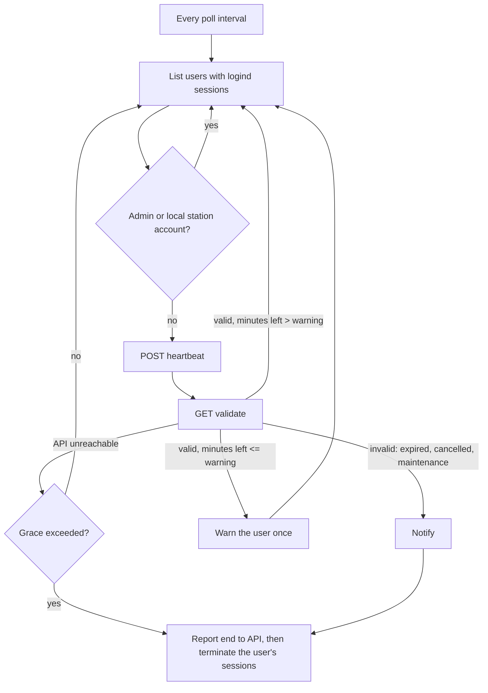
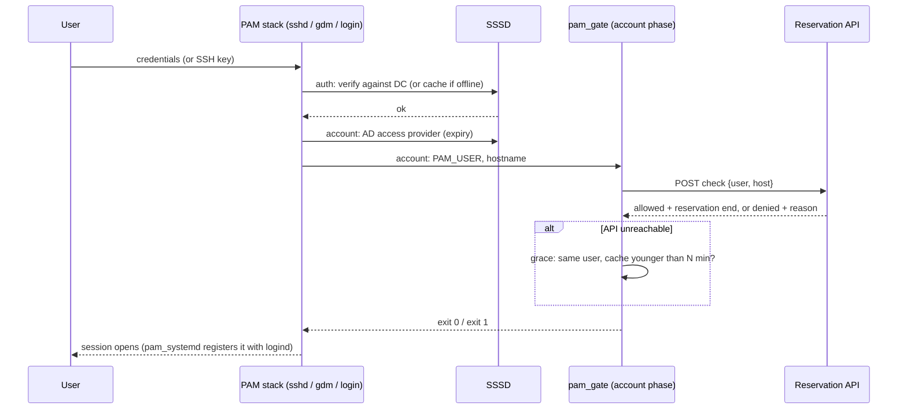

*Bu yazının Türkçesi: [Paylaşımlı Linux İş İstasyonlarında Süreli Giriş]()*

## The Problem

You have a room of shared Linux workstations. They are joined to Active Directory, users sign in with their domain accounts, and the machines are too valuable to be first come, first served. People book a specific machine for a specific window: Tuesday 09:00 to Thursday 18:00 on `ws07`, for example. The system has to enforce three rules:

1. **Nobody signs in without a valid reservation for this machine, right now.**
2. **When the reservation ends, the session ends.** Not at the next logout, and not when someone notices.
3. **An administrator can change things centrally.** Cancel, extend, put a machine into maintenance, ban a user, and see the effect within a minute or two.

The first rule is about *admission*. The second is about *eviction*. The third is about *who owns the truth*. Most tools you can find solve the first rule, and solve it well. Hardly any of them solve the second. For the third, you usually end up editing a config file on every host.

This post covers the architecture I built for it (a PAM login gate, SSSD, a session watchdog, a heartbeat, and a central reservation API), the trade-offs I accepted, and the edge cases a lab rebuild exposed.

## Off-the-Shelf Options and Why They Fall Short

Before writing any code, I compared what already exists on the seven properties this problem needs: dynamic reservations, machine-specific assignment, expiry in the middle of a session, advance warning, central revoke and extend, behavior during a network outage, and an audit trail.

| Option | Dynamic reservations | Machine-specific | Mid-session expiry | Advance warning | Central revoke/extend | Outage behavior | Audit |
|---|---|---|---|---|---|---|---|
| AD `logonHours` + GPO, **Windows clients** | No: a weekly hour grid per account | Logon-rights GPOs per OU (`userWorkstations` is deprecated) | Yes, with "Set action to take when logon hours expire" (lock, disconnect, log off) | Yes, when an action is set | Edit the account or GPO | Cached logons | DC and client event logs |
| Same AD attributes, **Linux via SSSD** | No | GPO logon rights via `ad_gpo_access_control`, or `ad_access_filter` | No: evaluated at login | No | Group or GPO change, seen at next login | Cached credentials, no expiry by default | syslog |
| `pam_time` | No: static `time.conf` per host | Yes (local file) | Not documented | No | Push a file to every host | Unaffected (local) | syslog |
| `pam_access` | No time dimension | Yes (users × origins) | No | No | Push a file to every host | Unaffected (local) | syslog |
| cron or systemd timer + kill | Only by regenerating schedules | Yes | Yes, at fixed times | Possible, but hand-built | Push schedules | Unaffected | Whatever you log |
| Slurm + `pam_slurm_adopt` | Yes (jobs) | Yes (nodes) | Yes, for adopted processes when the job ends | No desktop warning | `scancel`, time-limit updates | Depends on `slurmctld` and `slurmd` | `sacct` |
| PAM gate + watchdog + API (this post) | Yes | Yes | Yes, within one poll interval | Yes | Yes, single source of truth | Explicit grace period, then fail-closed | Central audit log |

**Group Policy on Windows is better than its reputation.** The documentation for the `LogonHoursPolicyDescription` setting says it can lock the workstation, disconnect the user, or log them off when their logon hours expire. Users get a warning first, if an action is configured. The often-quoted "Force logoff when logon hours expire" setting, on the other hand, only affects SMB sessions. If your machines run Windows and your schedule is *weekly and static*, GPO is enough. Don't write code.

**SSSD on Linux only covers admission.** `sssd-ad` can evaluate GPO logon rights (Interactive, RemoteInteractive, and the others) and map them to PAM services, and `ad_access_filter` can restrict logins with an LDAP filter. The AD access provider also checks whether the account has expired. All of this runs in the PAM *account* phase, which only runs at login. Neither the `sssd-ad` nor the `sssd-ldap` man page mentions `logonHours` or `userWorkstations`. And nothing in SSSD ends a session that is already running.

**`pam_time` and `pam_access` are local and static.** `pam_time` provides only the account phase, and its man page describes granting or denying access, not ending sessions. Its rules live in `/etc/security/time.conf` on each host: fine for "the lab closes at night", useless for "Alice has `ws07` until Thursday".

**Slurm comes closest, but it is built for batch jobs and SSH.** `pam_slurm_adopt` denies SSH to nodes where you have no running job, and adopts your SSH session into the job's cgroup, so cleanup happens when the job ends. However, its documentation says that `pam_systemd` conflicts with it and must be disabled. Without it there is no logind session and no `/run/user/$UID`, both of which a graphical desktop needs. For desktop users, Slurm is the wrong shape.

Admission control is a solved problem. *Eviction on a dynamic, per-machine schedule, controlled from one place* is not.

## The Architecture

The design has five parts. Each part does one job and assumes the others can fail.

### The API Is the Single Source of Truth

A central service holds the reservations, bans, maintenance windows, and active sessions. Every decision about "may this user be on this machine now?" is answered there, using the server's clock. The clients never compute a reservation window themselves. Cancel, extend, and ban happen in one place, a workstation with a drifting clock cannot extend its own reservation, and every admission and eviction becomes an audit row in one database.

The clients use four endpoints: `check` (may this user log in?), `validate` (is this session still valid, and how many minutes are left?), `heartbeat` (I am alive, and this user is here), and `end` (this session is over).

### The PAM Gate: Admission

On each workstation, a small script runs in the PAM **account** phase through `pam_exec`:

```text
# /etc/pam.d/common-account (Debian/Ubuntu), after pam_sss
account required pam_exec.so quiet /usr/bin/python3 /opt/reservation/pam_gate.py
```

The auth phase answers "is this really you?", which is SSSD's job. The account phase answers "are you allowed in *here*, *now*?", and it runs even when auth is skipped, for example for an SSH public-key login. In the lab, every service that includes `common-account` called the gate: `sshd` (password and key), `login`, `su`, `sudo`, `cron`, `atd`, `gdm-password` (which also unlocks the GNOME lock screen), and `systemd-user`.

The script reads `PAM_USER`, asks the API, and exits 0 or 1. A small whitelist of administrator accounts, and system accounts below UID 1000, skip the API entirely.

**Why the gate alone is not enough.** The account phase runs *once*, at login. A user who logged in at 08:59 for a reservation ending at 09:00 could otherwise stay for a week.

### SSSD: Identity, and the Offline Trap

SSSD handles identity and authentication against the domain controller (in my lab, a Samba-based AD domain controller for `EXAMPLE.LOCAL`). Two settings matter here:

```ini
[domain/example.local]
cache_credentials = True
offline_timeout = 15
offline_timeout_max = 60
```

`cache_credentials` lets users sign in when the domain controller is unreachable. That is usually what you want on workstations. The trap is that the cached view of the account can be stale. In the lab, I disabled an account in AD after it had logged in once, then made the domain controller unreachable. SSSD went offline and accepted the cached password. Because the reservation was still valid, the PAM gate let the user in too. The `sssd.conf` man page documents the default for `offline_credentials_expiration` as `0 (No limit)`.

The opposite problem: while SSSD is offline, it only knows cached users, so an account created this morning fails before the PAM gate ever runs. Lowering `offline_timeout_max` (default 3600 seconds) keeps the retry interval from growing to an hour, and a small timer that forces SSSD back online helps too.

### The Watchdog: Eviction

A systemd service on each workstation runs this loop every 60 seconds:



The watchdog knows nothing about reservations; it acts on the API's answer. When we later added a maintenance mode, the clients needed no changes. To find users, it asks systemd-logind, which knows every session `pam_systemd` registered (SSH, console, graphical). Eviction is `loginctl terminate-user`, which is where the hardest edge cases turned out to be.

### Heartbeat and No-Show

The heartbeat tells the server the session is real (rows whose heartbeats stop get cleaned up), stamps the reservation's "first login" time, and *creates* the session record if it is missing. That last part covers a user who got in during an API outage through the grace period and never went through `check`; otherwise their reservation could be marked as a no-show while they sit at the machine. The first-login stamp is write-once, so a logout, reboot, or heartbeat timeout never turns a reservation back into a no-show.

### The Login Flow



## Design Decisions and Their Costs

### Fail-Open or Fail-Closed, and the Grace Period

A pure fail-closed design evicts everyone whenever the server restarts, and a deploy that rebuilds a Python virtual environment and a web front end takes minutes. A pure fail-open design means unplugging a network cable gives you unlimited time. I chose a bounded middle:

- **The PAM gate fails closed, with one exception.** If the API cannot be reached, the gate allows only the *last user who was successfully admitted on this machine*, and only if that happened within the grace period. Everyone else is denied. This covers "my session crashed and I need to log back in during a deploy" without opening the door to strangers.
- **The watchdog tolerates a bounded outage, then evicts.** In our deployment, the tolerance started at five minutes. We raised it to ten after a server deploy took longer than that. An outage that is entirely ours should not cost users their work.

The cost: an outage longer than the grace period logs people out for something that is not their fault.

### What Goes in PAM and What Goes in the Watchdog

I keep the PAM gate small and dumb: one HTTP request and a cache file. PAM runs inside `sshd` and the display manager. A slow or crashing PAM module can lock *everyone* out, including administrators if the whitelist logic breaks. So the gate has a strict timeout, a whitelist check *before* any network call, and an exception handler that still lets whitelisted administrators in.

Everything that takes time or judgment lives in the watchdog: warnings, waiting, deciding to evict, and reporting.

### Warnings That Never Reach SSH Users

The watchdog warns users five minutes before the end with a desktop notification. Then, on one day, all three users whose reservations were ending turned out to be connected over SSH, where a desktop notification never arrives. We added server-side email reminders two hours and thirty minutes before the end, because the server is the only component that can reach someone who is not looking at the screen.

### Maintenance Mode and Giving Time Back

Maintenance is a server-side state, not a client feature. While it is active, `check` denies everyone except administrators, `validate` and `heartbeat` report "invalid", the no-show sweep pauses, and automatic assignment stops. The heartbeat change was subtle but critical. Without it, the heartbeat recreated the session record that maintenance had just deleted, `validate` then said "valid", and nobody was ever logged out.

Users get their time back: each affected reservation is extended by its overlap with the maintenance window, up to the start of the next reservation on that machine. I deliberately did not cascade the extension; rescheduling five people to compensate one creates more problems than it solves. Time that cannot be returned is reported to an administrator. Maintenance also has a *mandatory* planned end, so a forgotten window expires on its own.

### The Administrator Exemption

Administrators bypass the gate and the watchdog. Both components check the whitelist before they talk to the network, so an administrator can always log in and repair a machine whose API connection is broken. The cost is that the whitelist is now part of every client's configuration, and a mistake in it is a privilege escalation. Keep it short and deploy it from one template.

### Diagnosis Order

"I can't log in" has at least nine different causes in this architecture: no reservation, the AD account doesn't exist, it is disabled, it is locked, the password has expired, SSSD is offline, the user doesn't resolve on the host, the password is wrong, or the gate denied the login. One ticket took two hours to diagnose by hand, so we automated the checks and fixed their **order**: the cause furthest *upstream* wins. A locked account also shows up as password failures in the logs; diagnose "wrong password" first and an administrator resets a password that cannot work while the lock is in place. The check only reads and never fixes anything, so people are not afraid to run it.

## Edge Cases I Hardened

To check the guarantee, I rebuilt the client side in a lab. The lab has a Samba-based AD domain controller, a reservation API that runs the *real* server-side session and reservation code on SQLite, and an Ubuntu workstation container with systemd as PID 1. The SSSD and PAM settings come from the original configuration tasks, and the PAM gate and watchdog are copied unmodified. For each component I asked: *under normal operating conditions, when does "the session really ends, and no unauthorized session starts" stop being true?*

Each case lists the status, what the lab showed, and the hardening. The lab reproduced the *current* behavior; the hardening has not been measured in production yet.

### 1. `terminate-user` Is Not "Everything the User Started"

**Status:** observed in the lab, needs confirmation on bare-metal hosts. **Severity:** high.

When a reservation expired, the watchdog called `loginctl terminate-user`, which stopped the user's systemd service manager and everything under it. Two kinds of processes kept running: background work left in a session that had *already logged out* (logind showed it as "closing"), and jobs started by `cron` or `at`, which run in those services' cgroups, outside any login session, where neither logind nor the watchdog sees them. The effective `KillUserProcesses` was `no`, the Ubuntu default; per `logind.conf(5)`, the session scope is then "abandoned" at logout and its processes keep running. As a knock-on effect, a user with leftovers stayed in `loginctl list-users` as "closing", and the watchdog repeated its warn-and-wait routine for them on every cycle.

**Hardening:**

```ini
# /etc/systemd/logind.conf.d/50-reservation.conf
[Login]
KillUserProcesses=yes
KillExcludeUsers=root admin
```

Beyond that: verify instead of assuming. After `terminate-user`, the watchdog checks whether the UID still owns any processes. If it does, it stops the user's slice (`user-<UID>.slice`), uses `loginctl kill-user` as a last resort, and reports whatever is left to the API so it can raise an alarm. Restrict `cron` and `at` to administrators with `cron.allow` and `at.allow`. Finally, base the watchdog's notion of "who is on this machine" on the process table, not only on logind.

### 2. The Client Cannot Tell Who It Is Talking To, and the Server Cannot Tell Which Machine Is Asking

**Status:** verified (code and lab). **Severity:** high.

The client talked to the API over plain HTTP, and the session endpoints required no authentication. The gate trusted `"allowed": true` from whoever answered at that address. Machine identity was just the hostname the client put in the request body. In the lab, `ws01` asked about a reservation belonging to `ws02`, got `allowed: true`, and the server recorded a session for `ws02`, although the request came from `ws01`'s address. The `end` endpoint can likewise close someone else's session record.

**Hardening:** Use HTTPS with a pinned CA, and refuse an `http://` URL in the configuration. For machine identity, use a secret every domain-joined workstation already has: the `host/` principal in `/etc/krb5.keytab`. The client authenticates to the API with Kerberos (SPNEGO), and the server takes the hostname from the authenticated principal, never from the request body. Per-machine mTLS certificates are the alternative if Kerberos to the API is not an option.

### 3. A "Ten-Minute" Grace Period That Lasted Under Five

**Status:** verified. **Severity:** medium.

The watchdog counted *failed calls*, not elapsed time, and it used one counter for the whole machine. With three users listed, every poll added three failures. The threshold was the number of minutes from the configuration. The API went unreachable at 19:11:24, and the first user was evicted at 19:16:10. Once the threshold was crossed, everyone else in the same cycle went with them.

**Hardening:** measure time, not attempts.

```python
# last_api_ok is updated on every successful response (time.monotonic())
outage = time.monotonic() - last_api_ok
if outage > GRACE_SECONDS:
    terminate(user, "API unreachable beyond grace period")
```

### 4. A Serial Loop With `sleep` Inside It

**Status:** verified. **Severity:** medium.

When a session became invalid, the watchdog sent a notification, slept 30 seconds, and then terminated the session, one user at a time. In the lab, a single expiry took 47 seconds to enforce. Two users whose reservations ended at the same moment were evicted after 52 and 82 seconds. With N users, the last one gets about N × 30 extra seconds, and the "closing" user from case 1 added 30 seconds to *every* cycle.

**Hardening:** Use a per-user state machine. The first "invalid" answer sends the notification and records a deadline. A later cycle, or a timer, enforces it. There is no blocking sleep in the loop.

### 5. A Stopped Watchdog Is a Silent Watchdog

**Status:** verified. **Severity:** medium.

`Restart=always` brought the service back 11 seconds after a `SIGKILL`. A clean `systemctl stop` (a package upgrade, a mistake, a debugging session) is different: the user stays indefinitely. In the lab, the user was still there three minutes after expiry and was evicted 31 seconds after the service came back. On the server, the stale session row eventually gets cleaned up, but the alerting only watched "is the machine up?", not "is the watchdog talking?".

**Hardening:** Send a machine-level heartbeat even when nobody is logged in, and alert when the machine is up but has been silent for X minutes. Use `Type=notify` with `WatchdogSec=` so a hung loop is restarted too, not only a dead process.

### 6. A Disabled Account That Still Logs In

**Status:** verified. **Severity:** medium. This is the SSSD trap described earlier. It only matters when the domain controller is unreachable but the API is not, for example during DC maintenance or a partial network partition.

**Hardening:**

```ini
offline_credentials_expiration = 1
offline_failed_login_attempts = 5
```

Also, make the account-disable workflow update the API, which is the single source of truth. Let `check` consult the account's AD status, since the server already has LDAP access.

### 7. A Ban That Waits for the Reservation to End

**Status:** verified. **Severity:** medium.

Bans were checked in `check` only. A user banned in the middle of a session was still logged in 2.5 minutes later. New logins were refused, but `validate` and `heartbeat` never looked at the ban table, and banning did not cancel the user's active reservations.

**Hardening:** run the same ban lookup in `validate`, or cancel active reservations when a ban is created. Then "revoke centrally" means within one poll interval.

### 8. The Grace Cache Trusts the Local Clock

**Status:** verified. **Severity:** low to medium.

The gate computed "minutes since the last successful admission" from the local clock. With the API down and the clock set back three hours, the log read `grace active (-180/10 min), allow`. A negative age passes a `<= grace` check. The cache also stored the reservation end time but never used it. On top of that, one configuration key controlled two different grace periods: the gate's and the watchdog's.

**Hardening:**

```python
age = (now - cached_at).total_seconds()
if age < 0 or age > PAM_GRACE_SECONDS:
    return deny("grace cache invalid or expired")
if cached_reservation_end and now >= cached_reservation_end:
    return deny("reservation already ended")
```

Give the two grace periods separate configuration keys.

### 9. The PAM Line Was Not Where the Playbook Thought

**Status:** verified. **Severity:** low.

The deployment inserted the `pam_exec` line *before* a line matching `account required pam_unix.so`. On Ubuntu, that line begins with `[success=1 new_authtok_reqd=done default=ignore]`, so the pattern never matched, and the line was appended at the end of the file instead, after `account sufficient pam_localuser.so`. Domain users are unaffected, but local accounts never reach the gate: that matches the intent, by accident.

**Hardening:** Anchor the line explicitly, right after `pam_sss`. Test every PAM service in CI with `pamtester <service> <user> acct_mgmt`.

### 10. Feedback That Says Nothing, and Logs That Say Too Much

**Status:** verified. **Severity:** low.

When the gate denied someone, `pam_exec` returned `PAM_SYSTEM_ERR`, so `su` printed "System error" and SSH just refused the connection. The actual reason ("no reservation for this machine") only appeared in a client-side log. The warning to SSH users was logged as "Desktop notification sent" even in a lab container that had no display at all, because nobody checked the exit code.

**Hardening:** Use `pam_exec`'s `stdout` option to pass the reason to the user. Send warnings to the user's terminals as well. Log the result of a notification, not the attempt.

### 11. Smaller Ones

- **Corrupt configuration:** the loader swallowed the parse error and fell back to built-in defaults, including a default API address. In the lab, the result was fail-closed after a five-second timeout, with no message saying why. *Hardening:* log the failure as critical, and refuse to start the watchdog with an unreadable configuration.
- **The "is SSSD online?" timer** read `sssctl domain-status`, which needs the InfoPipe responder (`sssd-dbus`, only a *Recommends* of `sssd-tools`). Without that package, the check always reads "not online" and restarts SSSD every two minutes. *Hardening:* install the package explicitly, and treat a failing `sssctl` as "unknown", not "offline".
- **Time zones:** every decision uses the server's UTC clock, which is the right choice. One user-facing message printed the reservation end without converting the time zone. Format times for humans at the edge, never in the decision path.

## Conclusion

If your schedule is static and weekly and your clients run Windows, use Group Policy. It warns users and can log them off when their hours run out, and it costs you nothing to maintain. On Linux with SSSD, the stock tools give you strong **admission** control, through GPO logon rights, access filters, `pam_time`, and `pam_access`. They give you no **eviction**, and no central place to change a reservation that will be different tomorrow. Slurm handles eviction well, but only for batch workloads that can live without `pam_systemd`.

The architecture here fills that gap with three ideas. Keep the server as the only place where time and policy are decided. Keep the PAM gate small and fail-closed. Treat eviction as a loop that verifies its own work.

The lab mostly found problems in the loop, not in the policy: the watchdog counted the wrong thing, slept inside its own loop, trusted logind's view of "who is here", and logged attempts as successes, while client and server never proved who they were to each other. None of this is exotic. It is what happens when success means "I ran the command" instead of "the state I wanted is now true".

## References

- Microsoft Learn, [ADMX_WinLogon Policy CSP: LogonHoursPolicyDescription, LogonHoursNotificationPolicyDescription](https://learn.microsoft.com/en-us/windows/client-management/mdm/policy-csp-admx-winlogon)
- Microsoft Learn, [Network security: Force logoff when logon hours expire](https://learn.microsoft.com/en-us/previous-versions/windows/it-pro/windows-10/security/threat-protection/security-policy-settings/network-security-force-logoff-when-logon-hours-expire)
- Microsoft Learn, [Logon-Hours attribute](https://learn.microsoft.com/en-us/windows/win32/adschema/a-logonhours) and [User-Workstations attribute](https://learn.microsoft.com/en-us/windows/win32/adschema/a-userworkstations)
- [sssd-ad(5)](https://manpages.ubuntu.com/manpages/noble/man5/sssd-ad.5.html), [sssd.conf(5)](https://manpages.ubuntu.com/manpages/noble/man5/sssd.conf.5.html), [sssd-ldap(5)](https://manpages.ubuntu.com/manpages/noble/man5/sssd-ldap.5.html) (Ubuntu 24.04)
- [pam_exec(8)](https://man7.org/linux/man-pages/man8/pam_exec.8.html), [pam_time(8)](https://man7.org/linux/man-pages/man8/pam_time.8.html), [pam_access(8)](https://man7.org/linux/man-pages/man8/pam_access.8.html), [pam_systemd(8)](https://man7.org/linux/man-pages/man8/pam_systemd.8.html)
- [logind.conf(5)](https://man7.org/linux/man-pages/man5/logind.conf.5.html), [loginctl(1)](https://man7.org/linux/man-pages/man1/loginctl.1.html)
- SchedMD, [pam_slurm_adopt](https://slurm.schedmd.com/pam_slurm_adopt.html)
