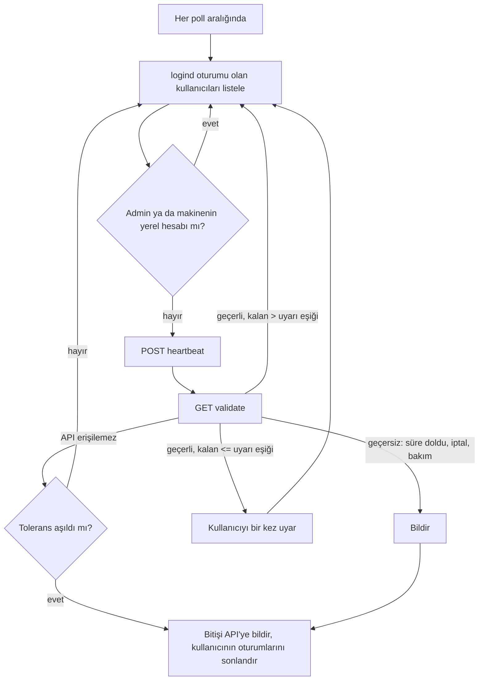
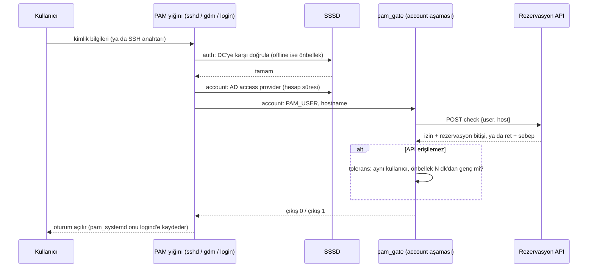

*English version: [Time-Boxed Logins on Shared Linux Workstations]()*

## Problem

Elinizde ortak kullanılan bir oda dolusu Linux iş istasyonu var. Makineler Active Directory'ye bağlı, kullanıcılar domain hesaplarıyla giriş yapıyor ve makineler "ilk gelen alır" denemeyecek kadar değerli. Kullanıcılar belirli bir makineyi belirli bir zaman aralığı için ayırıyor: örneğin `ws07`, salı 09:00'dan perşembe 18:00'e kadar. Sistemin üç kuralı uygulaması gerekiyor:

1. **Bu makine için şu an geçerli bir rezervasyonu olmayan kimse giriş yapamaz.**
2. **Rezervasyon bitince oturum da biter.** Bir sonraki çıkışta değil, birisi fark ettiğinde de değil.
3. **Yönetici değişiklikleri merkezden yapar.** İptal etmek, süre uzatmak, makineyi bakıma almak ya da kullanıcıyı yasaklamak tek yerden yapılır ve bir iki dakika içinde etkisini gösterir.

Birinci kural *kabul* (admission), ikincisi *tahliye* (eviction), üçüncüsü ise *doğrunun kimde olduğu* ile ilgili. Bulabileceğiniz araçların çoğu birinci kuralı çözüyor, hem de iyi çözüyor. İkincisini çözen neredeyse yok. Üçüncüsü için de genellikle her makinede bir yapılandırma dosyası düzenlemek zorunda kalıyorsunuz.

Bu yazı bu problem için kurduğum mimariyi (bir PAM giriş kapısı, SSSD, bir oturum watchdog'u, heartbeat ve merkezi bir rezervasyon API'si), kabul ettiğim ödünleri ve her şeyi bir test ortamında yeniden kurduğumda ortaya çıkan uç durumları anlatıyor.

## Hazır Seçenekler ve Neden Yetmedikleri

Kod yazmadan önce mevcut seçenekleri, bu problemin gerçekten ihtiyaç duyduğu yedi özellik üzerinden karşılaştırdım: dinamik rezervasyon, makineye özel atama, oturum ortasında süre dolması, önceden uyarı, merkezden anlık iptal ve uzatma, ağ kesintisindeki davranış ve denetim kaydı.

| Seçenek | Dinamik rezervasyon | Makineye özel | Oturum ortasında süre dolması | Önceden uyarı | Merkezden iptal/uzatma | Kesintide davranış | Denetim kaydı |
|---|---|---|---|---|---|---|---|
| AD `logonHours` + GPO, **Windows istemciler** | Hayır: hesap başına haftalık saat tablosu | OU bazında logon-rights GPO'ları (`userWorkstations` kullanımdan kalkmış) | Evet, "Set action to take when logon hours expire" ile (kilitle, bağlantıyı kes, oturumu kapat) | Evet, bir eylem tanımlıysa | Hesabı ya da GPO'yu düzenle | Önbellekli girişler | DC ve istemci olay günlükleri |
| Aynı AD öznitelikleri, **SSSD ile Linux** | Hayır | `ad_gpo_access_control` ile GPO logon hakları ya da `ad_access_filter` | Hayır: girişte değerlendirilir | Hayır | Grup veya GPO değişikliği, bir sonraki girişte görülür | Önbellekli kimlik bilgileri, varsayılan olarak süresiz | syslog |
| `pam_time` | Hayır: makine başına statik `time.conf` | Evet (yerel dosya) | Belgelenmemiş | Hayır | Her makineye dosya dağıt | Etkilenmez (yerel) | syslog |
| `pam_access` | Zaman boyutu yok | Evet (kullanıcı × kaynak) | Hayır | Hayır | Her makineye dosya dağıt | Etkilenmez (yerel) | syslog |
| cron veya systemd timer + kill | Ancak takvimi yeniden üreterek | Evet | Evet, sabit saatlerde | Mümkün, ama elle kurulur | Takvimi dağıt | Etkilenmez | Ne loglarsanız |
| Slurm + `pam_slurm_adopt` | Evet (job'lar) | Evet (node'lar) | Evet, sahiplenilen süreçler için job bitince | Masaüstü uyarısı yok | `scancel`, süre sınırı güncellemesi | `slurmctld` ve `slurmd`'ye bağlı | `sacct` |
| PAM kapısı + watchdog + API (bu yazı) | Evet | Evet | Evet, bir poll aralığı içinde | Evet | Evet, tek doğru kaynak | Açık bir tolerans süresi, sonra fail-closed | Merkezi denetim kaydı |

**Windows'ta Group Policy, ününden daha iyi.** `LogonHoursPolicyDescription` ayarının belgesine göre, oturum saatleri dolduğunda iş istasyonunu kilitleyebiliyor, kullanıcının bağlantısını kesebiliyor ya da oturumunu kapatabiliyor. Bir eylem tanımlıysa kullanıcı önce uyarılıyor. Sıkça alıntılanan "Force logoff when logon hours expire" ayarı ise yalnızca SMB oturumlarını etkiliyor. Makineleriniz Windows çalıştırıyor ve takviminiz *haftalık ve sabitse* GPO yeterli. Kod yazmayın.

**Linux'ta SSSD yalnızca kabulü karşılıyor.** `sssd-ad`, GPO logon haklarını (Interactive, RemoteInteractive ve diğerleri) değerlendirip PAM servislerine eşleyebiliyor; `ad_access_filter` de girişleri bir LDAP filtresiyle kısıtlayabiliyor. AD access provider ayrıca hesabın süresinin dolup dolmadığına bakıyor. Bunların hepsi PAM'in yalnızca girişte çalışan *account* aşamasında çalışıyor. Ne `sssd-ad` ne de `sssd-ldap` man sayfası `logonHours` ya da `userWorkstations`'tan bahsediyor. SSSD'de çalışan bir oturumu sonlandıran hiçbir şey yok.

**`pam_time` ve `pam_access` yerel ve statik.** `pam_time` yalnızca account aşamasını sağlıyor ve man sayfası erişime izin vermeyi ya da reddetmeyi anlatıyor, oturum sonlandırmayı değil. Kuralları her makinedeki `/etc/security/time.conf` dosyasında duruyor: "laboratuvar gece kapanır" için yeterli, "Ayşe perşembeye kadar `ws07`'de" için işe yaramaz.

**Slurm en yakın aday, ama batch job'lar ve SSH için tasarlanmış.** `pam_slurm_adopt`, üzerinde çalışan job'ınız olmayan node'lara SSH'ı reddediyor ve SSH oturumunuzu job'ın cgroup'una alıyor; böylece job bitince temizlik yapılıyor. Ancak belgesine göre `pam_systemd` ile çakışıyor ve devre dışı bırakılması gerekiyor. `pam_systemd` olmadan logind oturumu ve `/run/user/$UID` dizini olmuyor; grafik masaüstünün ikisine de ihtiyacı var. Masaüstü kullanıcıları için Slurm yanlış biçimde bir araç.

Kabul kontrolü çözülmüş bir problem. *Dinamik, makineye özel bir takvime göre, tek yerden yönetilen tahliye* ise değil.

## Mimari

Tasarımın beş parçası var. Her parça tek bir iş yapıyor ve diğerlerinin bozulabileceğini varsayıyor.

### Tek Doğru Kaynak: API

Merkezi bir servis rezervasyonları, yasakları, bakım pencerelerini ve aktif oturumları tutuyor. "Bu kullanıcı şu an bu makinede olabilir mi?" sorusunun her cevabı orada, sunucunun saatiyle veriliyor. İstemciler rezervasyon penceresini asla kendileri hesaplamıyor. İptal, uzatma ve yasak tek yerden yapılıyor, saati kaymış bir iş istasyonu kendi rezervasyonunu uzatamıyor ve her kabul ile her tahliye tek bir veritabanında denetim kaydı oluyor.

İstemciler dört uç nokta kullanıyor: `check` (bu kullanıcı giriş yapabilir mi?), `validate` (bu oturum hâlâ geçerli mi, kaç dakika kaldı?), `heartbeat` (ayaktayım, bu kullanıcı burada) ve `end` (bu oturum bitti).

### PAM Giriş Kapısı: Kabul

Her iş istasyonunda küçük bir betik, `pam_exec` aracılığıyla PAM'in **account** aşamasında çalışıyor (`pam_exec`, PAM yığını içinden harici bir komut çalıştıran modül):

```text
# /etc/pam.d/common-account (Debian/Ubuntu), pam_sss'ten sonra
account required pam_exec.so quiet /usr/bin/python3 /opt/reservation/pam_gate.py
```

Auth aşaması "gerçekten sen misin?" sorusunu cevaplar; bu SSSD'nin işi. Account aşaması ise "*burada*, *şimdi* girebilir misin?" sorusunu cevaplar ve auth atlandığında da çalışır, örneğin SSH açık anahtar girişinde. Test ortamında `common-account`'u içeren her servis kapıyı çağırdı: `sshd` (parola ve anahtar), `login`, `su`, `sudo`, `cron`, `atd`, `gdm-password` (GNOME kilit ekranının açılmasını da yönetir) ve `systemd-user`.

Betik `PAM_USER` değişkenini okuyor, API'ye soruyor ve 0 ya da 1 ile çıkıyor. Kısa bir yönetici listesi (whitelist) ve UID'si 1000'in altındaki sistem hesapları API'ye hiç sorulmadan geçiyor.

**Kapı neden tek başına yetmez?** Account aşaması girişte *bir kez* çalışır. Rezervasyonu 09:00'da biten ve 08:59'da giriş yapan bir kullanıcı, başka bir şey olmasa bir hafta kalabilir.

### SSSD: Kimlik ve Offline Tuzağı

SSSD (System Security Services Daemon; Linux'u AD gibi kimlik kaynaklarına bağlayan servis), domain controller'a karşı kimlik ve doğrulamayı yönetiyor. Benim test ortamımda bu, `EXAMPLE.LOCAL` için Samba tabanlı bir AD domain controller'dı. Burada iki ayar önemli:

```ini
[domain/example.local]
cache_credentials = True
offline_timeout = 15
offline_timeout_max = 60
```

`cache_credentials`, domain controller'a ulaşılamadığında kullanıcıların giriş yapabilmesini sağlıyor. Tuzak, hesabın önbellekteki görüntüsünün bayat olabilmesi. Test ortamında bir hesap bir kez giriş yaptıktan sonra onu AD'de devre dışı bıraktım, ardından domain controller'ı erişilemez hâle getirdim. SSSD offline oldu ve önbellekteki parolayı kabul etti. Rezervasyon hâlâ geçerli olduğu için PAM kapısı da kullanıcıyı içeri aldı. `sssd.conf` man sayfası `offline_credentials_expiration` için varsayılanı `0 (No limit)` olarak belgeliyor.

Ters yöndeki problem: SSSD offline'ken yalnızca önbellekteki kullanıcıları tanıyor; bu sabah açılmış bir hesap PAM kapısına gelmeden başarısız oluyor. `offline_timeout_max` değerini düşürmek (varsayılan 3600 saniye) yeniden deneme aralığının bir saate çıkmasını engelliyor; SSSD takılırsa onu yeniden online olmaya zorlayan küçük bir zamanlayıcı da işe yarıyor.

### Watchdog: Tahliye

Her iş istasyonundaki bir systemd servisi, 60 saniyede bir şu döngüyü çalıştırıyor:



Watchdog rezervasyonlar hakkında hiçbir şey bilmiyor; API'nin cevabına göre davranıyor. Sonradan bakım modu eklediğimizde istemcilerde hiçbir değişiklik gerekmedi. Kullanıcıları bulmak için systemd-logind'e (oturumları yöneten systemd bileşeni) soruyor; logind, `pam_systemd`'nin kaydettiği her oturumu (SSH, konsol, grafik) biliyor. Tahliye `loginctl terminate-user` ile yapılıyor ve en zor uç durumlar da tam burada çıktı.

### Heartbeat ve No-Show

Heartbeat, sunucuya oturumun gerçek olduğunu söylüyor (heartbeat'i kesilen kayıtlar temizleniyor), rezervasyonun "ilk giriş" zamanını damgalıyor ve eksikse oturum kaydını *oluşturuyor*. Son madde, API kesintisi sırasında tolerans yoluyla giren ve hiç `check`'ten geçmeyen kullanıcıyı kapsıyor; yoksa kullanıcı makinenin başında otururken rezervasyonu "gelmedi" (no-show) sayılabilirdi. İlk giriş damgası bir kez yazılıyor; çıkış, yeniden başlatma ya da heartbeat zaman aşımı rezervasyonu asla yeniden "gelmedi" durumuna döndürmüyor.

### Giriş Akışı



## Tasarım Kararları ve Bedelleri

### Fail-Open mı Fail-Closed mı, ve Tolerans Süresi

Saf fail-closed (hata durumunda kapalı kalan) bir tasarım, sunucu her yeniden başladığında herkesi dışarı atar; Python sanal ortamını ve web arayüzünü yeniden derleyen bir deploy da dakikalar sürer. Saf fail-open (hata durumunda açık kalan) bir tasarımda ise ağ kablosunu çekmek size sınırsız süre kazandırır. Sınırlı bir orta yol seçtim:

- **PAM kapısı tek bir istisnayla fail-closed.** API'ye ulaşılamazsa kapı yalnızca *bu makinede en son başarıyla kabul edilen kullanıcıyı* ve ancak bu kabul tolerans süresi içinde olduysa içeri alıyor. Diğer herkes reddediliyor. Bu, "oturumum çöktü, deploy sırasında yeniden girmem gerek" durumunu kapıyı yabancılara açmadan karşılıyor.
- **Watchdog sınırlı bir kesintiye tahammül ediyor, sonra tahliye ediyor.** Bizim kurulumumuzda tolerans beş dakikayla başladı. Bir sunucu deploy'u bundan uzun sürünce on dakikaya çıkardık. Tamamen bizden kaynaklanan bir kesinti, kullanıcılara işlerine mal olmamalı.

Bedeli: tolerans süresinden uzun bir kesinti, insanları kendi suçları olmayan bir şey yüzünden dışarı atıyor.

### PAM'e Ne, Watchdog'a Ne

PAM kapısını küçük ve basit tutuyorum: bir HTTP isteği ve bir önbellek dosyası. PAM, `sshd`'nin ve display manager'ın içinde çalışır. Yavaş ya da çöken bir PAM modülü, whitelist mantığı bozulursa yöneticiler dahil *herkesi* dışarıda bırakabilir. Bu yüzden kapının sıkı bir zaman aşımı var, whitelist kontrolünü her ağ çağrısından *önce* yapıyor ve hata durumunda bile whitelist'teki yöneticileri içeri alan bir istisna yakalayıcısı var.

Zaman ya da muhakeme gerektiren her şey watchdog'da: uyarılar, bekleme, tahliye kararı ve raporlama.

### SSH Kullanıcısına Ulaşmayan Uyarılar

Watchdog, bitişe beş dakika kala kullanıcıyı bir masaüstü bildirimiyle uyarıyor. Sonra bir gün, rezervasyonu biten üç kullanıcının üçünün de SSH ile bağlı olduğu ortaya çıktı; masaüstü bildirimi oraya hiç ulaşmıyor. Sunucu tarafına, bitişe iki saat ve otuz dakika kala giden e-posta hatırlatmaları ekledik. Ekrana bakmayan birine ulaşabilen tek bileşen sunucu.

### Bakım Modu ve Hak İadesi

Bakım bir istemci özelliği değil, sunucu tarafında bir durum. Bakım aktifken `check` yöneticiler dışında herkesi reddediyor, `validate` ve `heartbeat` "geçersiz" diyor, no-show taraması duruyor ve otomatik atama duruyor. Heartbeat'teki değişiklik ince ama kritikti. O olmadan heartbeat, bakımın az önce sildiği oturum kaydını yeniden oluşturuyor, `validate` "geçerli" diyor ve kimse dışarı çıkarılmıyordu.

Kullanıcılar süresini geri alıyor: etkilenen her rezervasyon, bakım penceresiyle çakışan süre kadar, o makinedeki bir sonraki rezervasyonun başlangıcına kadar uzatılıyor. Uzatmayı zincirleme kaydırmadım; bir kişiyi telafi etmek için beş kişinin planını otomatik değiştirmek çözdüğünden fazla sorun yaratır. Geri verilemeyen süre yöneticiye raporlanıyor. Bakımın ayrıca *zorunlu* bir planlanan bitişi var; unutulan bir bakım penceresi kendiliğinden kapanıyor.

### Yönetici Muafiyeti

Yöneticiler kapıyı da watchdog'u da atlıyor. İki bileşen de whitelist'i ağa çıkmadan önce kontrol ediyor; böylece bir yönetici, API bağlantısı bozuk bir makineye her zaman girip onu onarabiliyor. Bedeli, whitelist'in artık her istemcinin yapılandırmasının bir parçası olması; oradaki bir hata, yetki yükseltmesi demek. Listeyi kısa tutun ve tek bir şablondan dağıtın.

### Teşhis Sırası

Bu mimaride "giremiyorum" şikâyetinin en az dokuz farklı sebebi var: rezervasyon yok, AD hesabı yok, hesap devre dışı, hesap kilitli, parolanın süresi dolmuş, SSSD offline, kullanıcı makinede çözülemiyor, parola yanlış ya da kapı girişi reddetti. Bir talebin elle teşhisi iki saat sürünce kontrolleri otomatikleştirdik ve sıralarını sabitledik: *en yukarı akıştaki* sebep kazanıyor. Kilitli bir hesap loglarda parola hatası olarak da görünür; önce "parola yanlış" teşhisi koyarsanız yönetici, kilit dururken işe yaramayacak bir parolayı sıfırlar. Kontrol yalnızca okuyor ve hiçbir şeyi düzeltmiyor; bu yüzden insanlar onu çalıştırmaktan çekinmiyor.

## Sertleştirdiğim Uç Durumlar

Garantiyi sınamak için istemci tarafını bir test ortamında yeniden kurdum. Ortamda Samba tabanlı bir AD domain controller, *gerçek* sunucu tarafı oturum ve rezervasyon kodunu SQLite üzerinde çalıştıran bir rezervasyon API'si ve systemd'nin PID 1 olduğu bir Ubuntu iş istasyonu container'ı var. SSSD ve PAM ayarları özgün yapılandırma görevlerinden geliyor; PAM kapısı ve watchdog değiştirilmeden kopyalandı. Her bileşen için şunu sordum: *normal işletim koşullarında, "oturum gerçekten biter ve yetkisiz oturum açılmaz" ne zaman doğru olmaktan çıkıyor?*

Her madde durumu, test ortamında gözleneni ve sertleştirmeyi veriyor. Test ortamı *mevcut* davranışı yeniden üretti; sertleştirmeler henüz üretimde ölçülmedi.

### 1. `terminate-user` "Kullanıcının Başlattığı Her Şey" Demek Değil

**Durum:** test ortamında gözlendi, fiziksel makinelerde doğrulanmalı. **Önem:** yüksek.

Rezervasyon bitince watchdog `loginctl terminate-user` çağırdı; bu, kullanıcının systemd servis yöneticisini ve altındaki her şeyi durdurdu. İki tür süreç çalışmaya devam etti: *çoktan çıkış yapılmış* bir oturumda kalan arka plan işleri (logind bunu "closing" gösterdi) ve `cron` ya da `at` ile başlatılan işler. Sonrakiler bu servislerin cgroup'larında, herhangi bir giriş oturumunun dışında çalışıyor; ne logind ne de watchdog onları görüyor. Etkin `KillUserProcesses` değeri Ubuntu varsayılanı olan `no` idi; `logind.conf(5)`'e göre bu durumda oturum scope'u çıkışta "abandoned" (terk edilmiş) olur ve süreçleri çalışmaya devam eder. Yan etki olarak, süreçleri kalan kullanıcı `loginctl list-users`'ta "closing" olarak kaldı ve watchdog her turda onun için uyar-ve-bekle rutinini tekrarladı.

**Sertleştirme:**

```ini
# /etc/systemd/logind.conf.d/50-reservation.conf
[Login]
KillUserProcesses=yes
KillExcludeUsers=root admin
```

Bunun ötesinde: varsaymak yerine doğrulayın. `terminate-user` sonrasında watchdog, UID'nin hâlâ süreci olup olmadığına baksın. Varsa kullanıcının slice'ını (`user-<UID>.slice`) durdursun, son çare olarak `loginctl kill-user` kullansın ve kalanları alarm üretebilmesi için API'ye bildirsin. `cron` ve `at`'ı `cron.allow` ve `at.allow` ile yöneticilere sınırlayın. Son olarak watchdog'un "bu makinede kim var" bilgisini yalnızca logind'e değil, süreç tablosuna da dayandırın.

### 2. İstemci Kiminle Konuştuğunu, Sunucu da Hangi Makinenin Sorduğunu Bilmiyor

**Durum:** doğrulandı (kod ve test). **Önem:** yüksek.

İstemci API ile düz HTTP üzerinden konuşuyordu ve oturum uç noktaları kimlik doğrulama istemiyordu. Kapı, o adreste kim cevap verirse onun `"allowed": true` demesine güveniyordu. Makine kimliği yalnızca istemcinin istek gövdesine yazdığı hostname'di. Test ortamında `ws01`, `ws02`'ye ait bir rezervasyonu sordu, `allowed: true` aldı ve sunucu `ws02` adına oturum kaydetti; oysa istek `ws01`'in adresinden gelmişti. `end` uç noktası da aynı şekilde başkasının oturum kaydını kapatabiliyor.

**Sertleştirme:** Sabitlenmiş bir CA ile HTTPS kullanın ve yapılandırmada `http://` adresini reddedin. Makine kimliği için domain'e bağlı her iş istasyonunda zaten bulunan bir sırrı kullanın: `/etc/krb5.keytab` içindeki `host/` principal'ı. İstemci API'ye Kerberos (SPNEGO) ile bağlansın, sunucu da hostname'i istek gövdesinden değil doğrulanmış principal'dan alsın. API'ye Kerberos mümkün değilse alternatif, makine başına mTLS sertifikası.

### 3. Beş Dakika Bile Sürmeyen "On Dakikalık" Tolerans

**Durum:** doğrulandı. **Önem:** orta.

Watchdog geçen süreyi değil *başarısız çağrıları* sayıyordu ve tüm makine için tek bir sayaç kullanıyordu. Listede üç kullanıcı varken her poll üç hata ekledi. Eşik, yapılandırmadaki dakika sayısının kendisiydi. API 19:11:24'te erişilemez oldu ve ilk kullanıcı 19:16:10'da dışarı atıldı. Eşik aşılınca aynı turdaki herkes onunla birlikte gitti.

**Sertleştirme:** denemeyi değil, zamanı ölçün.

```python
# last_api_ok her başarılı cevapta güncellenir (time.monotonic())
outage = time.monotonic() - last_api_ok
if outage > GRACE_SECONDS:
    terminate(user, "API unreachable beyond grace period")
```

### 4. İçinde `sleep` Olan Seri Bir Döngü

**Durum:** doğrulandı. **Önem:** orta.

Bir oturum geçersiz olunca watchdog bildirim gönderiyor, 30 saniye uyuyor ve sonra oturumu sonlandırıyordu; kullanıcıları da sırayla işliyordu. Test ortamında tek bir süre dolumunun uygulanması 47 saniye sürdü. Rezervasyonları aynı anda biten iki kullanıcı 52 ve 82 saniye sonra atıldı. N kullanıcıda sonuncusu yaklaşık N × 30 saniye fazladan kazanıyor; 1. maddedeki "closing" kullanıcı da *her* tura 30 saniye ekledi.

**Sertleştirme:** Kullanıcı başına bir durum makinesi kullanın. İlk "geçersiz" cevabı bildirimi gönderip bir son tarih kaydetsin; sonraki bir tur ya da bir zamanlayıcı bunu uygulasın. Döngüde bloklayan `sleep` olmasın.

### 5. Durdurulmuş Watchdog Sessiz Bir Watchdog'dur

**Durum:** doğrulandı. **Önem:** orta.

`Restart=always`, servisi bir `SIGKILL`'den 11 saniye sonra geri getirdi. Temiz bir `systemctl stop` ise farklı (paket güncellemesi, bir hata, bir hata ayıklama oturumu): kullanıcı süresiz kalıyor. Test ortamında kullanıcı, süre dolduktan üç dakika sonra hâlâ içerideydi ve servis geri geldikten 31 saniye sonra atıldı. Sunucuda bayat oturum kaydı eninde sonunda temizleniyor, ama alarmlar yalnızca "makine ayakta mı?" sorusuna bakıyordu, "watchdog konuşuyor mu?" sorusuna değil.

**Sertleştirme:** Kimse giriş yapmamışken bile makine düzeyinde bir heartbeat gönderin ve makine ayakta olduğu hâlde X dakikadır sessizse alarm üretin. Yalnızca ölen süreç değil, asılı kalan döngü de yeniden başlasın diye `Type=notify` ile `WatchdogSec=` kullanın.

### 6. Devre Dışı Hesabın Hâlâ Girebilmesi

**Durum:** doğrulandı. **Önem:** orta. Bu, yukarıda anlatılan SSSD tuzağı. Yalnızca domain controller erişilemezken API erişilebilir olduğunda önemli; örneğin DC bakımı ya da kısmi bir ağ bölünmesi sırasında.

**Sertleştirme:**

```ini
offline_credentials_expiration = 1
offline_failed_login_attempts = 5
```

Ayrıca hesabı devre dışı bırakma akışı tek doğru kaynak olan API'yi de güncellesin. Sunucunun zaten LDAP erişimi olduğu için `check`, hesabın AD'deki durumuna da baksın.

### 7. Rezervasyonun Bitmesini Bekleyen Yasak

**Durum:** doğrulandı. **Önem:** orta.

Yasaklar yalnızca `check`'te kontrol ediliyordu. Oturum ortasında yasaklanan bir kullanıcı 2,5 dakika sonra hâlâ içerideydi. Yeni girişler reddedildi, ama `validate` ve `heartbeat` yasak tablosuna hiç bakmıyordu, yasaklama da kullanıcının aktif rezervasyonlarını iptal etmiyordu.

**Sertleştirme:** Aynı yasak sorgusunu `validate`'te de çalıştırın ya da yasak oluşturulurken aktif rezervasyonları iptal edin. O zaman "merkezden iptal", bir poll aralığı içinde demek olur.

### 8. Tolerans Önbelleği Yerel Saate Güveniyor

**Durum:** doğrulandı. **Önem:** düşük–orta.

Kapı, "son başarılı kabulden bu yana geçen dakika"yı yerel saatle hesaplıyordu. API kapalıyken saat üç saat geri alındığında log `grace active (-180/10 min), allow` yazdı. Negatif bir yaş, `<= grace` kontrolünden geçiyor. Önbellek rezervasyon bitişini kaydediyor ama hiç kullanmıyordu. Üstelik tek bir yapılandırma anahtarı iki farklı toleransı yönetiyordu: kapınınkini ve watchdog'unkini.

**Sertleştirme:**

```python
age = (now - cached_at).total_seconds()
if age < 0 or age > PAM_GRACE_SECONDS:
    return deny("grace cache invalid or expired")
if cached_reservation_end and now >= cached_reservation_end:
    return deny("reservation already ended")
```

İki toleransa ayrı yapılandırma anahtarları verin.

### 9. PAM Satırı, Playbook'un Sandığı Yerde Değildi

**Durum:** doğrulandı. **Önem:** düşük.

Dağıtım, `pam_exec` satırını `account required pam_unix.so` ile eşleşen bir satırın *önüne* ekliyordu. Ubuntu'da o satır `[success=1 new_authtok_reqd=done default=ignore]` ile başladığı için desen hiç eşleşmedi ve satır bunun yerine dosyanın sonuna, `account sufficient pam_localuser.so`'nun arkasına eklendi. Domain kullanıcıları etkilenmiyor, ama yerel hesaplar kapıya hiç ulaşmıyor: niyetle örtüşüyor, ama tesadüfen.

**Sertleştirme:** Satırın yerini açıkça, `pam_sss`'in hemen arkası olarak sabitleyin. Her PAM servisini CI'da `pamtester <servis> <kullanıcı> acct_mgmt` ile test edin.

### 10. Hiçbir Şey Söylemeyen Geri Bildirim, Fazla Şey Söyleyen Loglar

**Durum:** doğrulandı. **Önem:** düşük.

Kapı birini reddettiğinde `pam_exec` `PAM_SYSTEM_ERR` döndürüyordu; `su` "System error" yazdı, SSH ise bağlantıyı reddetmekle yetindi. Asıl sebep ("bu makine için rezervasyon yok") yalnızca istemci tarafındaki bir logda görünüyordu. SSH kullanıcılarına giden uyarı, hiç ekranı olmayan bir test container'ında bile "Desktop notification sent" olarak loglandı, çünkü çıkış koduna bakan yoktu.

**Sertleştirme:** Sebebi kullanıcıya iletmek için `pam_exec`'in `stdout` seçeneğini kullanın. Uyarıları kullanıcının terminallerine de gönderin. Bildirimin denemesini değil, sonucunu loglayın.

### 11. Daha Küçükler

- **Bozuk yapılandırma:** yükleyici ayrıştırma hatasını yuttu ve varsayılan bir API adresi dahil koddaki varsayılanlara döndü. Test ortamında sonuç, beş saniyelik zaman aşımından sonra sebebi söyleyen hiçbir mesaj olmadan fail-closed oldu. *Sertleştirme:* hatayı kritik olarak loglayın ve okunamayan bir yapılandırmayla watchdog'u başlatmayı reddedin.
- **"SSSD online mı?" zamanlayıcısı**, InfoPipe responder'ına (`sssd-dbus`; `sssd-tools`'un yalnızca *Recommends*'ı, yani önerilen paketi) ihtiyaç duyan `sssctl domain-status` çıktısını okuyordu. Bu paket yoksa kontrol hep "online değil" okuyor ve SSSD'yi iki dakikada bir yeniden başlatıyor. *Sertleştirme:* paketi açıkça kurun ve başarısız bir `sssctl`'i "offline" değil "bilinmiyor" olarak ele alın.
- **Saat dilimleri:** her karar sunucunun UTC saatiyle veriliyor, doğrusu da bu. Kullanıcıya gösterilen bir mesaj rezervasyon bitişini saat dilimi dönüşümü yapmadan yazıyordu. Saatleri insanlar için yalnızca en uçta biçimlendirin, karar yolunda asla.

## Sonuç

Takviminiz sabit ve haftalıksa ve istemcileriniz Windows çalıştırıyorsa Group Policy kullanın. Kullanıcıları uyarıyor, süreleri dolunca oturumlarını kapatabiliyor ve bakımı size hiçbir şeye mal olmuyor. SSSD ile Linux'ta hazır araçlar GPO logon hakları, erişim filtreleri, `pam_time` ve `pam_access` üzerinden güçlü bir **kabul** kontrolü veriyor. Ama **tahliye** vermiyor ve yarın farklı olacak bir rezervasyonu değiştirmek için merkezi bir yer sunmuyor. Slurm tahliyeyi iyi yapıyor, ama yalnızca `pam_systemd` olmadan yaşayabilen batch iş yükleri için.

Buradaki mimari bu boşluğu üç fikirle dolduruyor. Zamanın ve politikanın kararını yalnızca sunucuda verin. PAM kapısını küçük ve fail-closed tutun. Tahliyeyi, kendi işini doğrulayan bir döngü olarak ele alın.

Test ortamı sorunları çoğunlukla politikada değil döngüde buldu: watchdog yanlış şeyi saydı, kendi döngüsünün içinde uyudu, "kim burada" sorusunda logind'in görüşüne güvendi ve denemeleri başarı olarak logladı; istemci ile sunucu da birbirine kim olduğunu hiç kanıtlamadı. Bunların hiçbiri egzotik değil. Başarı "komutu çalıştırdım" anlamına geldiğinde, "istediğim durum artık gerçek" anlamına gelmediğinde olan şey bu.

## Kaynaklar

- Microsoft Learn, [ADMX_WinLogon Policy CSP: LogonHoursPolicyDescription, LogonHoursNotificationPolicyDescription](https://learn.microsoft.com/en-us/windows/client-management/mdm/policy-csp-admx-winlogon)
- Microsoft Learn, [Network security: Force logoff when logon hours expire](https://learn.microsoft.com/en-us/previous-versions/windows/it-pro/windows-10/security/threat-protection/security-policy-settings/network-security-force-logoff-when-logon-hours-expire)
- Microsoft Learn, [Logon-Hours attribute](https://learn.microsoft.com/en-us/windows/win32/adschema/a-logonhours) ve [User-Workstations attribute](https://learn.microsoft.com/en-us/windows/win32/adschema/a-userworkstations)
- [sssd-ad(5)](https://manpages.ubuntu.com/manpages/noble/man5/sssd-ad.5.html), [sssd.conf(5)](https://manpages.ubuntu.com/manpages/noble/man5/sssd.conf.5.html), [sssd-ldap(5)](https://manpages.ubuntu.com/manpages/noble/man5/sssd-ldap.5.html) (Ubuntu 24.04)
- [pam_exec(8)](https://man7.org/linux/man-pages/man8/pam_exec.8.html), [pam_time(8)](https://man7.org/linux/man-pages/man8/pam_time.8.html), [pam_access(8)](https://man7.org/linux/man-pages/man8/pam_access.8.html), [pam_systemd(8)](https://man7.org/linux/man-pages/man8/pam_systemd.8.html)
- [logind.conf(5)](https://man7.org/linux/man-pages/man5/logind.conf.5.html), [loginctl(1)](https://man7.org/linux/man-pages/man1/loginctl.1.html)
- SchedMD, [pam_slurm_adopt](https://slurm.schedmd.com/pam_slurm_adopt.html)
